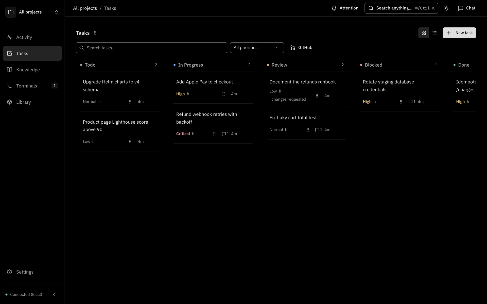
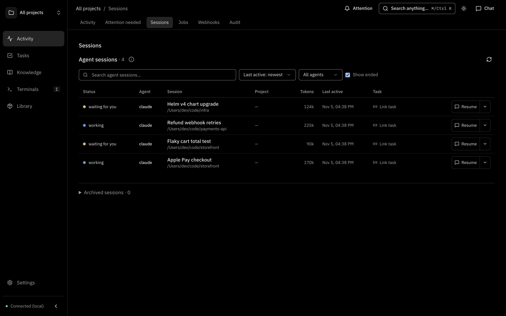
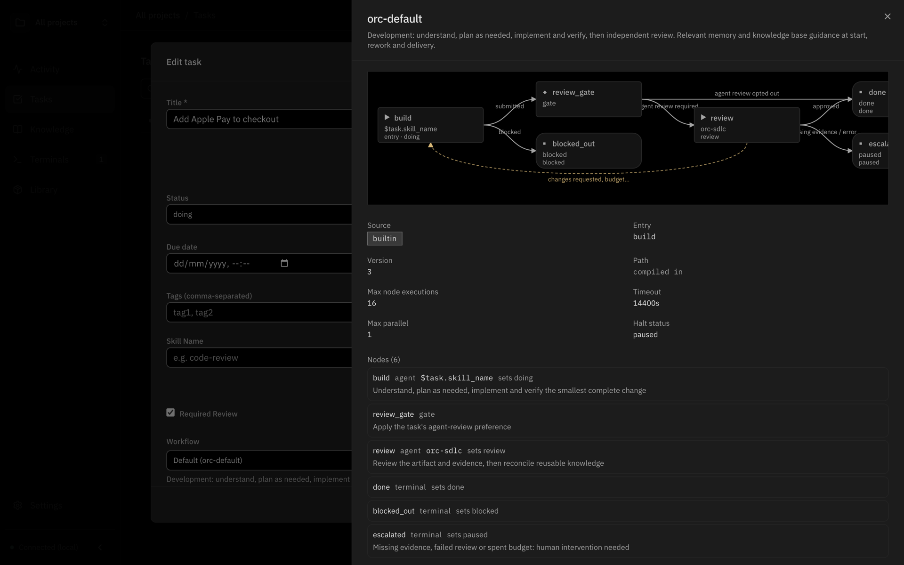
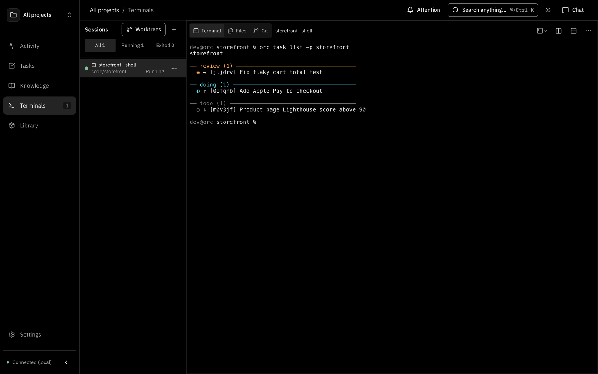

<div align="center">


# orc

**One hub for every coding agent.**

Tasks, live sessions, memory and knowledge shared across Claude Code, Codex and Cursor, on your laptop or your own server.

[](https://github.com/niradler/orc/releases/latest)
[](https://www.npmjs.com/package/orc-ai)
[](https://niradler.github.io/orc/)
[](LICENSE)

[Documentation](https://niradler.github.io/orc/) · [Install](#install) · [Quick start](#quick-start) · [Releases](https://github.com/niradler/orc/releases)


</div>

## Why ORC

Every agent session is an island. A new session forgets the last one, two sessions in parallel can't coordinate, and switching from Claude Code to Codex starts from zero. ORC is the shared layer underneath them:

- **See every session.** Claude Code, Codex and Cursor sessions appear on their own, with status, tokens and transcript. Resume any of them from the browser or your phone.
- **Track the work, not the windows.** A task board of PR-sized goals that many sessions can serve, with flow graphs, review loops and human approval.
- **Stop re-explaining your codebase.** Memories and knowledge bases that every agent reads through MCP, plus a daily digest that turns sessions into documents.
- **Run agents for you.** Hand a task to a backend, schedule jobs, take webhooks, and answer agent questions from Telegram or Slack.
- **Local first, cloud when you want it.** One SQLite file on your laptop, plus a self-hosted ORC on your server to hand sessions off to and keep work running.

## Install

**The desktop app is the recommended install.** It starts the daemon, sets an API secret, installs the `orc` CLI on your `PATH`, and adds a tray icon. Download it from [GitHub Releases](https://github.com/niradler/orc/releases/latest):

| OS | Installer |
| --- | --- |
| macOS (Apple Silicon) | `orc-<version>-mac-arm64.dmg` |
| Windows (x64) | `orc-<version>-win-x64.exe` |
| Linux (x64 / ARM64) | `orc-<version>-linux-x86_64.AppImage` / `orc-<version>-linux-arm64.AppImage` |

Prefer a headless install? Use a single binary, npm or Docker:

```bash
# Binary (macOS Apple Silicon shown; mac-x64, linux-x64 and linux-arm64 also published)
curl -L https://github.com/niradler/orc/releases/latest/download/orc-mac-arm64 -o /usr/local/bin/orc && chmod +x /usr/local/bin/orc

# npm (needs Bun >= 1.4.4)
npm install -g orc-ai

# Docker
docker run -d --name orc -p 127.0.0.1:7700:7700 \
  -v orc-data:/data -v orc-home:/home/bun \
  -e ORC_API_SECRET=$(openssl rand -hex 32) niradler/orc:latest
```

> [!TIP]
> Without the desktop app, run `orc daemon install` to start ORC now and at every login. Full options are in the [install guide](https://niradler.github.io/orc/guide/install).

## Quick start

```bash
orc status                                         # daemon is up on :7700
orc project add my-app -d "My application"
orc project use my-app
orc task add "Fix the auth bug" --priority high
orc mem add token-refresh-lock -d "Check before touching token refresh" -c "Use RWMutex for token refresh"
```

Open the dashboard at **http://localhost:7700** (or the desktop app), then connect your agent:

```bash
claude mcp add --transport http orc 'http://127.0.0.1:7700/mcp' \
  --header 'Authorization: Bearer ${ORC_API_SECRET}'
npx skills add niradler/orc --all
```

Codex, Cursor, Gemini and other MCP clients are covered in [Connect your agents](https://niradler.github.io/orc/guide/connect-agents).

## Five ways in

The same data sits behind every interface.

| Interface | Use it for | Docs |
| --- | --- | --- |
| **Desktop app** | Daily driver: tray, start at login, bundled daemon and CLI | [Desktop and web](https://niradler.github.io/orc/guide/desktop-and-web) |
| **Web dashboard** | Board, sessions, terminals, knowledge, jobs, settings, from any browser or phone | [Desktop and web](https://niradler.github.io/orc/guide/desktop-and-web) |
| **CLI** | `orc task`, `orc mem`, `orc kb`, `orc job`, `orc flow`, `orc session` and more | [CLI](https://niradler.github.io/orc/guide/cli) |
| **MCP** | Agents read and write tasks, memory, knowledge and sessions at `/mcp` | [MCP](https://niradler.github.io/orc/guide/mcp) |
| **REST API + SDK** | Scripts and integrations, OpenAPI at `/openapi.json`, typed `@orc/sdk` client | [REST API](https://niradler.github.io/orc/guide/api) |

<table>
  <tr>
    <td></td>
    <td></td>
  </tr>
  <tr>
    <td></td>
    <td></td>
  </tr>
</table>

## Local and cloud

Run ORC on your laptop and a second ORC on your own server, side by side. Point the CLI and your agents at either one, hand a running session off to the server so it keeps going there, run tasks on the server's runner, and copy scratchpads, skills, agents and packages between the two. The two installations stay independent: nothing replicates on its own. See [Self-hosted ORC](https://niradler.github.io/orc/guide/self-hosted).

## Documentation

Everything else lives on the docs site, **[niradler.github.io/orc](https://niradler.github.io/orc/)**:

- **Usage**: [what ORC is](https://niradler.github.io/orc/guide/what-is-orc), [concepts](https://niradler.github.io/orc/guide/concepts), [task flows](https://niradler.github.io/orc/guide/task-flows), [live sessions](https://niradler.github.io/orc/guide/live-sessions), [configuration](https://niradler.github.io/orc/guide/configuration)
- **Contributing**: [how to contribute](https://niradler.github.io/orc/development/), [run locally](https://niradler.github.io/orc/development/setup), [build and test](https://niradler.github.io/orc/development/build-and-test)

The same pages are in [`docs/`](docs) as plain Markdown.
