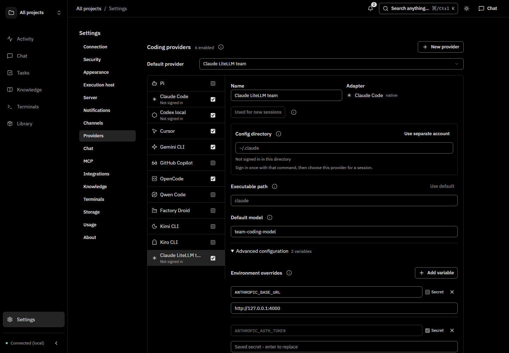
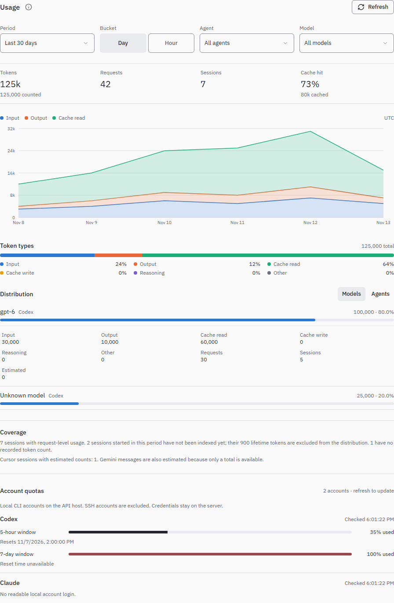

# Configuration

## Coding providers

Open **Settings → Providers**. Choose **New provider**, name it (for example,
**Claude LiteLLM**), select a coding-agent adapter, and configure its connection.
You can create several providers using the same adapter. Claude Code and Codex
use native integrations; Pi uses its native RPC interface, OpenCode uses direct ACP, and other coding agents use acpx.
Field guidance and examples live behind info icons: hover, focus or tap to read them.

Choose an enabled **Default provider** for new chats. Each provider has a default
model; leave it blank to use the adapter's default. The chat picker selects named
providers and can override the model and launch options for that conversation.
An explicit choice in this browser is remembered across reloads; saving provider
settings clears that browser override so the saved defaults take effect. Unsent
model and option edits are retained separately for each provider while switching.
Changing providers starts a new conversation. Existing conversations retain their
provider ID and model when the default changes. Disabling a provider hides it from
new launches while allowing its existing conversations to resume.
Conversations saved before profiles existed remain pinned to their original native provider.



[Phone layout](/screens/settings-providers-phone.png) ·
[Compact context action](/screens/provider-compaction-phone.png)

For Claude, Codex, OpenCode and Pi, **Executable path** overrides the local binary for native
chat, model discovery and provider terminal launches. Enter a path without
arguments, or leave it blank for the default installation. Paths with spaces and
`~/` work. SSH uses the remote installation. Changes apply at the next launch;
ORC does not restart running processes.

**Advanced configuration** starts collapsed:

- **Environment overrides** apply to launches and native model discovery, including
  SSH. Values override the execution environment; an empty value clears an
  inherited value. Use variables such as `CODEX_HOME` or `CLAUDE_CONFIG_DIR` for a
  separate CLI configuration. ORC does not create shadow accounts.
- Mark sensitive values **Secret**. Credential names such as `ANTHROPIC_AUTH_TOKEN`
  require this automatically. Secrets are encrypted on the API host and are
  write-only in the UI. An untouched saved placeholder preserves its value;
  entering a replacement changes it. Remove a row to stop overriding that variable.
  Transport and ORC connection variables are managed by ORC.
- **Chat launch options (JSON)** accept validated adapter options: Claude SDK
  options such as `{"effort":"high","maxTurns":20}`, or supported Codex/acpx
  argument arrays. ORC owns session, transport and working-folder arguments.
  Explicit session options take precedence over provider defaults. Native terminal
  launches use provider environment and, for Claude/Codex, model; chat JSON options
  are for the chat adapter. Package setups keep their own launch configuration.

Use **Save changes** to save the provider list, default and advanced settings
together. Drafts survive switching providers and Settings sections. **Use default**
clears an executable override; **Discard changes** restores saved values. Failed
saves retain the draft. Concurrent edits are rejected rather than overwriting
another device's settings; **Discard draft and reload** loads the saved version.

### Pi

Install [Pi](https://pi.dev/) 1.5.2 or newer on the execution host, with Node.js
22.19 or newer, and configure its model credentials in Pi. Create a provider in
**Settings → Providers** and choose **Pi**. Pi is optional and is not enabled by
default. ORC uses `pi --mode rpc`, preserving Pi's own credentials, extensions,
skills and session files. An executable override selects the local Pi installation;
SSH uses the remote installation.

The model picker discovers configured models without an inference turn. Use
`provider/model` to distinguish identical model IDs from different providers.
**Chat launch options (JSON)** accepts an object such as:

```json
{
  "thinkingLevel": "high",
  "steeringMode": "one-at-a-time",
  "followUpMode": "one-at-a-time",
  "autoCompaction": true,
  "autoRetry": true
}
```

Thinking levels are `off`, `minimal`, `low`, `medium`, `high`, `xhigh` and `max`;
Pi applies the selected model's limits. Queue modes are `all` or `one-at-a-time`.
These controls also work as native Pi options for agent jobs using backend `pi`.
Queue mode, auto-retry and auto-compaction changes are saved to Pi's own settings
on the execution host, so external Pi sessions use them too. Thinking level is
scoped to the ORC session. ORC owns transport, session identity, working folder
and its permission bridge; arbitrary Pi command-line arguments are not accepted.

Pi supports streamed text/thinking and tool results, images on compatible models,
native session resume, **Send now** steering, cooperative Stop, extension questions,
permission prompts, live permission changes and `/compact`. Default permissions ask
before each tool; **Accept edits** allows Pi's edit/write tools, and bypass permits
all tools. An approval for the session applies to that tool name. This gates Pi's
tool calls; it is not an operating-system sandbox or a restriction on extension code.
Plan permissions and ORC tool whitelists are rejected rather than silently ignored.

With ORC tools enabled, ORC registers an authenticated, scoped MCP connection through
a temporary session extension. It waits for tools to connect and refuses to start
if the bridge fails. It does not edit `~/.pi/agent/mcp.json` or `.pi/mcp.json`.
Resume uses Pi's exact native session UUID; missing sessions produce an error
instead of creating another conversation. Keep the execution host and its
Pi session directory available for saved conversations.

Pi's terminal-only custom components and editor replacement are not reproduced in
ORC. External Pi sessions are not automatically imported into ORC's session list. Fork/rollback and native account quota controls are not exposed. Active ORC
rules that require unavailable interception prevent the session from starting.

### Bedrock and LiteLLM examples

These are environment configurations of the Claude adapter:

| Configuration | Environment overrides |
| --- | --- |
| Claude Bedrock | `CLAUDE_CODE_USE_BEDROCK=1`, `AWS_REGION`, and an `AWS_PROFILE` configured on the execution host |
| Claude LiteLLM | `ANTHROPIC_BASE_URL` pointing to your gateway and a secret `ANTHROPIC_AUTH_TOKEN` |

Choose the model ID supported by your gateway or Bedrock deployment. If an
inherited `ANTHROPIC_API_KEY` conflicts with gateway authentication, add an empty
secret override for it. AWS profiles, gateway routing and optional endpoint
variables remain native Claude configuration; see
[Claude on Bedrock](https://code.claude.com/docs/en/amazon-bedrock),
[Claude gateway configuration](https://code.claude.com/docs/en/llm-gateway) and
[LiteLLM's Claude Code guide](https://docs.litellm.ai/docs/proxy/client_setup/claude_code).
The configured URL is reached from the execution host, so a loopback proxy must
run on that host.

### Storage and API

Authenticated `GET/PUT /api/settings/providers` reads and replaces
`{providers, default_provider_id, revision}`. Each provider has `id`, `name`,
`agent`, `enabled`, `executable`, `model`, optional `options`, and
`environment: [{name, value, secret}]`. Secret values are returned as `null`;
send that placeholder unchanged to retain a saved secret with the same provider
and variable name. New or renamed secrets require a value. Send the current
revision when saving; stale writes return 409. An existing provider's adapter is
immutable; create another provider to change adapters.

Private configuration lives under `providers.instances` and
`providers.default_id` in the server's JSON config. Encrypted values use ORC's
machine key at `~/.orc/secret.key`; back up that key with the config. Provider
secrets are excluded from readable workspace preferences. Existing
`preferences.agents`, `preferences.provider_paths` and chat defaults are migrated
when saving Providers and remain compatible with `GET/PATCH /api/settings`.
Without saved profiles, the existing CLI login, paths and chat settings are used.

**Local account limits** starts collapsed. **Check limits** reuses the local-account
quota reader below; it does not report gateway/Bedrock billing or SSH quotas.
There is no provider health polling. Native Claude quota rejections and Codex
usage-window notices include reset times when supplied by the agent. Claude extra
usage is distinguished from a blocked request. A failed turn holds queued messages;
retry explicitly after access returns. ORC does not switch accounts or schedule
automatic quota retries.

## Project workspace environment

Open a project and use **Edit → Workspace**, or fill the **Workspace** step while
creating a project. These settings apply to terminals, flow-node sessions, chat
turns and job actions that run in that project's folders.

- **Setup script** runs once in each new managed worktree under
  `.orc/worktrees`, `.claude/worktrees` or `.codex/worktrees`, before the first
  agent or terminal starts there. ORC runs it with the project's shell on the
  terminal's host, from the worktree folder. A failed or timed-out script is
  recorded with its output and the agent still starts. The script does not rerun
  for an existing worktree, and a project's main checkout is never prepared for
  you. **Setup timeout** is 900 seconds by default (30–3600).
- **Dev script** starts with **Start dev server** in the terminal launcher. It
  opens as a shell terminal in the current folder; the first printed `http(s)`
  URL becomes the workspace preview link. Loopback hosts such as `0.0.0.0` and
  `::` are shown as `localhost`, and later URLs in the same terminal are ignored.
- **Port range** gives each workspace a stable block instead of a single port.
  The first workspace of a project starts at 3100 with 10 ports unless
  **Port range start** or **Ports per workspace** is changed (1-100). Later workspaces
  take the next free block, and blocks never overlap on the same API host, even
  across projects. Ports already bound on a local host are skipped; SSH hosts
  cannot be probed, so only ORC's own allocations are avoided there.
- **Environment** holds extra variables for every launch in the project. Mark
  sensitive values **Secret** to encrypt them with ORC's machine key; secrets are
  write-only and read back as empty placeholders. An untouched placeholder keeps
  the saved value. `ORC_` names are reserved for ORC.

Workspaces export `PORT`, `ORC_PORT`, `ORC_PORT_END`, `ORC_PORT_COUNT` and
`ORC_PORT_1`…`ORC_PORT_<count>`, plus `ORC_PROJECT_ID` and `ORC_WORKSPACE`
(`ORC_WORKTREE` only inside a managed worktree). Project environment values are
added last.

Setup status, ports and the preview link appear in a session's inspector and on a
task's Git links, and are readable through `GET /api/workspaces`. The preview
belongs to the workspace path and is cleared when its dev terminal exits. Deleting
a project removes its workspace rows. Flow nodes run in the task's checkout;
per-node worktrees are not created yet.

## Manual context compaction

For an existing idle Claude, Codex or Pi chat, choose **Compact context** from session
actions (an icon in the expanded desktop header), or send `/compact`. This uses the
same native session: Claude's SDK command, Codex's `thread/compact/start` RPC, or
Pi's `compact` RPC.
Progress, failures and completion use the normal conversation stream and history.
Running turns, attachments and integrations without native support cannot be
compacted this way. Keep automatic compaction under the agent's own control;
Claude sessions with slash commands explicitly disabled must enable them first.
There is no ORC idle-compaction timer. Compaction summarizes model context and may
use provider quota; it does not erase the displayed ORC transcript.

## Usage in Settings

Open **Settings → Usage** for session token history and account quotas. History
shows lifetime token totals for imported native sessions started in the last 7,
30 or 90 days, or all time, across all projects. Daily rows use UTC session start
dates; they do not represent tokens consumed that day. Missing counts are reported
separately, Cursor counts are estimates, and these totals are not billed costs.
Claude totals include input, output, cache-creation and cache-read tokens, with
repeated assistant messages counted once. Older Claude counts refresh from
available transcripts on the next session sync, even for unchanged sessions.
Until a refresh succeeds, those counts are excluded from token totals and
reported among sessions without complete token counts. Inaccessible transcripts
remain unknown; ORC does not substitute their old partial counts.
The existing session importers determine which tokens are counted; this view does
not rescan transcripts or include managed gateway sessions a second time.



Account quotas show percentage used and reset times for local Codex and Claude
accounts on the API host. ORC reads the existing CLI login from
`CODEX_HOME/auth.json` (default `~/.codex/auth.json`) or
`CLAUDE_CONFIG_DIR/.credentials.json` (default `~/.claude/.credentials.json`) and
requests quota data from the provider over HTTPS. Credentials stay on the server
and are never returned to the browser. Keychain-only, API-key and SSH-host logins
are not supported. Missing logins, expired access and unsupported provider
responses display an unavailable state. Sign in again using the provider CLI
when access expires; ORC does not refresh or modify provider credentials.

The authenticated read-only routes `GET /api/usage/history?days=30` and
`GET /api/usage/quotas` expose the same data. History accepts `7`, `30`, `90`, or
`0` (all time). Quota requests share a 60-second server cache and an 8-second
provider timeout. The Usage panel polls quotas once a minute while open; Refresh
retries both views while respecting that cache. Provider quota interfaces can
change; unavailable quota data does not prevent session history from loading.

Where ORC keeps its config and data, every config key and environment variable you are likely to set, logs, running as a background service, and authentication.

## Notification and audit retention

Set these server-wide preferences in **Settings → Storage** or the JSON config:

| Config key | Default | Allowed days |
| --- | --- | --- |
| `preferences.notification_retention_days` | 30 | 1–3650 |
| `preferences.audit_retention_days` | 90 | 1–3650 |

All notifications expire, including unresolved requests' alerts. Audit history
retains the notification title and message independently until the audit event
expires. The audit log is also capped at 200,000 rows, oldest removed first. Expiry filters apply immediately; the API performs bounded cleanup at
startup and every minute. Freed SQLite pages are reusable but the file may not
shrink. See [Notifications](./notifications.md).

## Files and directories

| Path | Holds |
| --- | --- |
| `~/.orc/config.json` | Global config. The CLI (`orc project use`), the dashboard and the desktop app write here. |
| `./.orc/config.json` | Optional config read from the directory the process starts in |
| `~/.orc/orc.db` | SQLite database (`db.path`) |
| `~/.orc/knowledge/` | Knowledge base files and index (beside the database) |
| `~/.orc/secret.key` | Key that encrypts stored secrets. Back it up with the database. |
| `~/.orc/logs/orc.log` | Structured log |
| `~/.orc/daemon.log` | Daemon stdout/stderr when run as a launchd or systemd service |
| `~/.orc/daemon.pid` | PID of the running daemon |
| `~/.orc/daemon.json` | Private runtime identity and current port of the running daemon; contains no credentials |
| `~/.orc/desktop-daemon.log` | Daemon output when the desktop app started it |
| `~/.orc/bin/` | CLI installed by the desktop app |

`~` is `HOME` (`USERPROFILE` on Windows). Show the resolved paths and daemon state:

```bash
orc home
```

## Precedence

Later wins:

1. `~/.orc/config.json`
2. `./.orc/config.json`
3. Environment variables
4. Global CLI flags (`--port`, `--host`, `--db`, `--secret`, `--log-level`, `--runner-timeout`, `--runner-max-jobs`, `--snapshot-max-bytes`)

An invalid config file stops ORC with `Invalid orc config` and the failing key.

## Example config

```json
{
  "api": { "port": 7700, "host": "127.0.0.1", "secret": "change-me" },
  "activeProject": "my-app",
  "agent_loop": { "enabled": true, "default_backend": "claude", "max_workers": 2 },
  "runner": { "default_timeout_secs": 300, "max_concurrent_jobs": 5 },
  "rules": { "enabled": true }
}
```

## Config keys

### `api`

| Key | Default | Env | Purpose |
| --- | --- | --- | --- |
| `api.port` | `7700` | `ORC_API_PORT` | API, dashboard and MCP port |
| `api.host` | `127.0.0.1` | `ORC_API_HOST` | Bind address. `0.0.0.0` exposes ORC on the network. |
| `api.secret` | none | `ORC_API_SECRET` | Bearer secret. Unset means no auth. |
| `api.session_days` | `30` | `ORC_API_SESSION_DAYS` | Dashboard sign-in and default token lifetime (1-365) |
| `api.cors_origins` | `[]` | `ORC_API_CORS_ORIGINS` (comma-separated) | Extra browser origins allowed to call the API |

### `db`, `activeProject`

| Key | Default | Env | Purpose |
| --- | --- | --- | --- |
| `db.path` | `~/.orc/orc.db` | `ORC_DB_PATH` | SQLite file |
| `activeProject` | none | `ORC_ACTIVE_PROJECT` | Default project for CLI and MCP calls |

### `agent_loop`

The task loop picks up `todo` and `changes_requested` tasks and runs agents on them.

`agent_loop.enabled` only turns the subsystem on at startup. Its cycles are recorded under the `orc-task-loop` system job, and disabling that job (Jobs page, `orc jobs`) stops every automatic cycle — scheduled ticks, task-change triggers and follow-ups — even while the setting is `true`. The disabled state survives restarts and re-enabling the job resumes the loop without an environment change. Disabling does not stop agents that are already running.

| Key | Default | Env |
| --- | --- | --- |
| `agent_loop.enabled` | `false` | `ORC_AGENT_LOOP_ENABLED` |
| `agent_loop.poll_interval_minutes` | `5` | `ORC_AGENT_LOOP_POLL_INTERVAL` |
| `agent_loop.max_workers` | `1` | `ORC_AGENT_LOOP_MAX_WORKERS` |
| `agent_loop.default_backend` | `claude` | `ORC_AGENT_LOOP_DEFAULT_BACKEND` |
| `agent_loop.session_idle_timeout_minutes` | `20` | `ORC_AGENT_LOOP_IDLE_TIMEOUT` |
| `agent_loop.session_max_lifetime_minutes` | `120` | `ORC_AGENT_LOOP_MAX_LIFETIME` |
| `agent_loop.worker_auto_approve` | `true` | `ORC_AGENT_LOOP_AUTO_APPROVE` |
| `agent_loop.default_flow` | `orc-default` | `ORC_AGENT_LOOP_DEFAULT_FLOW` |
| `agent_loop.review_flow` | `orc-review-only` | `ORC_AGENT_LOOP_REVIEW_FLOW` |
| `agent_loop.max_node_retries` | `2` | `ORC_AGENT_LOOP_MAX_NODE_RETRIES` |
| `agent_loop.max_flow_runs_per_task` | `6` | `ORC_AGENT_LOOP_MAX_FLOW_RUNS` |

Run `orc doctor` to see which backends are usable. See [Task flows](./task-flows.md).

### `runner` (jobs)

| Key | Default | Env |
| --- | --- | --- |
| `runner.default_timeout_secs` | `300` | `ORC_RUNNER_TIMEOUT` |
| `runner.max_concurrent_jobs` | `5` | `ORC_RUNNER_MAX_JOBS` |
| `runner.log_retention_days` | `30` | `ORC_RUNNER_LOG_DAYS` |

### `context`, `memory`

| Key | Default | Env | Purpose |
| --- | --- | --- | --- |
| `context.snapshot_max_bytes` | `2048` | `ORC_SNAPSHOT_MAX_BYTES` | Session snapshot budget |
| `context.layer1_task_limit` | `10` | `ORC_LAYER1_TASKS` | Tasks in the `context` result |
| `context.layer1_memory_limit` | `30` | `ORC_LAYER1_MEMORIES` | Memories in the `context` result |
| `memory.max_content_chars` | `800` | none | Longest memory content |

### `knowledge`

| Key | Default | Env |
| --- | --- | --- |
| `knowledge.root` | beside `db.path` | `ORC_KNOWLEDGE_ROOT` |
| `knowledge.parser` | `auto` | `ORC_KNOWLEDGE_PARSER` |
| `knowledge.embedding.provider` | `none` (`none`, `ollama`, `openai`) | `ORC_KNOWLEDGE_EMBEDDING_PROVIDER` |
| `knowledge.embedding.base_url` | provider default | `ORC_KNOWLEDGE_EMBEDDING_URL` |
| `knowledge.embedding.model` | provider default | `ORC_KNOWLEDGE_EMBEDDING_MODEL` |
| `knowledge.embedding.api_key` | none | `ORC_KNOWLEDGE_EMBEDDING_API_KEY` |
| `knowledge.max_upload_bytes` | `104857600` (100 MB) | none |

Most knowledge settings are also editable under **Settings → Knowledge**.

### `terminals`, `ssh`

| Key | Default | Env | Purpose |
| --- | --- | --- | --- |
| `terminals.enabled` | `true` | `ORC_TERMINALS_ENABLED` | Browser terminals |
| `terminals.max` | `8` | none | Concurrent terminals (1-64) |
| `terminals.shell` | unset | `ORC_TERMINALS_SHELL` | Shell executable, or a JSON array of executable and literal arguments |
| `ssh.host` | none | `ORC_SSH_HOST` | `~/.ssh/config` host alias to run agents, terminals and git on |
| `ssh.remote_port` | none | `ORC_SSH_REMOTE_PORT` | Port the reverse tunnel opens on the SSH host so agents there reach ORC |

In JSON configuration, `"terminals": { "shell": ["pwsh", "-NoLogo", "-NoProfile"] }` launches PowerShell without personal profiles. The first array entry must be a nonempty executable; up to 64 entries are supported. Arguments are passed literally, without shell parsing. Existing executable strings remain supported, including `ORC_TERMINALS_SHELL`; that environment variable accepts an executable, not a command line or JSON array. An unset shell keeps the platform default, including its usual profile loading.

Pick the execution host from **Settings → Execution host**. Switching applies to new actions. When `ORC_SSH_HOST` is set, the selection is fixed.

### `rules`, `mcp`, `github`

| Key | Default | Env | Purpose |
| --- | --- | --- | --- |
| `rules.enabled` | `false` | `ORC_RULES_ENABLED` | Enforce [agent rules](./agent-rules.md) |
| `mcp.default_mode` | `meta` | none | MCP tool surface: `meta` or `full` |
| `github.token` | none | `ORC_GITHUB_TOKEN` | Token for ORC's GitHub calls (pull requests, reviews) |

### `gateway` (Telegram, Slack)

| Env | Effect |
| --- | --- |
| `ORC_TELEGRAM_TOKEN` | Enables the Telegram gateway with this bot token |
| `ORC_SLACK_BOT_TOKEN`, `ORC_SLACK_APP_TOKEN` | Enables the Slack gateway (Socket Mode) |

Channels are configured under **Settings → Channels**.

### `speech`, `tts`

| Env | Purpose |
| --- | --- |
| `ORC_SPEECH_PROVIDER` | `openai`, `groq` or `qwen` |
| `ORC_SPEECH_LANGUAGE` | Transcription language |
| `ORC_TTS_PROVIDER` | `openai` or `qwen` |
| `ORC_TTS_VOICE` | Voice (default `alloy`) |
| `ORC_TTS_MODE` | `voice_only` or `always` |
| `ORC_OPENAI_API_KEY`, `ORC_GROQ_API_KEY`, `ORC_QWEN_API_KEY` | Speech provider keys |

Setting any `ORC_SPEECH_*` or provider key enables speech; setting any `ORC_TTS_*` enables text-to-speech.

## Other environment variables

| Variable | Default | Purpose |
| --- | --- | --- |
| `ORC_HOME` | `~/.orc` | Location of `daemon.pid`, `daemon.json`, `daemon.log` and `desktop-daemon.log`. Config and database stay under `~/.orc`. |
| `ORC_API_BASE` | from `api.host`/`api.port` | ORC origin for the CLI, stdio MCP and hooks |
| `ORC_SESSION_ID` | none | Session attribution for MCP and CLI writes |
| `ORC_LOG_LEVEL` | `info` | `debug`, `info`, `warn`, `error` |
| `ORC_LOG_DIR` | `~/.orc` | Parent of the `logs/` directory |
| `ORC_LOG_FILE` | on | `0` disables the log file |
| `ORC_WEB_DIST` | bundled | Serve a different dashboard build |
| `ORC_SQLITE_VEC_PATH` | bundled | sqlite-vec library for vector search |
| `AGENTAPI_URL` | `http://localhost:3284` | agentapi server for the `agentapi` backend |
| `ANTHROPIC_API_KEY` | none | `claude` backend |

## Ports

| Port | Serves |
| --- | --- |
| `7700` | REST API (`/api/*`), dashboard (`/`), MCP (`/mcp`), OpenAPI (`/openapi.json`), Swagger UI (`/docs`) |

Change it with `api.port`, `ORC_API_PORT` or `orc --port <n> daemon start`. The desktop app reads the same setting.

Desktop automatically chooses an available loopback port if another application
occupies this port and no daemon is already running. It saves the selected port
and loopback host in global config after a successful start, so default CLI and
stdio MCP connections follow it. Explicit overrides still win. See
[Desktop app](./desktop-and-web.md#desktop-app-only) for reuse and recovery behavior.

The daemon writes `daemon.json` next to `daemon.pid` once its API is listening.
The record contains its PID, bound port, instance ID, version, database/config
paths, start time and whether authentication is enabled, never the secret.
It is written atomically with user-only file permissions and removed on clean
shutdown. Desktop ignores stale records whose PID is no longer the active daemon.

Health check (no auth needed):

```bash
curl -s http://127.0.0.1:7700/api/health
```

## Logs

`~/.orc/logs/orc.log` holds JSON lines. It rotates at 10 MB and keeps three rotated files (`orc.log.1` to `orc.log.3`). The terminal gets the same entries in readable form on stderr.

```bash
grep '"level":"error"' ~/.orc/logs/orc.log | tail -20
tail -f ~/.orc/logs/orc.log | jq .
orc --log-level debug daemon start
```

## Run as a background service

`orc daemon start` runs in the foreground. To start it at login and keep it running:

```bash
orc daemon install     # register and start now
orc daemon uninstall   # remove the registration
```

| Platform | Mechanism | Restarts on crash |
| --- | --- | --- |
| macOS | launchd agent `~/Library/LaunchAgents/com.orc.daemon.plist` | Yes |
| Linux | systemd user service `~/.config/systemd/user/orc-daemon.service` | Yes (on failure) |
| Windows | Registry Run key `HKCU\Software\Microsoft\Windows\CurrentVersion\Run\OrcDaemon` | No |

No admin rights needed. Service output goes to `~/.orc/daemon.log` on macOS and Linux.

```bash
orc daemon stop                       # stop the running daemon
orc daemon status                     # list scheduled jobs and their last runs
orc status                            # API health and counts
launchctl list | grep orc             # macOS
systemctl --user status orc-daemon    # Linux
```

`orc daemon install` refuses an `orc` that lives under nvm, fnm, volta, asdf or nodenv paths. Install a [pre-built binary](./install.md#pre-built-binary), or pass `--force`.

`orc daemon start` merges your login shell's `PATH` on macOS and Linux, so agent CLIs such as `claude`, `codex` and `cursor-agent` are found when the daemon runs as a service.

If a daemon already answers on the port, the desktop app uses it instead of starting its own.

`orc api` starts only the API server, without the scheduler, watchers, gateway or task loop.

## Authentication

With no secret, ORC accepts every request. Keep `api.host` on `127.0.0.1` in that case.

Set a secret:

```bash
orc --secret "$(openssl rand -hex 32)" daemon start   # one run
```

or put it in `~/.orc/config.json` as `api.secret`, or set `ORC_API_SECRET`. The desktop app generates and saves one for you.

| Client | How it authenticates |
| --- | --- |
| CLI, stdio MCP on the same machine | Reads the secret from config or `ORC_API_SECRET` |
| HTTP clients, HTTP MCP | `Authorization: Bearer <secret or access token>` |
| Dashboard | Asks for the secret once and stores a signed HttpOnly cookie for `api.session_days` |
| Desktop app | Sends the secret it configured |

Unauthenticated paths: `/health`, `/api/health`, `/api/auth/session`, `/api/auth/token`. Handoff upload, session-sync, skill download and scratchpad content URLs skip the secret but check their own signed, expiring link.

### Access tokens

An access token is a signed bearer credential that expires. Use one instead of the raw secret for agents and scripts.

Create one under **Settings → Security**, or:

```bash
curl -s -X POST http://127.0.0.1:7700/api/auth/token \
  -H 'Content-Type: application/json' \
  -d '{"secret":"'"$ORC_API_SECRET"'"}'
```

Returns `{"token": "...", "expires_at": <unix seconds>}`. Pass `expires_at` (unix seconds) to choose the expiry, up to 365 days. Rotating the secret revokes every token.

For exposing ORC beyond localhost, see [Self-hosting](./self-hosted.md).


### Direct ACP commands

`agent_loop.acp_commands` optionally maps agent IDs to `{ "command": "executable",
"args": ["literal", "arguments"] }`. Add the ID to `preferences.agents` to select it
in chat. The `opencode` agent already ships a built-in direct ACP command
(`opencode acp`); an `acp_commands.opencode` entry overrides it, for example to pin a
specific installation. Commands run on the chosen execution host; authenticate using that agent's
own login or existing secure environment configuration. Arguments are not shell
expressions and must not contain secrets. See [Connect agents](./connect-agents.md#capabilities-and-direct-acp)
for setup, capability negotiation and permission limitations. Existing chats retain
their selected backend even if this configuration changes.
