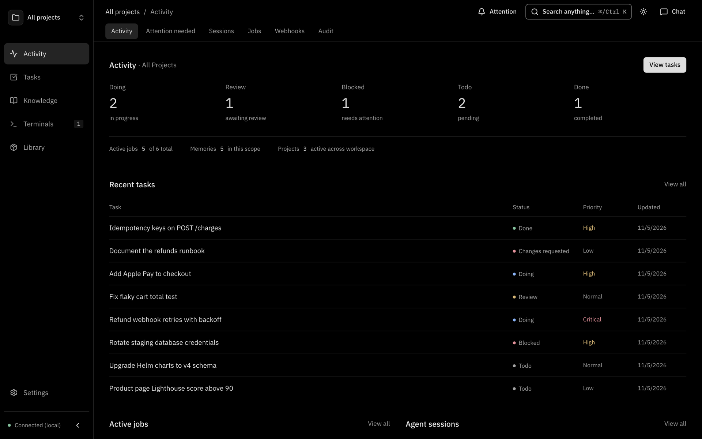
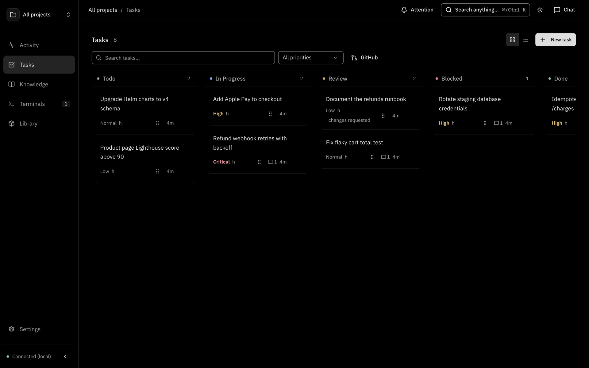
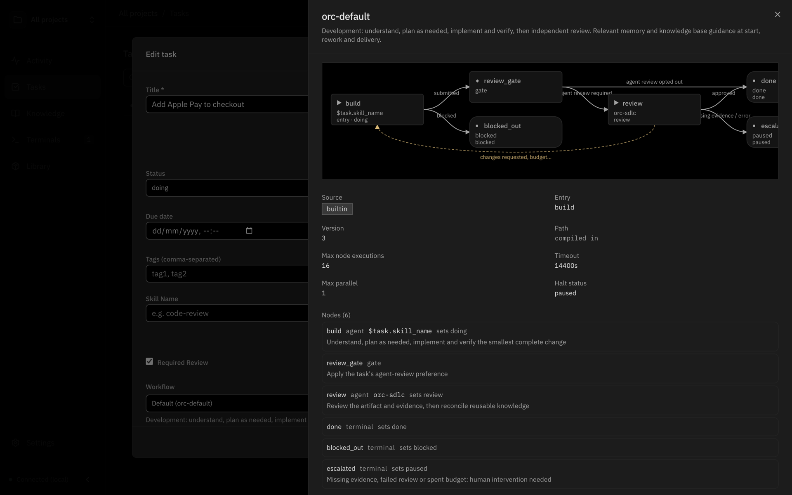
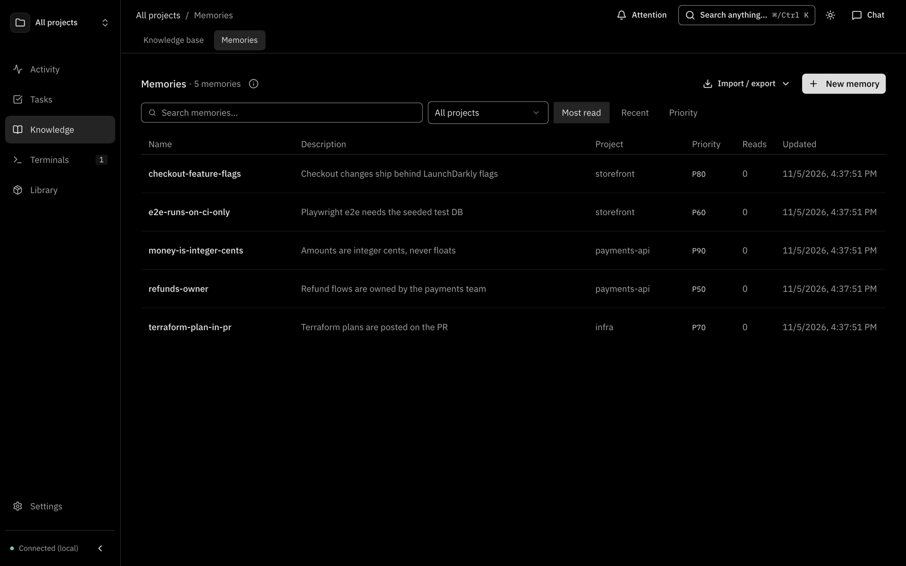
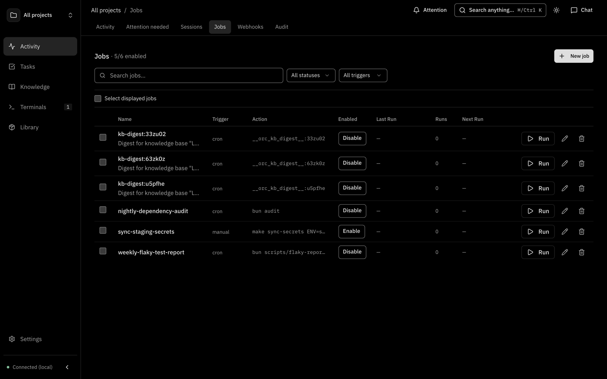
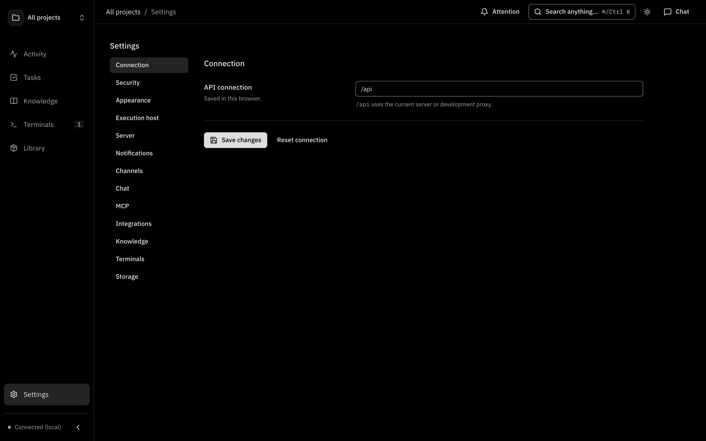

# Desktop app and web dashboard

A tour of every page in the ORC dashboard and what the desktop app adds on top of it.

The dashboard is served by the daemon at `http://localhost:7700`. The desktop app shows the same dashboard in its own window, so everything below applies to both.

## Layout

| Area | Contents |
| --- | --- |
| Sidebar | Activity, Tasks, Knowledge, Terminals, Library, Settings. Shows the execution host, for example `Connected (local)`. |
| Project picker | Scopes most pages to one project, all projects, or unassigned items |
| Chat panel | Talk to Claude, Codex or an ACPX agent from any page. Pick the agent and model at the top. |
| Command palette | **Ctrl+K** (**Cmd+K** on macOS) to search and run commands |

Pages are grouped in the sidebar:

| Group | Pages |
| --- | --- |
| Activity | Dashboard, Attention needed, Sessions, Jobs, Webhooks, Audit |
| Tasks | Tasks |
| Knowledge | Knowledge base, Memories |
| Terminals | Terminals |
| Library | Skills, Packages, Agents, Rules, Scratchpads |
| Settings | Settings |

Projects has its own page at `/projects`. Every page has a shareable URL.

## Dashboard

The **Activity** page: task metrics plus recent jobs, memories and sessions for the selected project.

## Tasks

The task board. Switch between **Board** (kanban) and **Table** views and filter the list. The GitHub panel lists issues and pull requests from known repositories (yours, assigned to you, or all open) and links them to tasks.

Open a task to see its body, status, comments, linked sessions and Git links, and its flow run:

The flow graph shows the nodes of the task's [flow](./task-flows.md) and the progress of its run.

## Sessions

Live and archived sessions from Claude Code, Codex, Cursor and Gemini on this machine or the selected host. Working sessions update live; waiting sessions stay available to resume in a terminal or in chat. Search across archived conversations. See [Live sessions](./live-sessions.md).

## Terminals

Browser terminals for shells and coding agents, with split panes and Files and Git panels beside them. Terminals run on the selected execution host. See [Terminal workspace](./terminal-workspace.md).

## Projects

Create, edit and archive projects. A project has a name, description, tags and an optional Git remote URL. Deleting a project deletes its memories and scratchpads and keeps its tasks, jobs and sessions without a project.

## Memories

Short project facts (ports, conventions, decisions) that agents load at session start. Create, edit, and view each memory's change history. Under **Knowledge → Memories**.

## Knowledge

Knowledge bases: upload PDFs, Office files, HTML, CSV and Markdown, write Markdown in place, or register a folder to copy in. Search returns cited passages. Each knowledge base can have a digest agent that maintains it on a schedule.

## Jobs

Scheduled and on-demand automation. A job runs a shell command, an agent or creates a task, triggered manually, by cron, by a file watch, once, or by a webhook. Each job keeps its run history with logs and linked agent sessions.

## Webhooks

Inbound event sources. Configure a webhook once, then connect it to one or more jobs, each with its own event filters and action.

## Attention needed

Questions and approval requests from your agents in one queue. Answer here and the reply goes back to the waiting session. See [Human requests](./human-requests.md).

## Audit

Recorded session summaries and events. Use Sessions to read full conversations or resume an agent.

## Skills

Reusable agent instructions stored as skill folders. Import skills from a repository or from local agent folders, create your own, edit files, view history, and assign skills to projects. See [Skills](./skills.md).

## Packages

Packages bundle instructions, skills and tools for reuse. Launch a package in chat or a terminal on the host and folder you choose. See [Agent packages](./agent-packages.md).

## Agents

Shared specialist agent definitions: instructions, model and tools, reusable across coding agents and packable into packages. Under **Library → Agents**.

## Rules

Applied rules and their outcomes per workspace, plus rule settings for enforcement and agent assignment. See [Agent rules](./agent-rules.md).

## Scratchpads

Working documents, diagrams and HTML pages that you or an agent create and come back to. Agents use the `pad_*` MCP tools. Share one by copying its link.

## Settings

| Section | Controls |
| --- | --- |
| Connection | API URL for this browser |
| Security | API secret, access tokens, sign-in lifetime, allowed web origins |
| Appearance | Theme |
| Execution host | Run agents, terminals and git locally or on an SSH host from `~/.ssh/config` |
| Server | **Restart ORC server** (closes terminals, keeps settings, reconnects) |
| Notifications | Browser push notifications for approvals, questions and chat replies. Needs HTTPS. |
| Channels | Telegram and Slack connections |
| Chat | Default models, instructions, tools and permission mode for chat |
| MCP | Build the MCP config snippet for your agent. See [Connect agents](./connect-agents.md). |
| Integrations | APIs and MCP servers in the `spec` CLI registry |
| Knowledge | Parser, embeddings and knowledge defaults |
| Terminals | Terminal font for new terminals |
| Storage | Where settings are stored |

## Desktop app only

The desktop app is an Electron shell around the same dashboard. On top of the browser experience it:

| Capability | Detail |
| --- | --- |
| Runs the daemon for you | Starts the bundled `orc` daemon, or attaches to one already running on the configured port |
| Configures auth | Generates an API secret when none is set and sends it on every request. No sign-in screen. |
| Installs the CLI | `~/.orc/bin/orc`, added to your shell `PATH` |
| Tray icon | **Open orc**, **Start at login** toggle, **Quit orc** |
| Start at login | On by default, starts hidden in the tray |
| Keeps running when closed | On Windows and Linux, closing the window hides it; the daemon keeps running |
| Recovers from crashes | If the daemon stops, offers **Retry** or **Quit** |
| Remembers the window | Size, position and maximized state |

Quitting the app (**Quit orc**) stops the daemon only if the app started it.

Command-line flags for the app executable:

| Flag | Effect |
| --- | --- |
| `--hidden` | Start without opening a window |
| `--quit` | Quit the running instance and the daemon it started |

Links to other sites open in your system browser. The app has no auto-update; see [Upgrading](./install.md#upgrading).
