# Desktop app and web dashboard

A tour of every page in the ORC dashboard and what the desktop app adds on top of it.

The dashboard is served by the daemon at `http://localhost:7700`. The desktop app shows the same dashboard in its own window, so everything below applies to both.

## Layout

| Area            | Contents                                                                                                                                                                     |
| --------------- | ---------------------------------------------------------------------------------------------------------------------------------------------------------------------------- |
| Sidebar         | Activity, Chat, Tasks, Knowledge, Terminals, Library, Settings. Shows the execution host, for example `Connected (local)`.                                                   |
| Project picker  | Scopes most pages to one project, all projects, or unassigned items. A project with sessions waiting on you shows how many.                                                  |
| Chat panel      | Talk to any enabled coding agent from any page. Pick the agent and model at the top. Claude and Codex run natively; OpenCode uses direct ACP; other agents run through ACPX. |
| Command palette | **Ctrl+K** (**Cmd+K** on macOS) to search and run commands                                                                                                                   |
| Next session    | **Alt+J** (**Option+J** on macOS) opens the next session that needs you, then the next finished session you have not seen. It does nothing while you are typing.             |

Popup menus and pickers across the dashboard close when you tap outside or press
Escape, including project, session, document and terminal actions. Tapping the
terminal canvas also dismisses an open menu. Interacting inside a picker or its
folder dialog keeps it usable without discarding your draft.

Pages are grouped in the sidebar:

| Group     | Pages                                        |
| --------- | -------------------------------------------- |
| Activity  | Activity, Jobs, Webhooks, Audit              |
| Chat      | Chat                                         |
| Tasks     | Tasks                                        |
| Knowledge | Knowledge base, Memories                     |
| Terminals | Terminals                                    |
| Library   | Skills, Packages, Agents, Rules, Scratchpads |
| Settings  | Settings                                     |

Projects has its own page at `/projects`. Every page has a shareable URL.

Switch between the dark and light themes in **Settings → General → Appearance**, or with the
theme command in the command palette:

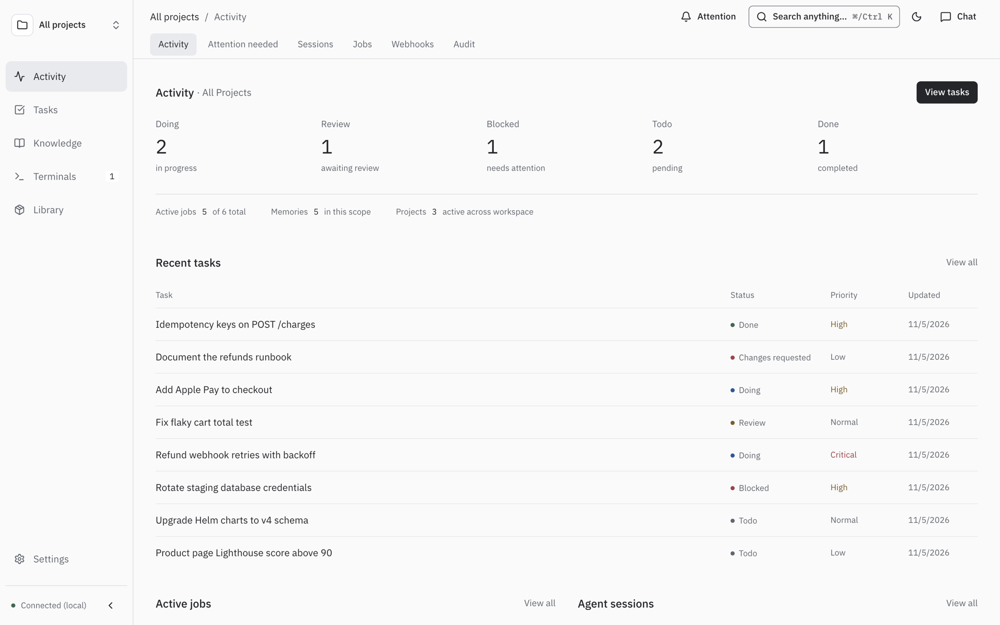

### Appearance

**Settings → General → Appearance** sets how ORC reads on each device. Theme is saved on
the server; everything else is saved in this browser, so a phone and a desktop keep their
own choices.

| Setting | Options | Default |
|---|---|---|
| Dark background | Charcoal, Black | Charcoal |
| Interface font | System, Inter, Geist | System (SF Pro on macOS, Segoe UI on Windows) |
| Interface text on desktop / on phone | Small, Default, Large, Extra large | Default |
| Chat message font | Same as interface, System, Inter, Geist, Serif | Same as interface |
| Chat text on desktop / on phone | Small (15px), Default (16px), Large (18px), Extra large (20px) | Large on desktop, Default on phone |
| Chat width | Comfortable, Wide, Full | Wide |

Phone sizes apply below 768px wide, so resizing a desktop window switches between them.
Chat text, its 1.65 line height and slight letter spacing apply to chat answers and to the
read-only session viewer; terminals keep their own font.

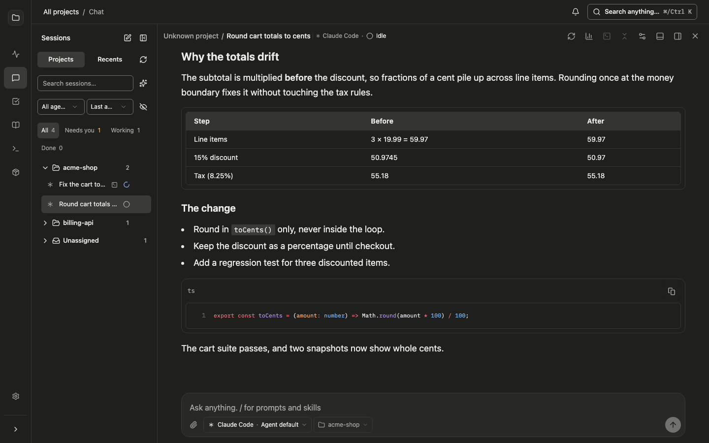

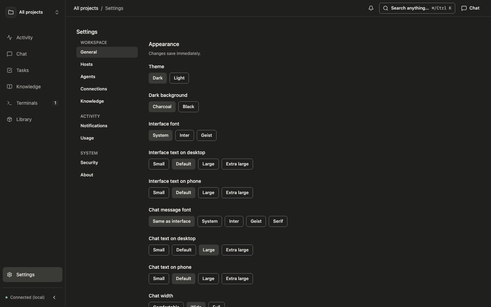

## Chat page

**Chat** in the sidebar opens the chat page at `/chat`. It is a
regular page: the workspace header keeps your navigation and notifications, and
**Chat** shows as the active page. The sidebar collapses to its icon rail while a
conversation is open, including the side chat, to give the conversation the width;
leaving chat restores the width you had, and expanding it during chat keeps your
choice.
The chat panel's full-screen button in the **Terminals** session list opens the
same page.

Below 1280px wide, the chat has no side panel: starting a chat from any page
opens the chat page instead.

- **Session list**: chats, coding agents running in ORC terminals, and live sessions discovered from every coding agent, each with its state. The full-screen session home also lists running shell terminals. Click a chat to read it, a terminal agent to see its terminal, or a discovered session to resume it in chat. Every list has the same search, state filters, agent filter, sort order, hidden-session toggle and stable ordering.
  - **Search** matches titles and summaries; the sparkle toggle also searches inside transcripts (ripgrep) and archived conversations (embeddings when configured). The result snippet shows the matching passage.
  - **Agent** filters by coding agent, merging Cursor IDE and Cursor CLI into one choice. **Sort** offers newest/oldest last activity or agent groups (newest first inside each agent); the choice is remembered.
  - Providers whose native store chat cannot resume (Cursor) open the read-only session view instead of resuming.
  - A session can be hidden from the list and shown again with the **hidden** toggle; both survive reloads.
  - Collapse the list to a rail of icons with its state marks; expand it again from the rail.
  - **Projects**, the default view, groups sessions under their project (unassigned sessions get their own group); the project of the session you are viewing opens and marks that session, expand any other project to see its sessions, and use a project's **+** button to start a chat in the project's folder. **Recents** lists every session by last activity, newest first. A session's working folder decides its project: the most specific project folder wins, a worktree resolves to its shared checkout, and a session without a recorded project is matched to a project whose folder contains its working folder. Both views follow the project selected in the workspace header; pick **All projects** to browse every project, and sessions in archived or paused projects stay listed under their project. Opening a session from the list adopts its project when the header is on **All projects** or **Unassigned**, so the list and notification inbox follow the work you opened.
  - Opening a session keeps its place in the list; sending a message is what moves it to the top. State filters still move rows as their status changes. While you hover or keyboard-focus the list, its order freezes and a pill offers to apply the new order. The header's refresh button re-imports agent sessions, then refreshes threads, live sessions and archive.
- **Inspector**: the panel button in the header opens one panel with **Overview**, **Changes** and **Files** on desktop and phone. Overview shows the host, folder, branch, changed files, linked task and the branch's pull request with its state, CI state and GitHub link; a checkout on a detached HEAD says so instead of reporting missing GitHub authentication. When a terminal is running in that folder, **Changes** combines the working-tree review (staging and commit) with the branch's PR review (diff, comments and an **Open on GitHub** link) behind Local / PR modes, and **Files** browses and edits the checkout. In the Electron desktop app the same panel adds a desktop-only **Browser** tab. On a phone the inspector is a full page.
- **Terminal drawer**: the terminal button in the header opens a shell in the session's folder below the conversation. Its header names the terminal, its live state and the folder/host. **Expand** gives the terminal the conversation's space and **Close** hides it, leaving the shell running. On a touch screen, swipe inside the terminal to scroll; a tap still opens the keyboard, and a swipe does not.
- **Continue in terminal**: when the response has finished and the session is idle, **Continue in terminal** in the session actions menu resumes that origin session in its native agent. This works for every native chat agent (Claude Code, Codex, Gemini CLI, OpenCode and Pi), including sessions you have hidden from the session list. The terminal opens as the chat view's main pane, leaving the conversation mounted behind it; the back arrow returns to the chat without losing the terminal or your draft. An already running terminal for that session is reused instead of started twice; if it has exited, a new one resumes the session. A link to an exited or deleted terminal says it is no longer running and the back arrow still returns to the chat.
- Drag a splitter, or focus it and use the arrow keys, to resize the list, inspector or drawer. Double-click to reset. The width is remembered.
- **Tool calls and plans**: a finished turn folds its tool calls and pre-tool narration into one summary line with duration, tool count, files changed with their added and removed lines, a command count when nothing changed, and failures. Expand the line to read each call: reads and searches stay one line, edits and writes show compact diffs, and commands show the command with its output tail. MCP, browser, todo, plan and question calls have their own view, and a tool ORC does not recognise keeps its raw input and result. An image a tool returned is shown inline when it is embedded in the result (never fetched from a remote URL), loads lazily, stays within a bounded size and expands on request. A file path opens in the inspector's file preview, and a Git command's branch, changed files and pull request link appear only when its output contains them.
  Inside the expanded turn, **All**, **Changes**, **Commands** and **Failed** narrow the tool calls, and **Hide successful** leaves only running or failed ones; the choice is remembered for the next turn. Thinking, plans and status messages stay visible under every filter, and the collapsed summary always counts every failure. Agents that publish a checklist (ACP agents, Codex, Claude and OpenCode todos) show it as a plan card with each step's status — pending, in progress, completed or failed — in a bounded, scrollable list; the steps come from the agent, and providers that publish no plan show none. A turn's assistant message records the model that produced it when the session has one selected.
- **Message actions**: hover a response (they stay visible on touch screens) to copy it, fork the chat at that response, and read the turn's meta: the model that produced it, its duration, a stopped or failed outcome, and — on the newest response — the latest request's context tokens and cached share when the session records usage. Missing fields are left out instead of filled with zeros. A fork reuses the agent's native session when the response is the latest one and the agent supports it; otherwise the new chat carries a bounded, tool-aware replay up to that response. A notice at the top of the forked chat names the source, the mode it used, what context it carried, and links back to the source chat.
- **Act on selected text**: select prose in a message to open a toolbar with **Ask about this**, **Create task**, **Save** and **Copy as Markdown**. Ask appends a quoted draft plus a `Source:` line and focuses the composer; Create task opens the new-task form prefilled and links back to the session; Save creates a session-linked scratchpad and confirms it beside the composer; Copy puts the quote and source on the clipboard. Escape, scrolling or clicking elsewhere dismisses it. Each message's action row also has the same four actions in a **Selection actions** menu for keyboard and phone, acting on the start of the message (up to 2,000 characters) when nothing is selected.
- **Focus chat**: the focus button beside the header's other actions, or **Focus chat** in the session actions menu, gives the conversation the screen. It hides the session strip, the pending-message disclosure, background-work rows and started-by/child-session lineage, and narrows the header (the phone title loses its project · host line). The composer, Send/Stop, streaming status, errors, permissions and questions stay visible, and the focus button stays in the header. Press `Escape` to leave focus; an open dialog, popover, menu, prompt list, selection toolbar or an in-progress IME composition keeps `Escape` for itself first. Focus belongs to the chat you are reading: switching chats, closing the chat or reloading starts unfocused, and nothing is saved.
- **Composer hero**: a chat with no messages yet shows **What are you working on?** together with the composer as one centred block, with a three-line message field, so the first message is the obvious next step. Sending the first message docks the composer back to its normal place at the bottom of the conversation. There is one composer throughout, so the draft, caret and attachments carry over; a very short viewport, such as a phone with the software keyboard open, keeps the composer docked so it stays reachable.
- **Model and compaction dividers**: the conversation marks a model change between consecutive turns, and each recorded context compaction, in the transcript where it happened. A compaction divider names the reason only when the provider recorded one — `Context compacted automatically · 182k → 24k tokens`, `Context compacted manually · …`, or the plain `Context compacted` — and it leaves out a size it does not have instead of showing a zero. Sessions that record no model or no compaction show no divider.
- Automatic compaction belongs to the adapter, never to ORC: Codex applies its `model_auto_compact_token_limit` agent option (a Codex `-c` argument), Pi saves an `autoCompaction` choice to its own settings on the execution host, and Claude Code and OpenCode compact at their own thresholds that ORC cannot change. The size of the context is shown with each turn's meta, so there is no separate hint above the composer.
- The page keeps the workspace header and its single notification bell. On desktop **Close chat** returns to the page you came from; on a phone the chat is a regular page, so you leave it with Back or the navigation drawer.
- The URL keeps the selected session and which panels are open, so reload and Back restore them.
- The header shows the recorded project and session title. Unlinked terminal agents
  show **Unknown** until agent activity supplies a state; they appear only in All projects
  while project ownership is unavailable. The Activity session list uses the same
  compact row design, retaining search, filters, task links and resume actions.

The header carries one quiet strip: the agent, the selected model (or the model
the last turn recorded when none is selected), the cached share of the session's
latest request, and the session state. The info icon beside the context figure
explains the number and names the session's compactions; the figure is omitted
entirely when the session has no recorded usage, so nothing reads as zero. The
strip stays on one line and never displaces Send or Stop. On a phone, and in
narrow chat panels, it keeps the context figure and state while the composer
already names the agent and model.

On a phone (below 768px) the chat is a touch-first surface with one header row:
**Sessions**, **New**, the session title with its state, project and host, then
**Terminal**, **Inspector** and the **⋯** menu, which holds session settings,
focus chat, **Refresh**, analytics and **Compact**. Icon help appears on a long
press only, so closing a page or menu never leaves a tooltip behind. **Sessions**, the
**Inspector** and the **Terminal** open as full pages over the conversation,
which stays mounted underneath so streams and drafts survive. They follow your
finger:

- Swipe right from the left edge to open **Sessions**; swipe left to close it.
- Swipe left from the right edge to open the **Inspector**; swipe right to close it.
- Pull down on the chat header (or tap **Terminal**) to open the terminal page;
  it shows the same name, state and folder header, and swipe up on that header,
  tap the close button or press Escape to close it.
- Pull down from the very top of the screen with two fingers to open
  **Notifications**, like the system shade; Back returns to the chat.

Swipes that start inside code blocks, diffs or the terminal canvas stay with
that content. Every page also opens from its header button, closes with its back
button or Escape, and is kept in the URL: `sessionList=show`,
`inspector=overview|diff|files|browser` and `drawer=terminal` (older `inspector=pr` links
open the Changes tab's PR mode; `browser` opens the desktop-only Browser tab and falls
back to Overview on the web). Reload, Back and
Forward restore the page, and the URL is shareable.
The three-dot **Session actions** menu shows labeled actions with touch-sized rows
on phones. It closes when you tap elsewhere in the chat or
press Escape. Choosing an action also closes the menu; opening Session settings
keeps the conversation and your draft in place. Agent, workspace and branch
pickers also close when you tap outside them.
Back and Forward move between the chat and the page you opened it from, just like
any other page.

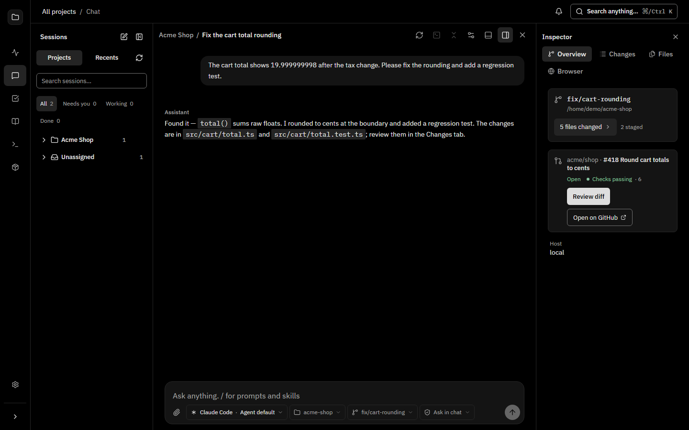

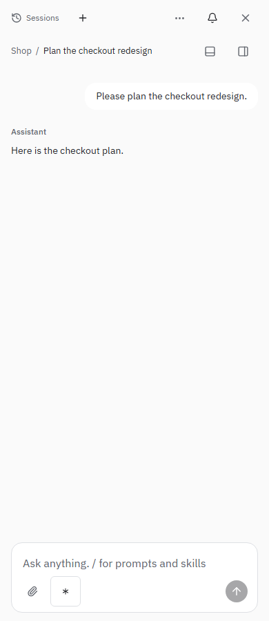
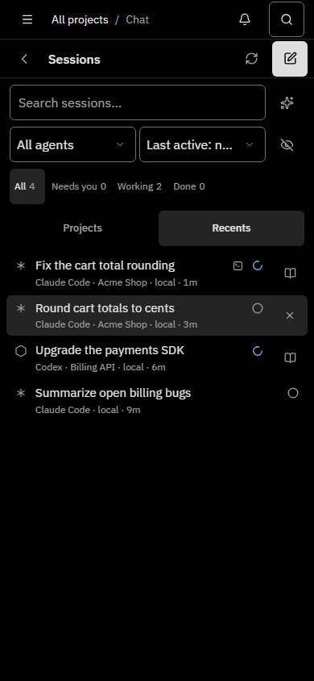

The phone inspector: branch and pull-request summary, the combined Changes tab
(working-tree and PR review) and the file editor.

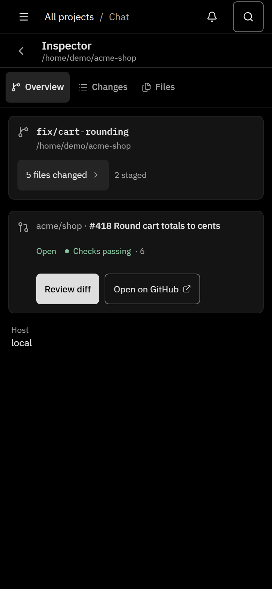

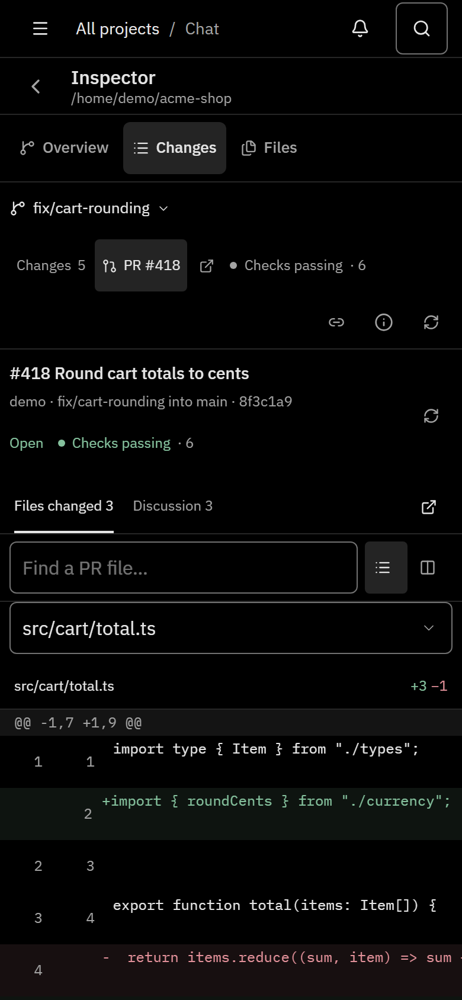
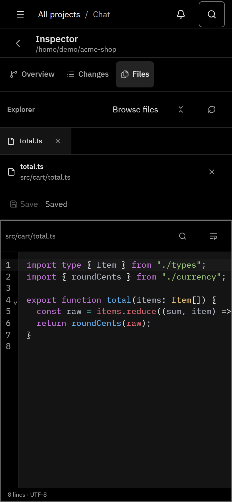

The session list's **Recents** and **Projects** views, ordered by last activity:

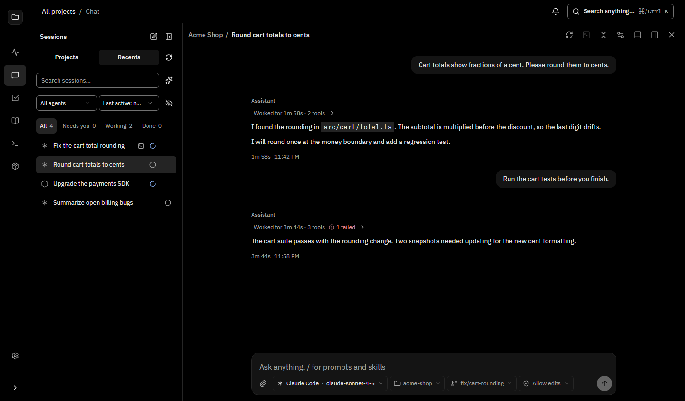

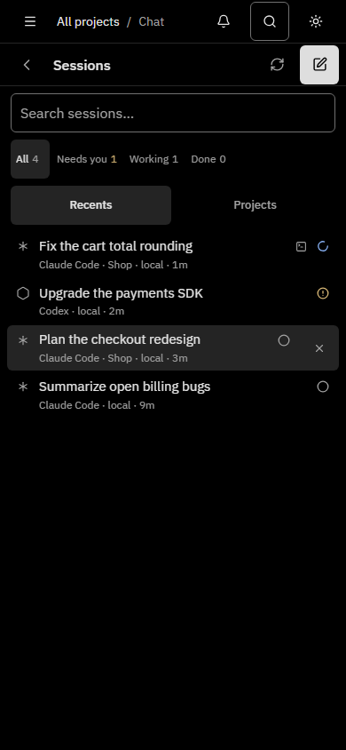
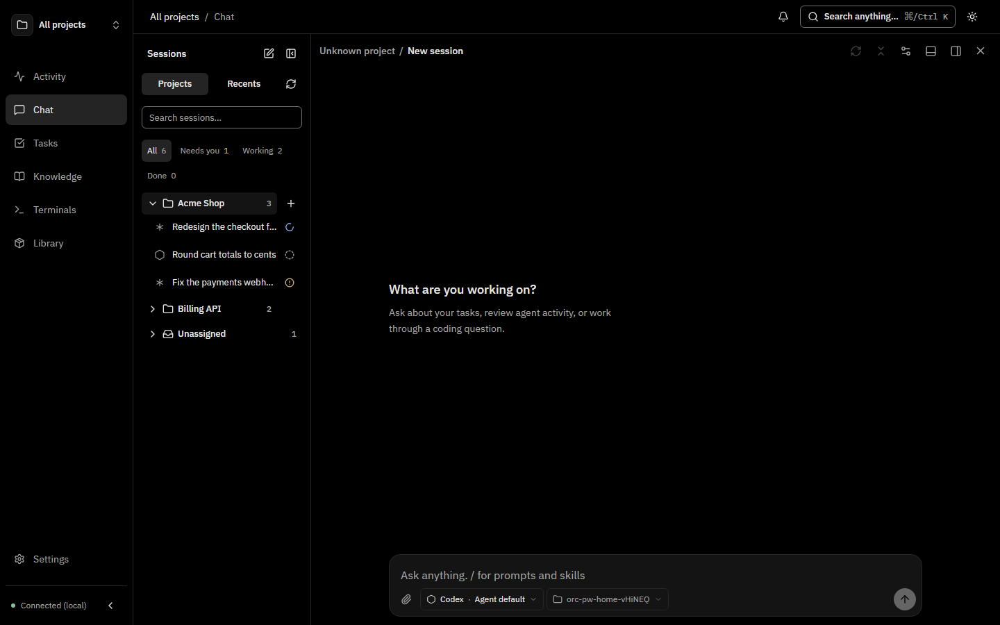


Forking at a response copies the conversation into a new chat. The notice names the
source, whether the fork continued the agent's native session or carried a context
replay, and what that replay included.


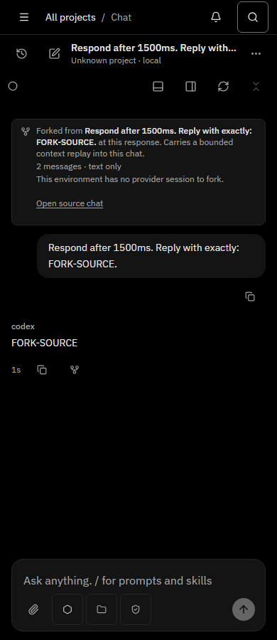

## Live components in chat

In a web chat an agent can answer with an `orc-ui` block instead of Markdown: a
small JSON layout of ORC components. Text outside the fence stays Markdown, and
a block that fails validation shows its JSON and the validation error rather than
hiding the answer. Live components read and act as the signed-in user; the
buttons and status controls keep working while the reply stays on screen.

Besides the live ORC components (`Task`, `TaskList`, `Job`, `SessionList`,
`Scratchpad` and the task/job actions), an answer can present numbers it already
has:

- `Metric` — one headline number with a label, an optional unit and a trend hint.
  The arrow is decoration; the hint carries the meaning.
- `Progress` — a determinate 0–100 percentage with an optional label.
- `Table` — up to six columns and fifty rows. Cells wrap instead of truncating,
  and a phone scrolls the table sideways rather than squeezing its columns or
  widening the conversation. A table with headers but no rows says "No rows".
- `Sparkline` — a small trend line without axes; the latest value stays in text
  beside it and the full range is in its accessible label.
- `Chart` — a Recharts line, bar or area chart with a tooltip and a named legend,
  using the shared series colors in both themes. Motion is short and stopped
  under reduced motion. A chart with no points says so instead of showing an
  empty plot.
- `KeyValue` — a compact definition list for up to eight labelled values.
- `Callout` — an info, warn, error or done note. A small icon carries the tone
  and the text stays readable.
- `Html` — a short inline HTML snippet inside a sandboxed frame. The frame runs
  on an opaque origin with no ORC storage, credentials, API or parent access, and
  the injected CSP blocks scripted requests (fetch, network images, fonts and
  forms), so it can run its own inline scripts and styles and show `data:` or
  `blob:` images but cannot call the ORC API. The frame can still navigate itself to another
  URL, so treat its content as untrusted output; its scripts also run on the
  page's main thread, so a runaway loop freezes the chat tab. Use a scratchpad
  for HTML you want to save or edit; inline chat HTML is not saved as a
  scratchpad.

`SessionUsage` shows the same figure as the header strip for a session the answer
talks about: the latest request's input tokens and the share served from the
provider's cache, with the same explanation. A session that records no usage yet
says so; the figures are left out rather than shown as zero.

## Activity

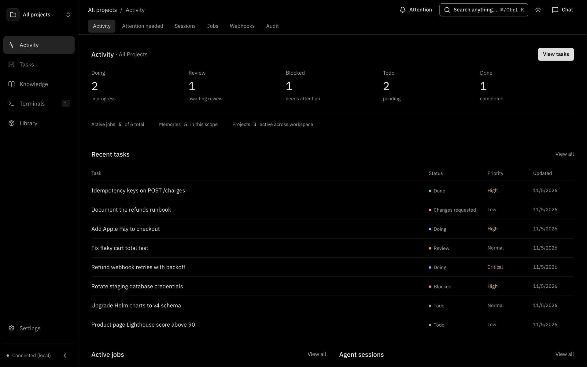

The **Activity** page: task metrics plus recent jobs, memories and sessions for the selected project.

## Tasks

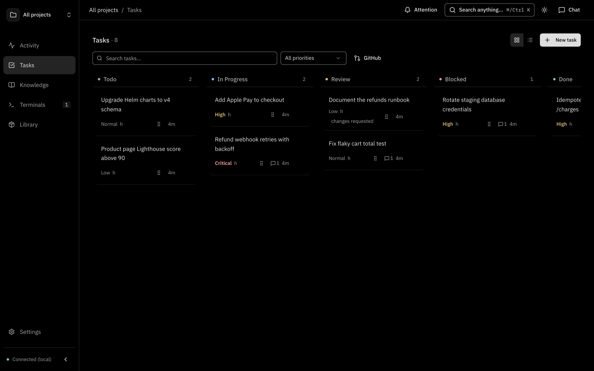

The task board. Switch between **Board** (kanban) and **Table** views and filter the list. The GitHub panel lists issues and pull requests from known repositories (yours, assigned to you, or all open) and links them to tasks.

Open a task to see its body, status, comments, linked sessions and Git links, and its flow run:

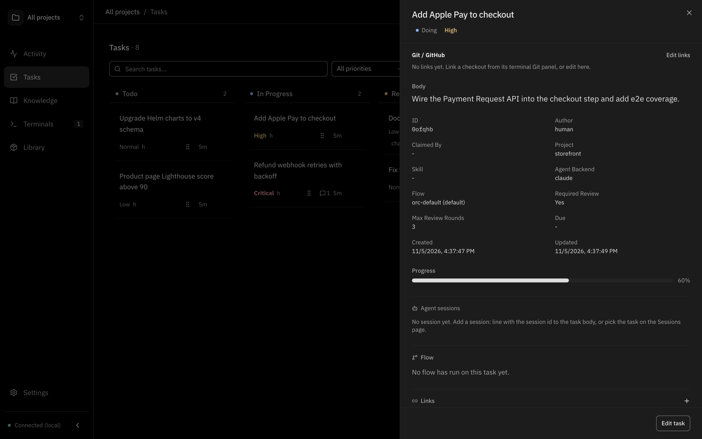

**Edit task → View flow** shows the nodes and edges of the task's [flow](./task-flows.md), including loops back for review:

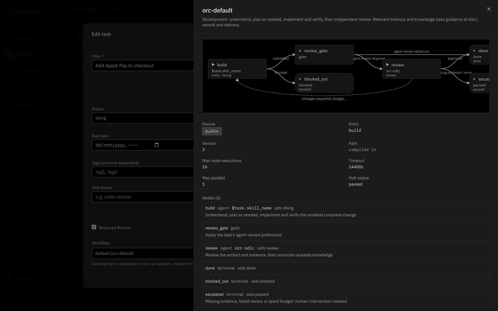

## Session history and viewer


Live and ended sessions from Claude Code, Codex, Cursor, Gemini CLI, OpenCode and Pi appear in the chat page's session list on this machine or the selected host. Working sessions update live; a session that finished after you last opened it shows **Done** until you open it, and this browser remembers what you have seen. Ended sessions stay listed by default. See [Live sessions](./live-sessions.md).

Filter with **All**, **Needs you**, **Working** and **Done**; each filter shows its count, and failed sessions count as Needs you. A Claude Code session that waits on you names why and which tool, such as **permission · Bash**, and an idle session whose background shell still runs shows a pulse icon. While a turn runs, the composer says whether Send steers the turn or queues until it ends. While your pointer is over the list, or a row has keyboard focus, rows stay where they are and an **N updated** pill applies the new order when you choose it.

The **view** button on a session row opens the read-only viewer: transcript search with match navigation, tokens and start/end timing, task link, rename, hide, scratchpads, cache usage, lineage and the queued-message inbox. **Analytics** opens from that page and shows message, turn and tool counts for the chat behind the session, plus context growth with cache reuse and compaction markers, per-tool call and failure bars, and turn-duration bars when the agent records usage. Agents without readable usage still show the chat-derived counts with an explanation. Resumable sessions also offer **Continue in chat** and a copyable CLI resume command. Cursor sessions stay readable here because chat cannot resume Cursor's separate CLI store. Archived sessions open the same viewer for their stored transcript and offer resume into chat from a pushed commit.

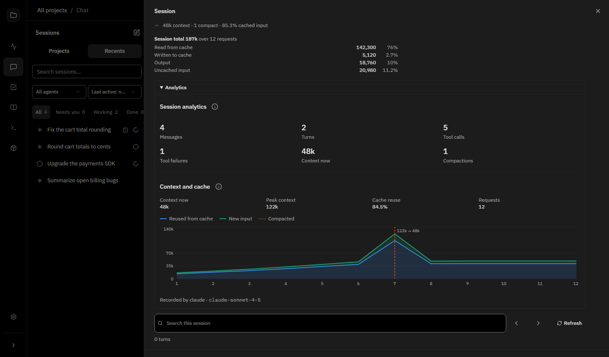
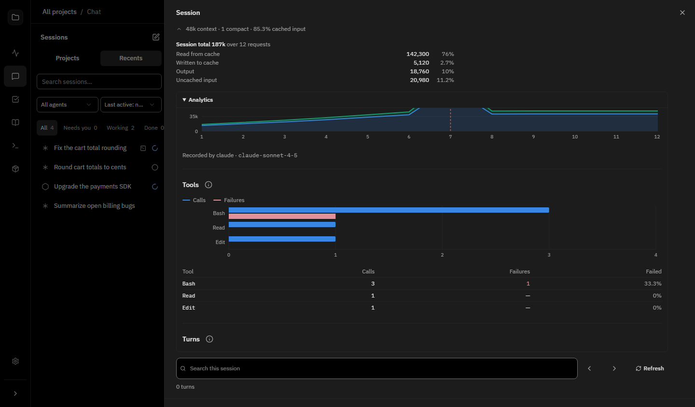

## Terminals

### Desktop browser, inspector and editor

In the Electron desktop app, **File → Browser and files** (Ctrl/Cmd+Shift+B),
or **Browser and files** in the tray menu, opens the inspector's **Browser** tab
beside your conversation. There is no second panel: the header's panel button
opens the same inspector on desktop and web, and the Browser tab appears only in
the desktop app. Chat links and file attachments open in that tab. Enter an
HTTP/HTTPS address and use Back, Forward and Reload. The external-link icon opens
the page in your system browser; Ctrl/Cmd-clicking a web link does the same. The
panel belongs to the chat page; the side chat stays a plain conversation with no
browser, file or agent-control entry points.

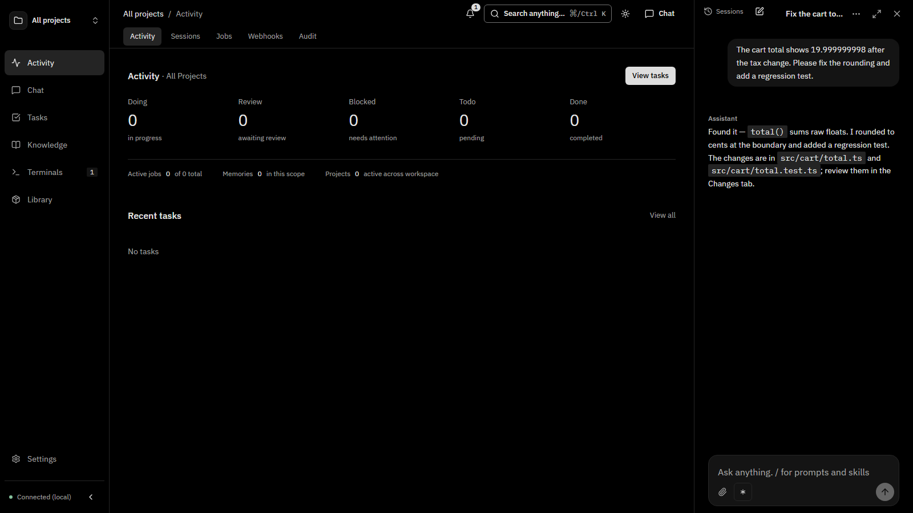

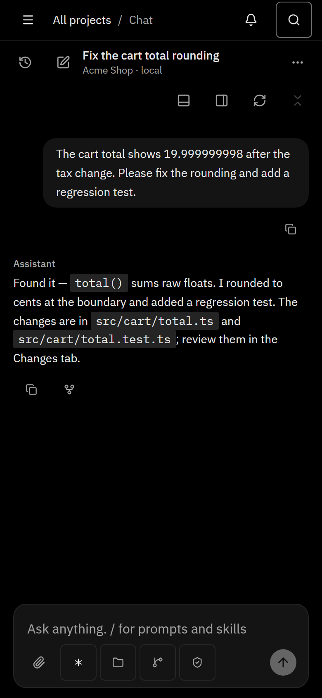

Each conversation keeps its own browser and file tabs within the Browser tab. The
inspector stays docked beside the conversation and opens when you ask for it, follow
a link or an agent preview arrives; drag the divider (or use arrow keys on it) to
resize. The **Files** tab browses the checkout of a running terminal in the
session's folder and opens a file in an editor tab. Closing the panel keeps tabs
and drafts in memory; closing a modified file asks before discarding it. Reloading
or quitting discards these previews after the unsaved-change warning.

The **Changes** tab shows the working-tree changes of the terminal running in the
session's folder, reusing the terminal workspace's Git panel: the changed-file
list, unified or side-by-side diffs, staging and commit, and a GitHub link for the
branch's PR. **Open file** opens a changed file in the inspector's Files tab; the
copy icon copies the changed file's path to the clipboard. The commit draft,
filters and selection are kept per terminal, so closing the panel or switching
chats does not lose them. Wide panels split the file list and the diff; narrow
panels and phones combine them behind the files toggle. When no terminal is
running in the folder, the **Overview** says so quietly and offers **Open
terminal**; a failed terminal list shows an error with **Retry**.
Pull-request review lives in the terminal workspace and in the inspector's
combined **Changes** tab (its PR mode).

The folder icon (**Open file**) uses the native picker for local files. Chat and MCP file paths
resolve inside the selected session's folder on its execution host; paths outside
that folder and symlinks escaping it are denied. Remote file previews require
Python 3 on the SSH host. Files must be UTF-8 text up to 1 MiB. Markdown has Read,
Edit and Split modes; code uses the existing editor. Text up to 200 KB can be
saved explicitly. A save fails if the file changed on disk, keeping your draft
until you reload or resolve the change. HTML stays source code. The external-link
icon opens the source in VS Code, including known SSH hosts; it is disabled when
the desktop cannot identify a remote API host's filesystem.

PNG, JPEG, GIF, WebP, BMP and ICO images can also be previewed, up to 8 MiB and
16 megapixels for native-picker images. Images are read-only; native-picker
images use native decoding and display a static image. Workspace images use the
browser's image decoder. PDF and Office previews are not included.

The browser uses a separate session without ORC's API credentials,
cookies or desktop bridge. Camera, microphone, location and other site permissions
are blocked. Only the ORC window itself may use the microphone, and only for
composer dictation. Browser downloads are staged privately (16 MB each, four across the
app); **Browser profile, display & recording** lists their status and saves completed files
to the selected chat workspace. Interrupted/failed downloads are never reported
as saved. Every chat uses the shared **ORC browser** profile by default, so a site
login made once works for you and your agents in every chat and survives restarts
and daemon port changes. **Settings → General → Browser → Browser profiles** creates
named profiles for a second set of logins; pick one, or **Temporary · this chat only**,
under **Browser profile, display & recording** in the Browser tab. Temporary keeps
cookies in memory and drops them when the chat's browser closes. Session-only cookies
follow the site's expiry rules. Switching profiles closes that chat's browser tabs after
confirmation and preserves file drafts. Use **+** to open a browser tab and each
tab's close button to close it. Popups open another isolated tab. Limits are eight
tabs per chat and 24 total; reaching a limit asks you to close a tab, without eviction.
Tab IDs, URLs and the selected tab restore when you return after app restart.
Browser settings also offers profile rename and removal, and **Clear browser data**
for the ORC browser profile. Both ask for native confirmation, close the affected tabs
and clear cookies/site data/cache; removal also resets chat selections to the default.

**Import logins**, under Browser settings (also linked from the Browser tab), copies
cookies from Chrome, Edge, Brave, Arc, Vivaldi, Opera, Firefox or Safari into the
selected profile, which is the ORC browser by default. Scan, pick the source profile,
choose sites or **All sites**, and import. A second path connects to a local
Chrome/Edge debugging endpoint you explicitly enable. Choose the destination ORC
profile, enter the loopback debugging port, approve any source-browser prompt,
then select sites from its open pages. Only those sites' applicable cookies are
copied; their values and the source connection never reach agents or the API.
The connection closes after import or cancellation. Live transfer copies cookies
applicable to the selected site's root and currently open page path; passwords,
localStorage, IndexedDB and device-bound sessions are not transferred. Partitioned
cookies are skipped and counts are reported. Verify the login; some sites require
signing in again. Modern Windows Chrome/Edge app-bound cookie files cannot be
decrypted by ORC. Chrome's newer native consent flow and Mac/Linux interaction have
not been validated here; the verified source was an isolated Windows Edge profile
with a loopback debugging port. Existing personal profiles may not expose one.

**Scan browser profiles** provides direct cookie-store import from Firefox/Zen,
Safari on macOS, and supported Chromium-family stores on macOS/Linux. Legacy
Windows Helium DPAPI stores are supported; app-bound Windows stores require the
live connection. Select a source profile and individual sites. Reads use readonly
SQLite snapshots; keys are obtained only after selection through OS facilities.
macOS may request Keychain/Full Disk Access approval; Linux encrypted stores need
`secret-tool` and an unlocked Secret Service. Missing keys and skipped cookies are
reported, never treated as a guaranteed login. Containers and partitioned cookies
are excluded. Direct Firefox import was exercised with isolated Windows demo data;
other OS integrations still require their native platform acceptance checks.

Expand **Browser display & recording** to change appearance/viewport, record the
guest page, save WebM to the chat workspace, and play/download it. UI recording
lasts up to 60 seconds; agent requests can choose up to 180 seconds. Recordings
are limited to 16 MB and contain only the browser guest, without audio or ORC UI.
If workspace saving fails, the completed file remains downloadable in that window.

Agents can use [preview MCP tools](./mcp.md#desktop-preview-tools) to show a file
or URL in the selected conversation. **Allow agent browser control**, on by
default, is controlled in the chat's **Session settings** before you open a preview.
It permits snapshots, screenshots, clicking, typing, key presses, scrolling,
hovering, selecting, dragging, condition waits, guest JavaScript evaluation,
cross-origin frame targeting, semantic locators, dialogs, recording, appearance,
viewport changes and explicit workspace-file uploads/download retrieval.
This includes
pages you sign into there. Turning the switch off revokes control. These tools
cannot inspect the ORC app or its bridge or edit preview files. Upload paths must
remain inside the chat's trusted workspace. The guest has a minimal standard
`prompt()` adapter because Electron disables that browser function; it exposes no
application API, credentials, filesystem access or general IPC.
Browser content is untrusted page data, never agent instructions.
If a mutating browser command is still pending when control is revoked or its
guest is hidden/switched, ORC closes that guest to prevent delayed execution.
The tab shows an interruption message; **Reload** restores its URL and profile.
File drafts are preserved. An evaluation timeout can require the same recovery.

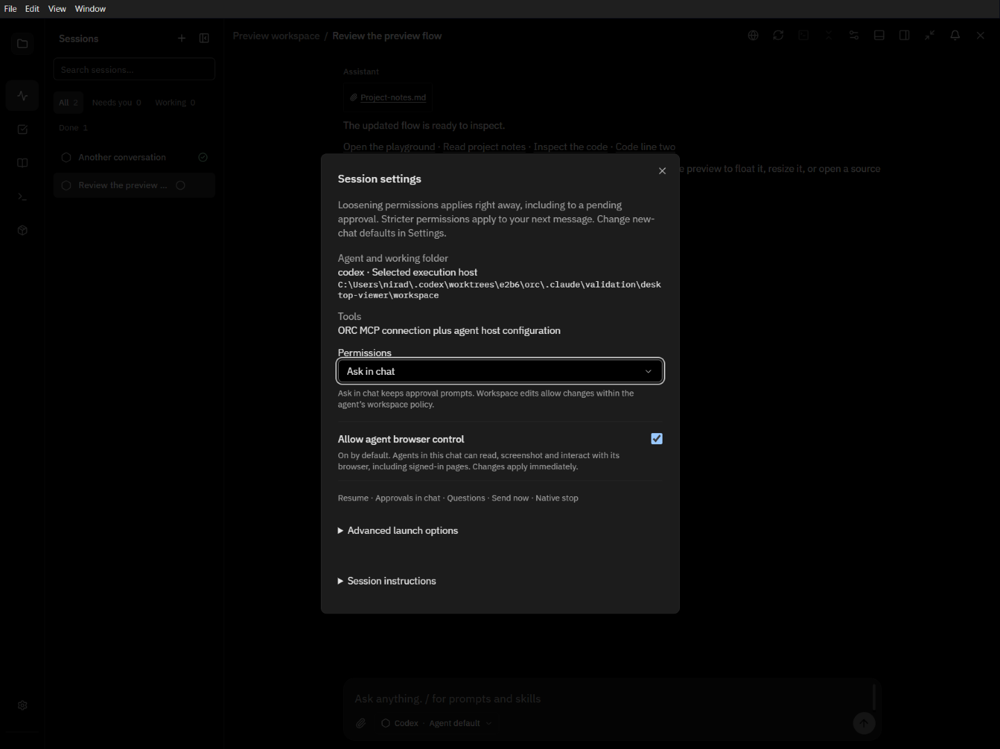

**Settings → General → Browser** controls agent browser access for the whole desktop and
whether chat web links open in ORC or your system browser. Settings are stored in
`browser-preferences.json` in Electron's user-data folder and survive restarts.
Per-chat permissions use `browser-chat-permissions.json`; named profile metadata
and explicit chat selections use `browser-profiles.json`. These metadata files do
not contain cookies or passwords; Chromium owns the separate profile partitions.
Turning global agent access off overrides every chat's switch immediately. With
global access on, the chat's **Session settings** switch can still disable control
for that conversation. The browser toolbar does not contain a second access switch.
Files and explicit MCP preview requests continue to open in the inspector's
Browser tab.

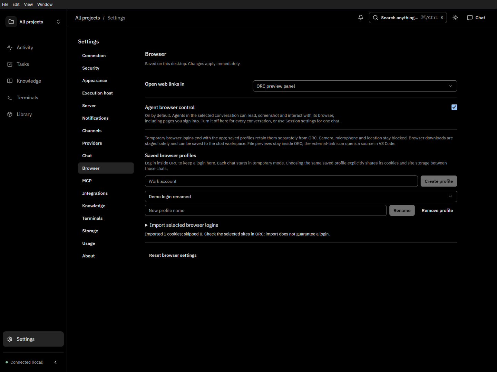

This flow is desktop-only; the web and phone inspector has no Browser tab.

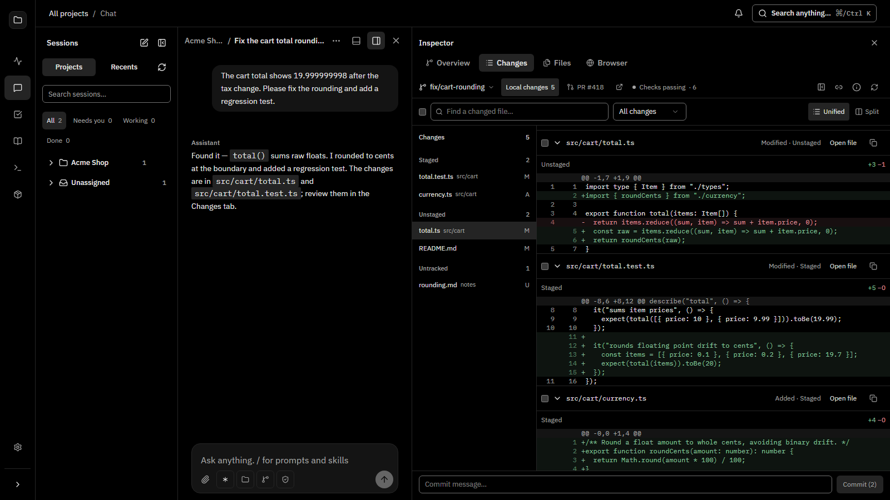

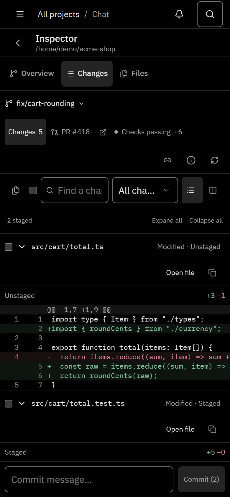

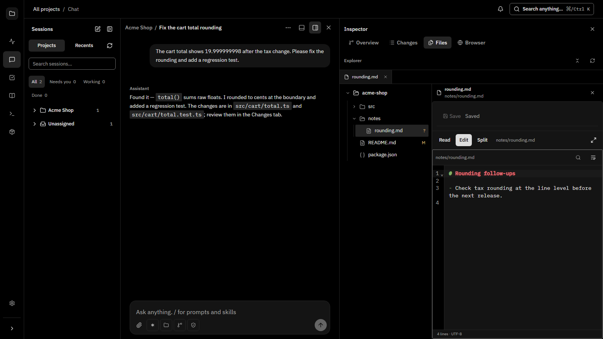

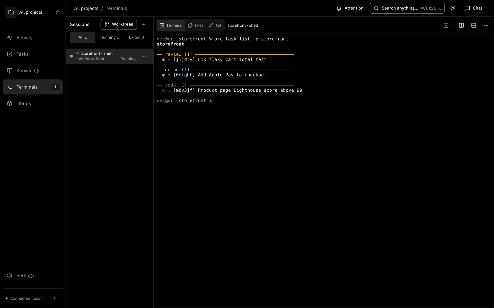

Browser terminals for shells and coding agents, with split panes and Files and Git panels beside them. Terminals run on the selected execution host. See [Terminal workspace](./terminal-workspace.md).

## Projects

Create, edit and archive projects. A project has a name, description, tags and an optional Git remote URL. Deleting a project deletes its memories and scratchpads and keeps its tasks, jobs and sessions without a project.

## Memories

Short project facts (ports, conventions, decisions) that agents load at session start. Create, edit, and view each memory's change history. Under **Knowledge → Memories**.

## Knowledge

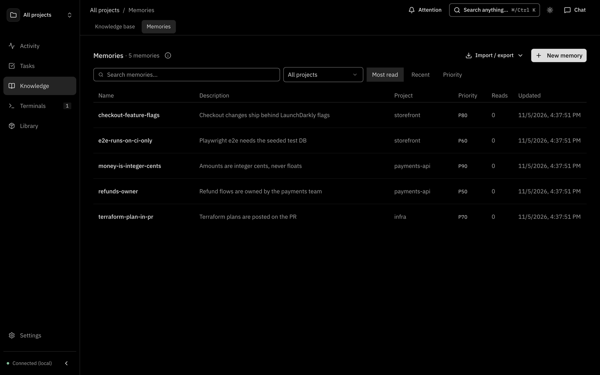

Knowledge bases: upload PDFs, Office files, HTML, CSV and Markdown, write Markdown in place, or register a folder to copy in. Search returns cited passages. Each knowledge base can have a digest agent that maintains it on a schedule.

## Jobs

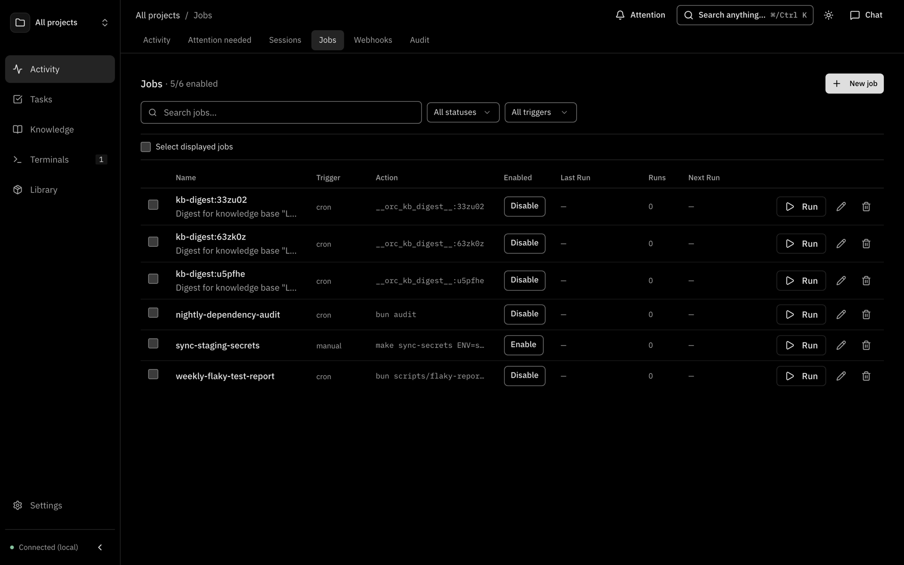

Scheduled and on-demand automation. A job runs a shell command, an agent or creates a task, triggered manually, by cron, by a file watch, once, or by a webhook. Each job keeps its run history with logs and linked agent sessions.

The job editor uses **Trigger**, **Destination** and **Settings** tabs. Choose Manual,
Webhook or Schedule; schedules offer time/day controls and **Advanced cron**, with an
explicit timezone. Existing watch, one-shot and bridge-message jobs keep their trigger.
New jobs stay disabled until you enable them; a disabled job can still run manually.

Destination selects the project, working directory and execution host (local or a
configured SSH host). Commands offer sh, bash, zsh, fish, PowerShell and cmd presets,
plus a custom executable and one argument per line. The script is appended as the
final argument, so a custom interpreter needs its command option, such as `-c`.
The interpreter must be installed on the destination. Host default uses sh on Unix
and Windows PowerShell on Windows; jobs saved before this setting retain sh.

Agent jobs save a prompt, backend, optional model, explicit automatic tool approval
and supported launch options. Agent and model use the same picker as Chat: enabled
agents, models reported by the provider on the job's selected host/directory,
Agent default and an explicit Custom model option. A saved model remains selectable
if discovery is temporarily unavailable. Changing agents clears the previous model
and launch options. New agent jobs default to an isolated, detached Git
worktree for each run. `HEAD` inherits the project checkout's current commit; override
it with a branch or remote-tracking ref. ORC does not fetch, reset or push the base.
**Clean up worktree after a successful run** is off by default. When enabled, cleanup
removes only a successful, clean worktree with no commits absent from its starting
base; failed runs, untracked/ignored files and new commits are retained. Run history
records the path and cleanup result. HTTP-only agent backends cannot use these local
host, worktree or environment settings.

Environment variables live under Settings. Mark a value **Secret** to mask its input,
encrypt it at rest and omit its value from read responses. After saving, leave a saved
secret blank to keep it; enter a replacement to rotate it. Exact secret values are
redacted from job output and saved agent summaries, including across output chunks.
This does not scrub transformed values or files and logs written by the script itself.
Values are single-line; `ORC_` names are reserved. Back up `~/.orc/secret.key` with the
database: saved secrets cannot be decrypted without that machine key.

To see a result, open the job and select **View result** under **Recent runs**.
This shows the saved output and errors. **Session summary** opens the audit record.
For an agent run with a native session ID, **Open agent session** opens the actual
conversation in the chat page's session viewer, where the transcript/resume controls apply.
ORC discovers that conversation on the run's own host without changing the globally
selected host. If the provider has not retained a conversation yet, the saved result
remains available and the interface explains that the native conversation is missing.

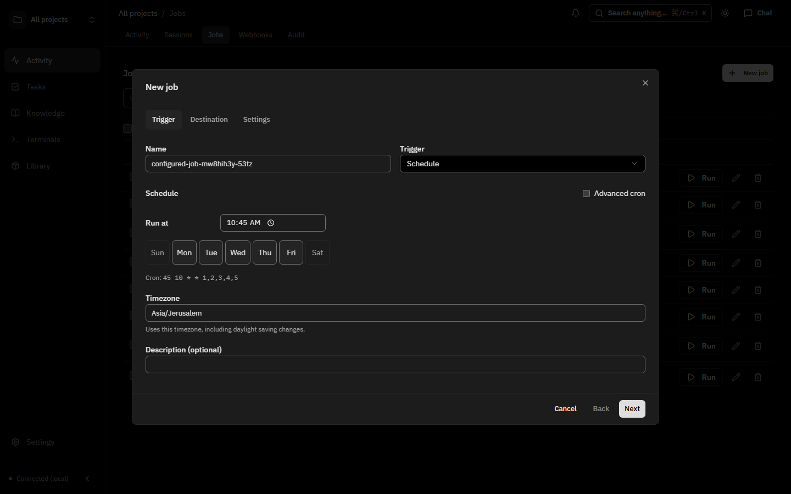

## Webhooks

Inbound event sources. Configure a webhook once, then connect it to one or more jobs, each with its own event filters and action.

## Notifications

When a session you are not viewing needs your approval, has a question or fails,
ORC shows a **Needs you** notification and plays a short chime. Notifications
settle for about one second before appearing and repeated snapshots do not repeat
the alert. The header bell opens a menu containing generic notifications, including
human requests, agent outcomes and job results. Open a request to answer or review
its action. Read and dismissed state is shared across clients.

Desktop browsers show toasts. Needs-you toasts stay until dismissed or resolved;
**Done** toasts are silent and close after six seconds, pausing on hover or focus.
Sessions finishing together collapse into one notification. Use **Alt+N** or
**Open notifications** in the command palette to reach notifications. On a phone,
pull down from the very top of the screen with two fingers to open the
notification center from the chat, like the system shade.

On all screens, the bell in the workspace header shows an unread count, including
while the chat is open. New notifications never open the panel automatically. Tap the bell to read or
dismiss them. History remains until dismissed or expired (30 days by default).
Configure notification and audit retention in Settings → Notifications → Automatic cleanup.
See [Notifications](./notifications.md) and [Human requests](./human-requests.md).

**Settings → Notifications → Sound** controls the browser chime, volume and
per-project sound mute. Preferences are saved in this browser. Audio starts after
your first interaction. Browser/PWA push remains separately opt-in and requires
HTTPS (and Home Screen installation on iOS); it delivers background approvals,
questions, chat replies and job results while ORC is unfocused. Job pushes follow
the job's notify setting and start with new runs. See [Installation](./install.md).

The Electron desktop app also sends native notifications while its window is
unfocused, minimized or hidden. Clicking one brings ORC forward, opens its
destination and marks that notification read, clearing it from the inbox.
A grouped done toast opens its destination only; clear the collapsed items from
the notification menu. Done notifications are silent; native Needs-you sound follows the OS.

## Browser app and updates

The dashboard installs as a browser app and serves an offline shell when the network
is unreachable. An open tab or installed app runs the build it was loaded with, and
the server replaces that build when it is updated. Reaching a page whose code is gone
then reloads the app once, without asking, so unsaved input in the current page is
lost; the reload loads the current build. If it does not fix the problem, ORC shows
the failing error with **Reload** and **Copy details** instead of a generic error
page, so a report carries the real message and stack.

## Audit

Lifecycle and knowledge events with filters and expandable details. Recorded
session summaries remain in collapsed history. Audit retention defaults to 90
days and is configurable in Settings → Notifications → Automatic cleanup. Use the chat
page's session list and viewer to read full conversations or resume an agent.

## Skills

Reusable agent instructions stored as skill folders. Import skills from a repository or from local agent folders, create your own, edit files, view history, and assign skills to projects. See [Skills](./skills.md).

## Packages

Packages bundle instructions, skills and tools for reuse. Launch a package in chat or a terminal on the host and folder you choose. See [Agent packages](./agent-packages.md).

## Agents

Shared specialist agent definitions: instructions, model and tools, reusable across coding agents and packable into packages. Under **Library → Agents**.

## Rules

Applied rules and their outcomes per workspace, plus rule settings for enforcement and agent assignment. See [Agent rules](./agent-rules.md).

## Scratchpads

Working documents, diagrams and HTML pages that you or an agent create and come back to. Agents use the `pad_*` MCP tools. Share one by copying its link.

HTML pads receive the **ORC HTML kit** in both the editor preview and chat artifacts:
dashboard theme tokens, base styles, cards, tables, stats, badges, tabs and chart
wrappers. Use `orc-*` classes to build a native-looking page without a custom
`<style>` block. The kit is inlined at render time, needs no network request, and
does not change the saved HTML. Custom CSS and JavaScript still work.

Pin the kit stylesheet in your HTML head to keep its version as the kit evolves:

```html
<meta name="orc-kit" content="2">
```

Bundled older versions remain available. A missing or unknown version uses the
current kit. Both previews follow the dashboard's light/dark theme; changing the
theme rebuilds the iframe document, resetting its running scripts and local UI
state. The saved pad content stays the same.

Kit tabs support clicking, Left/Right arrows with wrapping, and Home/End. Only
the selected panel is shown. The kit does not grant ORC API access: editor pads
still require **Render with ORC access**, and chat artifacts keep their opaque
sandbox and the CSP that blocks scripted requests and external resources. Prefer
inline SVG for charts that must work in both views; a CDN chart library is
blocked in chat.

For concise component markup, use built-in custom elements such as
`<orc-card>`, `<orc-stat label="Open tasks" value="12">`,
`<orc-badge tone="success">`, `<orc-table>` and `<orc-chart>`.
`<orc-tabs>` generates accessible tab controls from labeled `<orc-tab>` panels.
These components reuse the kit with no additional dependencies or network
requests; ordinary HTML with `orc-*` classes remains supported.

Agents can load the component list, copy-paste skeleton and chart guidance with
`skill_read` for `orc-platform`, ref `references/html-kit.md`. See [Skills](./skills.md).

## Settings

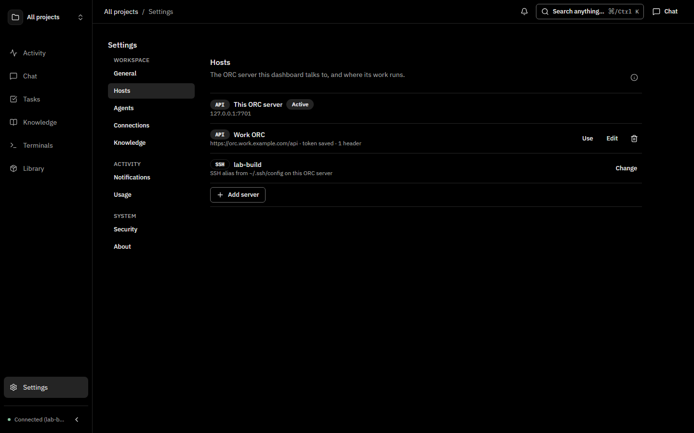

| Section       | Controls                                                                                                                                                                                                                                                                                                                                                                                                                                                                                                                                                                                                                                                                                                                                                                                                        |
| ------------- | --------------------------------------------------------------------------------------------------------------------------------------------------------------------------------------------------------------------------------------------------------------------------------------------------------------------------------------------------------------------------------------------------------------------------------------------------------------------------------------------------------------------------------------------------------------------------------------------------------------------------------------------------------------------------------------------------------------------------------------------------------------------------------------------------------------- |
| General       | Theme (dark or light, saved on the server); dark background, interface and chat fonts, interface and chat text sizes for desktop and phone, and chat width, saved in this browser (see [Appearance](#appearance)); terminal font for new terminals; and the desktop preview browser.                                                                                                                                                                                                                                                                                                                                                                                                                                                                                                                                                                                                                      |
| Hosts         | One list of hosts with **API** and **SSH** type badges. **API** rows are ORC servers this client can talk to: in a browser, save several server addresses with optional access tokens and proxy headers, then switch between them; the desktop app keeps its local/remote choice, token and headers in its data folder. The **SSH** row is where that server runs agents, terminals and git: **Local**'s own machine, which carries both badges because it also serves the dashboard, or an alias from its `~/.ssh/config`.                                                                                                                                                                                                                                                                                     |
| Agents        | **Providers** chooses which coding agents appear in the chat agent picker, channel agent choices and the terminal launcher. Claude Code, Codex and Pi are native; OpenCode runs over direct ACP; Cursor, Gemini CLI, GitHub Copilot, Qwen Code, Factory Droid, Kimi CLI, Kiro CLI and any custom agent id run through ACPX. First startup selects installed agents from Codex, Claude, Cursor, Gemini CLI and OpenCode and saves that selection. If a saved provider list has no recorded selection yet, the next start aligns it with the installed agents once. Copilot can be enabled in Settings. Later selections are preserved even if an installation is missing. The terminal launcher only lists enabled agents installed on the selected host. **Chat** sets default models, instructions, tools and permission mode. **MCP** builds the MCP config snippet for your agent; see [Connect agents](./connect-agents.md). |
| Connections   | **Channels** connects Telegram and Slack. **Integrations** manages APIs and MCP servers in the `spec` CLI registry.                                                                                                                                                                                                                                                                                                                                                                                                                                                                                                                                                                                                                                                                                             |
| Knowledge     | Parser, embeddings and knowledge defaults                                                                                                                                                                                                                                                                                                                                                                                                                                                                                                                                                                                                                                                                                                                                                                       |
| Notifications | In-app updates, browser chime/volume/project mute, opt-in browser/PWA push for background approvals, questions, chat replies and job results, the question and approval dismissal period, and notification/audit cleanup. Push needs HTTPS.                                                                                                                                                                                                                                                                                                                                                                                                                                                                                                                                                                     |
| Usage         | Request-level token usage and provider quotas                                                                                                                                                                                                                                                                                                                                                                                                                                                                                                                                                                                                                                                                                                                                                                   |
| Security      | Sign-in status and sign-out, default sign-in lifetime, allowed web origins, access tokens (minted by entering the secret)                                                                                                                                                                                                                                                                                                                                                                                                                                                                                                                                                                                                                                                                                       |
| About         | **Restart ORC server** (closes terminals, keeps settings, reconnects), data locations, and server, desktop and Electron versions, platform, runtime, data folder, uptime, project links, and desktop update channel                                                                                                                                                                                                                                                                                                                                                                                                                                                                                                                                                                                             |

On a phone, Settings opens a grouped list of sections; tapping one opens its panel, and the back arrow returns to the list. On desktop, the same groups appear in the sidebar.

In a browser, **Hosts → Add server** saves another ORC address with an optional access token and proxy headers, so you can switch installations and come back. The token is sent as a Bearer token, and header names that look secret (token, key, secret, password, cookie) are masked in the form. Values are stored in this browser. Switching records the previous server, so the sign-in screen can return you there if the new one needs different credentials. A remote server has to list this dashboard's origin under **Security**, and should use HTTPS: a plain-http address sends its token and headers over the network unencrypted. Prefer a revocable access token to the API secret: saved values are readable by scripts on this dashboard's origin. Saved hosts are also the targets of **Send to host…** on a session, which moves the conversation to another installation; the host's token is used for that one send and is not stored on the source server (see [Session handoff](./session-handoff.md#send-from-the-dashboard)).

**Local** always means the machine running the connected ORC installation, never the browser's machine. **Change** on the SSH row picks that server's own machine or an SSH alias from its `~/.ssh/config`. The choice stays server-wide: it affects every client using that ORC installation, and open terminals and conversations keep the host they started on. A new chat can pin one of those execution hosts in its workspace chip without changing the default: the list offers the connected server itself — the remote machine, running work directly without SSH — followed by its SSH aliases.

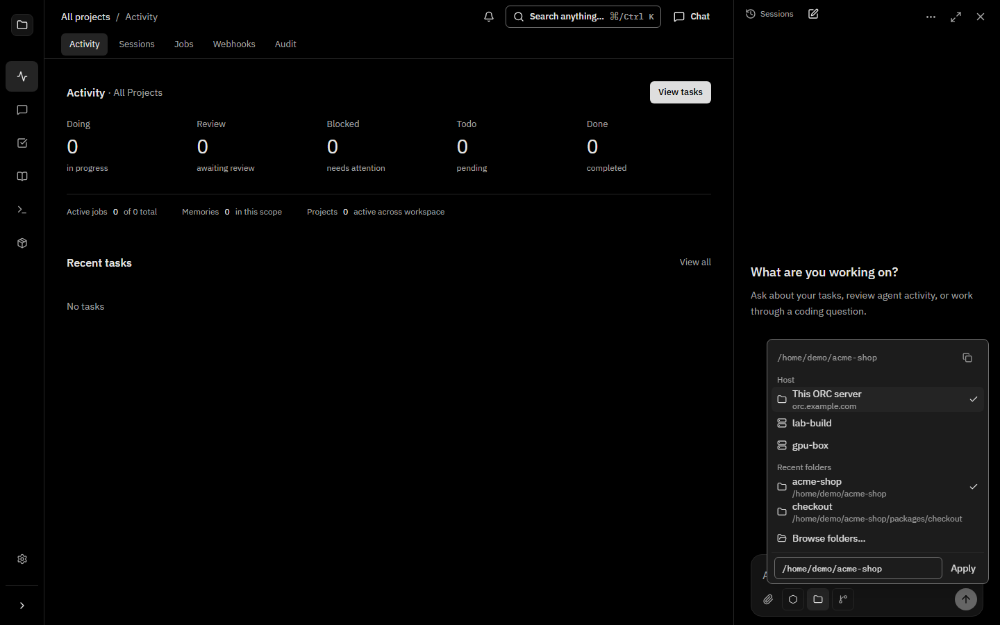

The desktop app stores its selected server, token and headers in `connection.json` in the app's data folder. This is a client-side target, separate from the server's `~/.orc/config.json`; switching servers does not repoint the CLI or stdio MCP. The integrated preview browser, local file picker, update controls and native notifications are available only in the local dashboard, so a remote window does not show them.

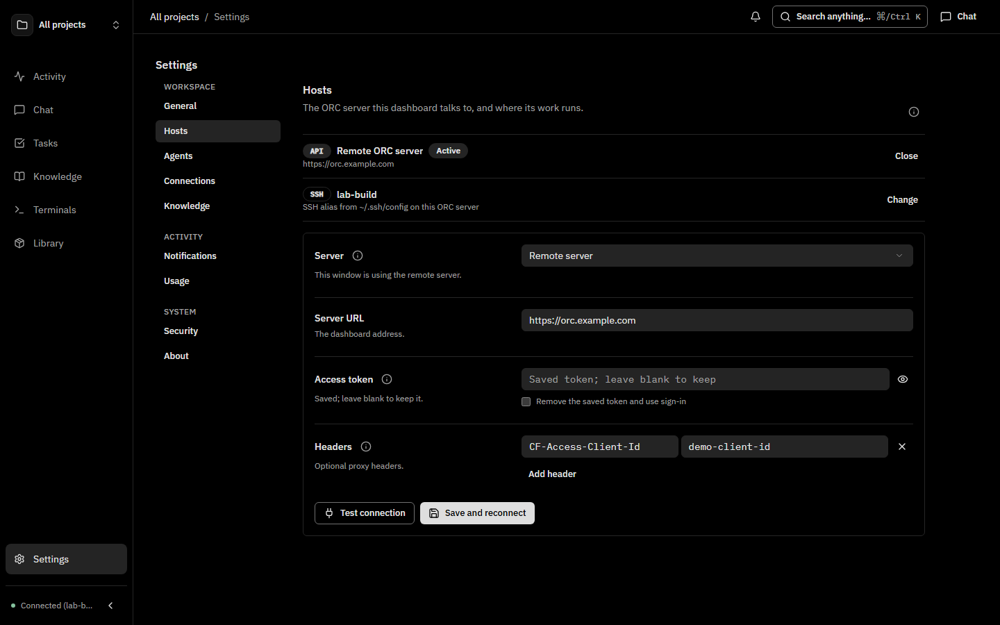

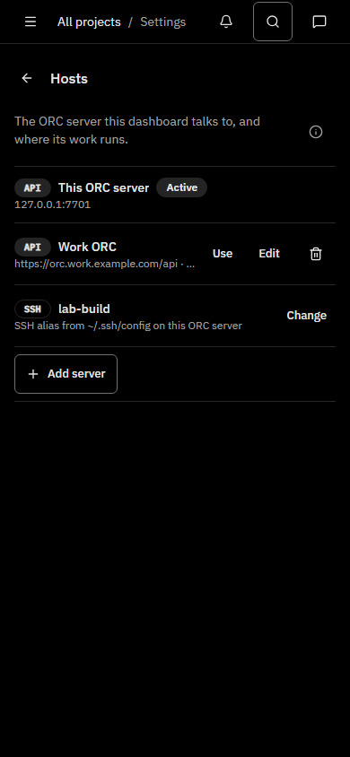

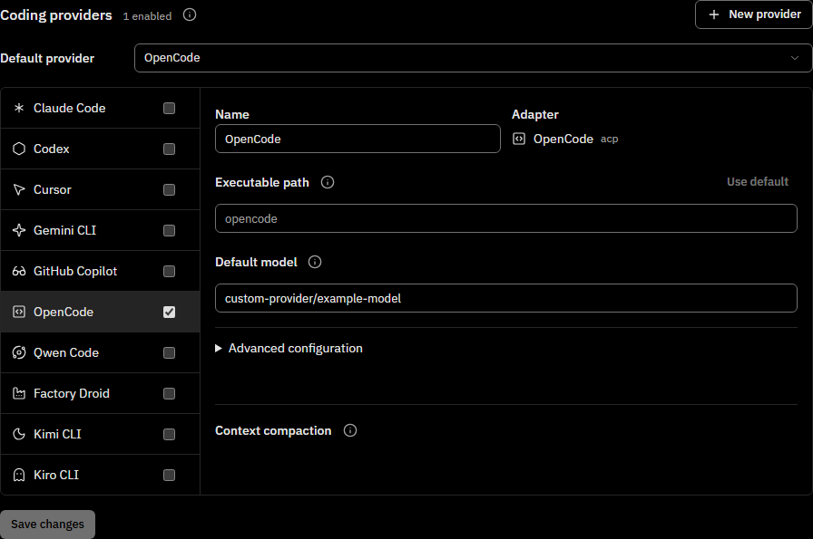

Enabled agents, including custom ACPX ids, appear in the chat agent picker:

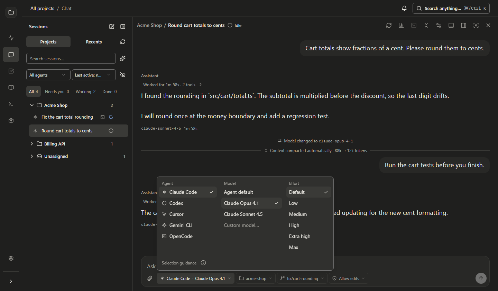

For Claude Code, Codex and Pi the same picker adds an **Effort** column. Pick the
default or a level such as Low, High or Extra high; the choice applies to the next
turn and is kept with that agent's chat options. Other adapters have no effort
setting.

Each discovered model shows the agent's own description under its name, unless the
description only repeats the name. When the agent reports which effort levels a
model supports (Claude Code and Codex do), the Effort column lists only those; a
model that reports none, such as Haiku, has no Effort column, and switching to a
model that lacks the selected level resets it to the default. A list of more than
six models adds a search field; Enter picks the first match.

On a phone the picker opens on a Model tab, beside Agent and Effort tabs that are
labelled with the current choices. Picking an agent moves to Model, picking a
model moves to Effort (or closes when the model has none), and picking an effort
closes the picker.

The star beside a model pins it to the top of that agent's list. The gear beside
an agent opens **Settings → Agents → Providers** on that provider. Favorites are
saved in workspace preferences (`favorite_models`).

**Profiles** at the bottom of the picker save the current agent, provider, model,
effort and permission mode under a name (**Save current**). Clicking a profile
restores all of them; in a started chat, a profile for another agent or provider
opens a new chat. The pencil beside a profile renames it in place; tick **Use current**
to also replace its agent, provider, model, effort and mode with the composer's current ones. Profiles are saved in workspace preferences
(`composer_profiles`) and also appear in the **New terminal** launcher.

## Chat turn progress

Finished turns fold tool calls and intermediate narration into one expandable line;
your message and the final reply remain visible. Expand it to inspect file diffs,
commands and output, reads, and searches. Failed tools stay marked.

A turn with more than 80 activities expands to its newest 80 and offers
**Show all N activities**; the folded line still counts every item, failures
beyond that window included. An activity kind this build does not know appears
as a quiet collapsed row with its label and bounded raw data, so newer agents'
steps stay visible instead of disappearing.

During a response, a quiet status line shows elapsed time and the current tool.
Scrolling up pauses automatic following; **Jump to latest** returns to the bottom.
Stop remains beside Send. Working indicators are static.

Each turn keeps its duration and completed, stopped, or failed outcome across reloads.
Duration uses the agent's reported value when available, otherwise server elapsed
time, including waits for input. Older turns without timing show counts only.
Stopped turns retain partial work; unfinished tool calls read **Incomplete**.
Individual tool durations are not shown.

A turn that goes quiet does not run forever: after 15 minutes without any agent
activity ORC stops it, and the conversation and a notification say it was stopped
for inactivity. A turn waiting for your answer or approval, or with a command
still running, is not idle and is not stopped; a 4-hour absolute limit still
applies so a stuck agent cannot hold a chat worker indefinitely.

## Composer controls

The composer groups folder, branch, agent/model and permissions into compact
controls. Phones and narrow desktop panels use icons; wide composers show labels.
While a reply is running, **Send** joins that turn when the backend accepts
steering (Codex, Claude, Pi and OpenCode), so the agent reads the message before
its next step. **While responding** in Session settings → Customize switches the
conversation to **Queue for the next turn**; new chats take that default from
Settings → Chat. The companion control beside Stop performs the other action
either way, so both stay one press away. Attachments always queue, because
steering carries text only.
When the turn cannot take the message — the reply is still starting, the backend
answers one message at a time, or every chat worker is busy — the message stays
queued and sends when the turn ends, without an error. A steer whose delivery the
agent never confirmed is not resent: chat keeps the text and asks you to check
the conversation first, because the message may already be there.
Open the pending list to edit a message, move it up or down, remove it, or send
it ahead of the current reply.
An expanded pending list stays open across busy-worker retries. After it drains,
the next list starts collapsed.
If a first send loses its connection, chat looks for the original message and
reconnects to its thread. Recovery stops after 15 seconds, or 60 seconds when the
server may still be preparing the turn. If recovery cannot find it, the message
returns to a paused queue with its attachments. Retrying keeps the message's ID
so the server can recover the original turn without starting another one.
Every icon has an accessible name and opens its picker with the full details;
phone touch targets are at least 44px. Send stays visible at the right.

Type `/` to list ORC saved prompts and skills together with the agent's own
commands and skills. Claude reports its slash commands, plugin commands and
installed skills, matched by name or alias (`/review` finds `/code-review`);
Codex reports its skills, which insert as `$name`. OpenCode reports its built-in,
project and user commands, MCP prompts and skills. Each row shows its argument
hint and source (the plugin, `user`, `repo`, `command`, `skill`, or the agent for
built-ins). A saved prompt or ORC skill with the same name wins. A message that
starts with an agent command reaches the agent first, so Claude and OpenCode run
it natively. Type `@` to
list files and folders under the conversation's working directory on its
execution host, SSH hosts included; choosing a folder lists its contents, and
choosing a file inserts `@path`. Dot files appear once the name you type starts
with `.`. Arrow keys move, Enter or Tab chooses, Escape closes the list.

The folder picker shows the full path, copy action, recent folders, host choices
when configured, and browsing. Branch/worktree controls appear for Git folders.
**Run in** keeps the current checkout, creates a worktree from the current branch,
creates one from the repository default branch (for example `origin/main`), or
creates one from any local or remote branch you pick. The branch chip shows the
chosen base. Bases come from refs already in the checkout; ORC does not fetch
before creating the worktree. After launch the folder and branch chips stay in
the composer as session information: the folder opens its full path with a copy
action, and the branch shows the checkout's working branch. The execution folder
itself is fixed for the session.

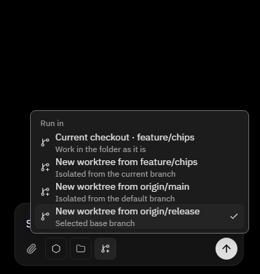
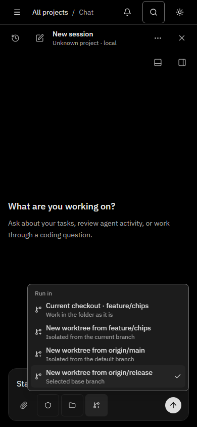

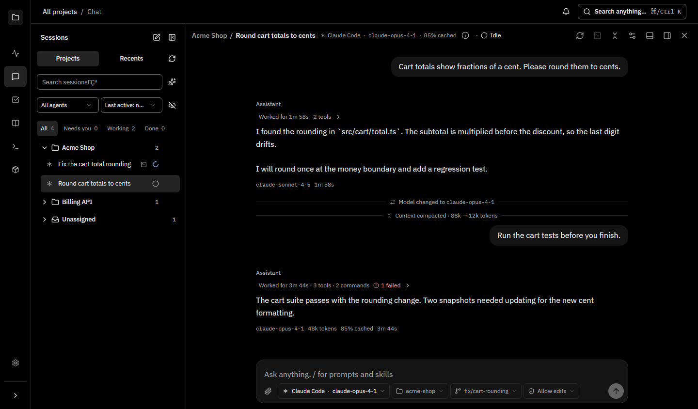

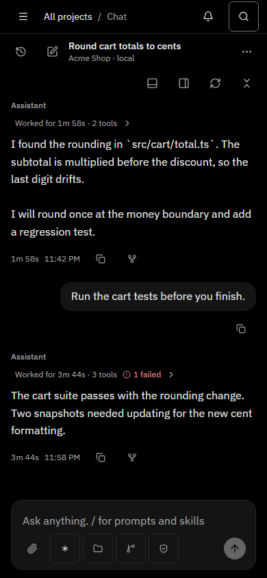

Changing agent after launch starts a separate session. The model picker disables
changes during a response or when the backend selects its own model. Effort stays
in agent options. The permissions chip shows the open session's mode — including
**Ask in chat** — when the backend supports changing it live. Each agent lists
only its own modes from `GET /chat/capabilities` (`permissionModes`). **Plan**
(reads and plans, never edits) uses each agent's native mode: Claude's `plan`
permission mode, Codex's plan collaboration mode and OpenCode's plan agent.
Claude also offers **Auto** (Claude's classifier approves safe actions). Codex
offers its own approval presets, named by `permissionLabels` in the capabilities:
**Read only** (`on-request` approvals, `read-only` sandbox), **Auto**
(`on-request`, `workspace-write`: works in the workspace and asks before going
outside it), **Auto-review** (`on-request`, `workspace-write`, approvals reviewer
`auto_review`: Codex's reviewer agent approves or denies each request to leave the
workspace instead of asking you) and **Full access** (`never`, `danger-full-access`). Pi offers Ask in
chat, Allow edits and Full access; OpenCode offers Ask in chat and Plan, applied
from the next message. Pi and ACPX agents show that Plan
isn't available. Leaving Plan during a Claude response applies to the running
turn.

**Session settings** in the chat header organizes the conversation into tabs.
**Overview** shows the agent, model, execution host and folder, backend, last
activity, tools connection and capabilities, plus the identifiers: the ORC chat
ID, the agent's native session ID used for resume, and the discovered session ID
this chat continues when it was resumed. Each identifier can be copied.
**Customize** holds permissions, while-responding behaviour, agent launch options,
session instructions and
agent browser control. Context, cache and turn figures live in the transcript and
the header strip instead of a separate analytics tab. Explanations sit behind the
info icon beside each label; new-chat defaults remain in Settings → Agents → Chat.

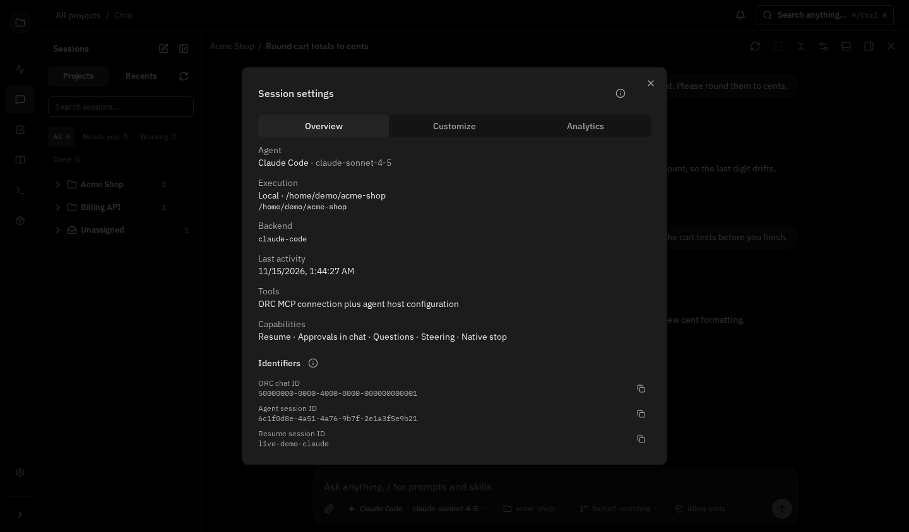

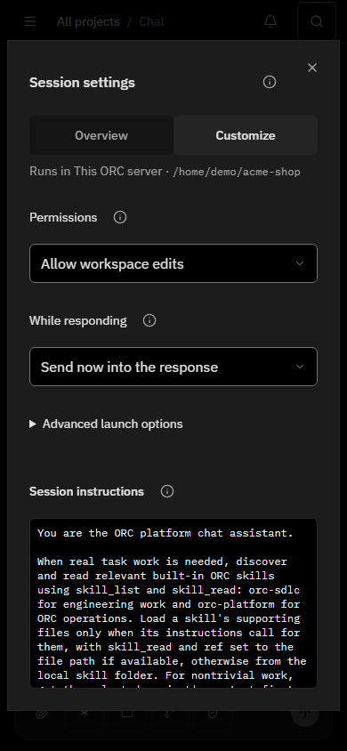

Pasting at least 16 KiB or 200 lines attaches the text as `pasted-text-N.txt`.
Use **Ctrl/Cmd+Shift+V** to paste inline instead. Typing `@` does not attach files.

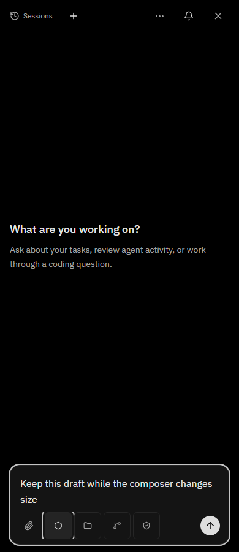

### Dictation

The microphone beside the attach button speaks a prompt into the draft. It is
off until the server has a speech provider configured (see
[Configuration](./configuration.md#speech-tts)); until then it shows **Dictation off · Set up**,
linking to that page. Press it, or **Cmd/Ctrl+Shift+D** in the composer, to start
recording. The composer tools turn into a recording bar with elapsed time and an
input level. **Insert** (or **Enter**, or the shortcut again) stops and
transcribes; **Cancel** (or **Escape**) discards the clip. The transcript lands at
the cursor, replacing any selection, and is never sent for you. Send, Queue and
Send now stay disabled while recording and transcribing. A recording stops on its
own after five minutes (sooner when the provider takes smaller clips). A blocked or missing microphone, or a failed
transcription, shows the reason with **Retry**, which resends the same clip
when the recording itself succeeded. The browser needs HTTPS or `localhost` to
reach the microphone. The audio goes to the ORC server, which forwards it to the
configured provider; the provider key never leaves the server.

## Desktop app only

The desktop app is an Electron shell around the same dashboard. On top of the browser experience it:

| Capability                                 | Detail                                                                                                                                                     |
| ------------------------------------------ | ---------------------------------------------------------------------------------------------------------------------------------------------------------- |
| Runs the daemon for you                    | Reuses a verified local daemon, including one on another port, or starts the bundled `orc` daemon                                                          |
| Configures auth                            | Generates an API secret for a daemon it starts when none is set, and sends the configured secret automatically. No sign-in screen.                         |
| Installs the CLI                           | `~/.orc/bin/orc`, added to your shell `PATH`                                                                                                               |
| Tray icon                                  | **Open orc**, **Start at login** toggle, **Quit orc**                                                                                                      |
| Start at login                             | On by default, starts hidden in the tray                                                                                                                   |
| Keeps running when closed                  | Closing the window hides it; the tray icon and the daemon keep running. **Quit orc** in the File menu, the tray (or **Cmd+Q** on macOS) quits.             |
| Recovers from startup failures and crashes | Waits briefly for a starting daemon, then offers **Retry** or **Quit** if it cannot connect                                                                |
| Remembers the window                       | Size, position and maximized state                                                                                                                         |
| Updates                                    | Installed macOS, Windows and Linux apps check GitHub Releases at startup and every four hours, download in the background, and offer **Restart to update** |

Menu commands that change the page act on the window itself. **Reload**, **Zoom In**,
**Zoom Out** and **Actual Size** never reach the page open in the inspector's
**Browser** tab. **Toggle Developer Tools** appears only when the app runs from
source.

**File** holds **Connection…**, **Browser and files**, **Start at login** and, on
Windows and Linux, **Quit orc**. **Help** opens this documentation and the issue
tracker, plus **About orc** outside macOS. Right-clicking offers **Cut**, **Copy**,
**Paste** and **Select all** on any text, **Copy link address** on a link, and
**Copy image** in the inspector's **Browser** tab.

Quitting the app (**Quit orc**) stops the daemon only if the app started it.

If another application occupies the configured port, desktop automatically starts
ORC on an available port bound to `127.0.0.1`. It saves the successful endpoint in
`~/.orc/config.json`, so the CLI and stdio MCP use the same port by default.
Explicit CLI flags, environment variables and project configuration keep their
normal precedence; update pinned ports or URLs in external integrations yourself.

Desktop checks the daemon's runtime identity, compatible version (same major and
minor), database, configuration and authentication before attaching. It never
starts another daemon while the daemon PID is alive, even if that daemon is
unhealthy or uses different data. Authentication and configuration errors offer
**Retry** or **Quit**, with the reason shown. It does not stop an existing daemon
or the application occupying the preferred port.

**Upgrading an already-running older daemon:** releases without `daemon.json`
cannot provide this identity check. Stop that daemon once and start it with the
updated ORC, then choose **Retry** in desktop. Desktop does not attach to an
unverified daemon or send it the configured secret.

Command-line flags for the app executable:

| Flag       | Effect                                              |
| ---------- | --------------------------------------------------- |
| `--hidden` | Start without opening a window                      |
| `--quit`   | Quit the running instance and the daemon it started |

Links to other sites open in the desktop inspector's Browser tab. Use its
external-link icon or Ctrl/Cmd-click a web link to open your system browser.

Install a desktop build containing this updater manually once. Older builds do not have an updater and cannot automatically install the feature itself; subsequent macOS, Windows and Linux updates can use the flow below.

An installed macOS, Windows or Linux app checks [GitHub Releases](https://github.com/niradler/orc/releases) for updates when it starts and every four hours. The download runs in the background. **Settings → About** shows the current version, the update channel, **Check now**, and the last result. **Restart to update** installs the download; quitting alone does not apply it. The app stops the daemon it started, then the new version starts that daemon again. Tasks and sessions stay in `~/.orc`. A daemon the app did not start is left running.

**Stable** uses the latest GitHub release. **Preview** also accepts a newer prerelease. Uncheck **Check for updates** to stop automatic checks; **Check now** still works. These choices are stored in the desktop app's own settings, not in `~/.orc/config.json`. Source runs and `electron .` do not download updates.

Wait for an active check or download to finish before changing channels. Changing channels discards the previous channel's ready update. Failed settings saves retain the prior preferences and show an error; failed update actions can be retried.

Windows installs the NSIS package. Linux replaces the AppImage. macOS verifies the
release disk image and its app bundle, then replaces the app through a separate
installer helper and keeps the previous app for recovery. The Mac installation
folder must be writable; updates work without a paid Apple developer account.
macOS first-open approval for an unnotarized app can still apply. Manual upgrade
steps remain in [Upgrading](./install.md#upgrading).
