# Desktop app and web dashboard

A tour of every page in the ORC dashboard and what the desktop app adds on top of it.

The dashboard is served by the daemon at `http://localhost:7700`. The desktop app shows the same dashboard in its own window, so everything below applies to both.

## Layout

| Area            | Contents                                                                                                                                                                     |
| --------------- | ---------------------------------------------------------------------------------------------------------------------------------------------------------------------------- |
| Sidebar         | Activity, Chat, Tasks, Knowledge, Terminals, Library, Settings. Shows the execution host, for example `Connected (local)`.                                                   |
| Project picker  | Scopes most pages to one project, all projects, or unassigned items. A project with sessions waiting on you shows how many.                                                  |
| Chat panel      | Talk to any enabled coding agent from any page. Pick the agent and model at the top. Claude and Codex run natively; OpenCode uses direct ACP; other agents run through ACPX. |
| Command palette | **Ctrl+K** (**Cmd+K** on macOS) to search and run commands                                                                                                                   |
| Next session    | **Alt+J** (**Option+J** on macOS) opens the next session that needs you, then the next finished session you have not seen. It does nothing while you are typing.             |

Popup menus and pickers across the dashboard close when you tap outside or press
Escape, including project, session, document and terminal actions. Tapping the
terminal canvas also dismisses an open menu. Interacting inside a picker or its
folder dialog keeps it usable without discarding your draft.

Pages are grouped in the sidebar:

| Group     | Pages                                        |
| --------- | -------------------------------------------- |
| Activity  | Activity, Sessions, Jobs, Webhooks, Audit    |
| Chat      | Chat                                         |
| Tasks     | Tasks                                        |
| Knowledge | Knowledge base, Memories                     |
| Terminals | Terminals                                    |
| Library   | Skills, Packages, Agents, Rules, Scratchpads |
| Settings  | Settings                                     |

Projects has its own page at `/projects`. Every page has a shareable URL.

Switch between the dark and light themes in **Settings → Appearance**, or with the
theme command in the command palette:

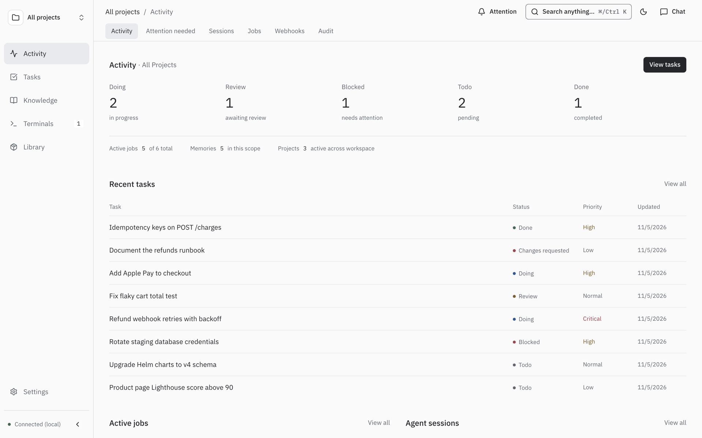

## Chat page

**Chat** in the sidebar, under Activity, opens the chat page at `/chat`. It is a
regular page: the workspace header keeps your navigation and notifications, and
**Chat** shows as the active page. The sidebar collapses to its icon rail while a
conversation is open, including the side chat, to give the conversation the width;
leaving chat restores the width you had, and expanding it during chat keeps your
choice.
The chat panel's full-screen button, and the full-screen button on **Sessions**
(on the page or on a row) or in the **Terminals** session list, open the same
page.

Below 1280px wide, the chat has no side panel: starting a chat from any page
opens the chat page instead.

- **Session list**: chats, coding agents running in ORC terminals, and live sessions discovered from your coding agents, each with its state. The full-screen session home also lists running shell terminals. Click a chat to read it, a terminal agent to see its terminal, or a discovered session to resume it in chat. Collapse the list to a rail of icons with its state marks; expand it again from the rail.
  - **Projects**, the default view, groups sessions under their project (unassigned sessions get their own group); expand a project to see its sessions, and use its **+** button to start a chat in the project's folder. **Recents** lists every session by last activity, newest first. A session's working folder decides its project: the most specific project folder wins, a worktree resolves to its shared checkout, and a session without a recorded project is matched to a project whose folder contains its working folder. Both views follow the project selected in the workspace header; pick **All projects** to browse every project, and sessions in archived or paused projects stay listed under their project. Opening a session from the list adopts its project when the header is on **All projects** or **Unassigned**, so the list and notification inbox follow the work you opened.
  - Opening a session keeps its place in the list; sending a message is what moves it to the top. State filters still move rows as their status changes. While you hover or keyboard-focus the list, its order freezes and a pill offers to apply the new order. The header's refresh button re-imports agent sessions, then refreshes threads, live sessions and archive.
- **Inspector**: the panel button in the header opens one panel with **Overview**, **Changes** and **Files** on desktop and phone. Overview shows the host, folder, branch, changed files, linked task and the branch's pull request with its state, CI state and GitHub link. When a terminal is running in that folder, **Changes** combines the working-tree review (staging and commit) with the branch's PR review (diff, comments and an **Open on GitHub** link) behind Local / PR modes, and **Files** browses and edits the checkout. In the Electron desktop app the same panel adds a desktop-only **Browser** tab. On a phone the inspector is a full page.
- **Terminal drawer**: the terminal button in the header opens a shell in the session's folder below the conversation.
- Drag a splitter, or focus it and use the arrow keys, to resize the list, inspector or drawer. Double-click to reset. The width is remembered.
- **Message actions**: hover a response (they stay visible on touch screens) to copy it, fork the chat at that response, and see how long it took. A fork reuses the agent's native session when the response is the latest one and the agent supports it; otherwise the new chat carries a bounded, tool-aware replay up to that response. A notice at the top of the forked chat names the source, the mode it used, what context it carried, and links back to the source chat.
- The page keeps the workspace header and its single notification bell. On desktop **Close chat** returns to the page you came from; on a phone the chat is a regular page, so you leave it with Back or the navigation drawer.
- The URL keeps the selected session and which panels are open, so reload and Back restore them.
- The header shows the recorded project and session title. Unlinked terminal agents
  show **Unknown** until agent activity supplies a state; they appear only in All projects
  while project ownership is unavailable. The Activity session list uses the same
  compact row design, retaining search, filters, task links and resume actions.

On a phone (below 768px) the chat is a touch-first surface. The header keeps the
session title, **Sessions**, **New** and the actions menu on one line, with the
**Terminal**, **Inspector**, **Refresh** and **Compact** controls on a second line
(right-aligned; it collapses when the viewport gets very short, such as with the
software keyboard on a small screen, and the same actions stay available in the
**⋯** menu). **Sessions**, the
**Inspector** and the **Terminal** open as full pages over the conversation,
which stays mounted underneath so streams and drafts survive. They follow your
finger:

- Swipe left from the right edge to open **Sessions**; swipe right to close it.
- Swipe right from the left edge to open the **Inspector**; swipe left to close it.
- Pull down on the chat header (or tap **Terminal**) to open the terminal page;
  swipe up on its header, tap the close button or press Escape to close it.
- Pull down from the very top of the screen with two fingers to open
  **Notifications**, like the system shade; Back returns to the chat.

Swipes that start inside code blocks, diffs or the terminal canvas stay with
that content. Every page also opens from its header button, closes with its back
button or Escape, and is kept in the URL: `sessionList=show`,
`inspector=overview|diff|files|browser` and `drawer=terminal` (older `inspector=pr` links
open the Changes tab's PR mode; `browser` opens the desktop-only Browser tab and falls
back to Overview on the web). Reload, Back and
Forward restore the page, and the URL is shareable.
The three-dot **Session actions** menu shows labeled actions with touch-sized rows
on phones. It closes when you tap elsewhere in the chat or
press Escape. Choosing an action also closes the menu; opening Session settings
keeps the conversation and your draft in place. Agent, workspace and branch
pickers also close when you tap outside them.
Back and Forward move between the chat and the page you opened it from, just like
any other page.

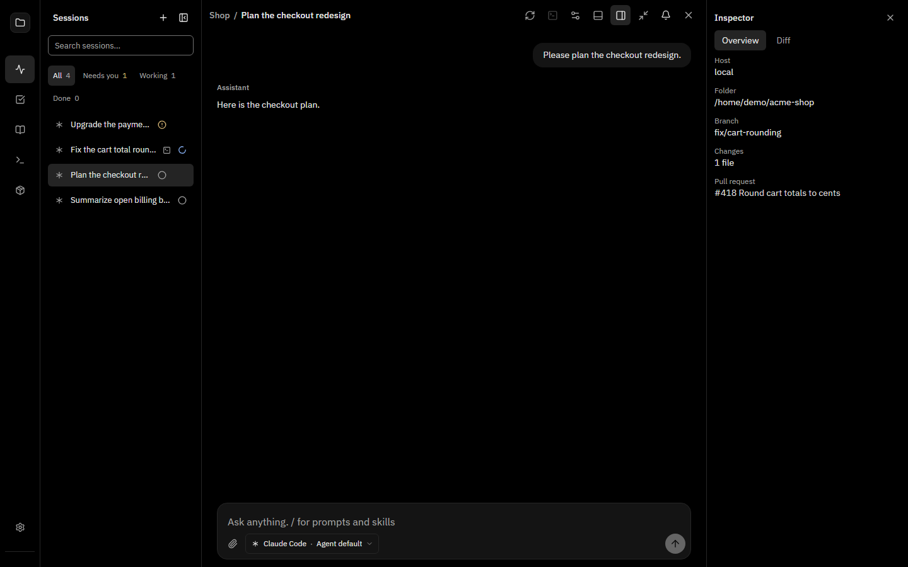

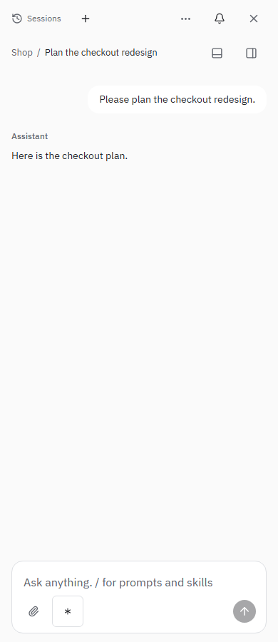
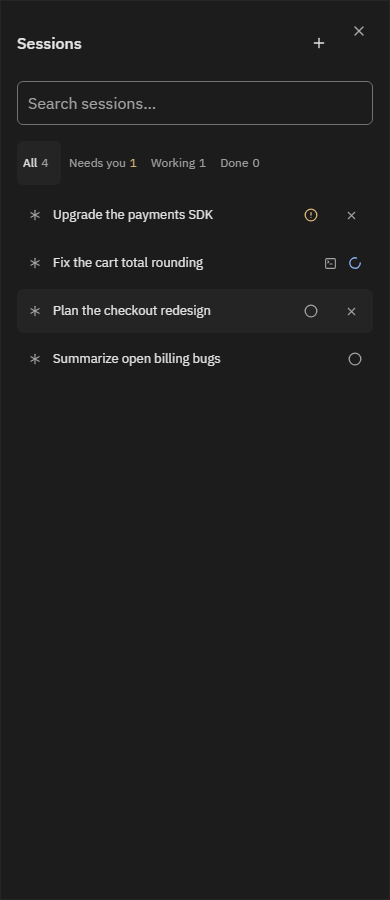

The phone inspector: branch and pull-request summary, the combined Changes tab
(working-tree and PR review) and the file editor.


The session list's **Recents** and **Projects** views, ordered by last activity:

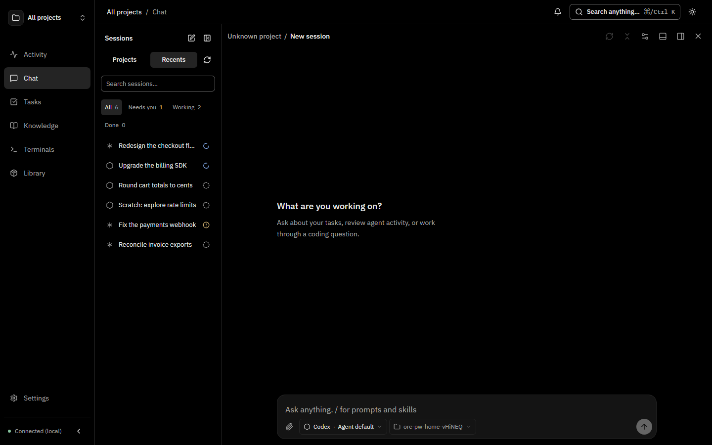

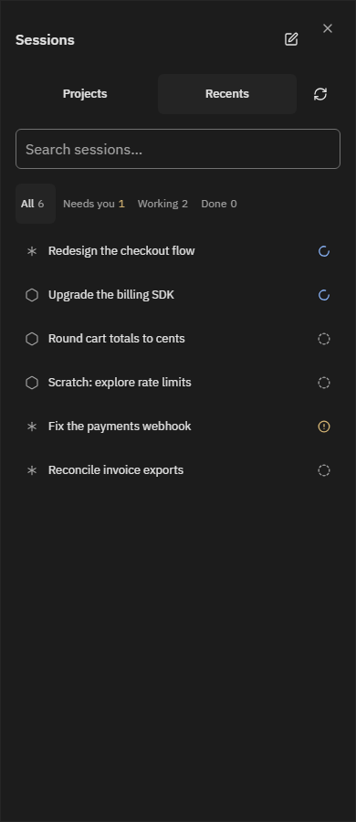
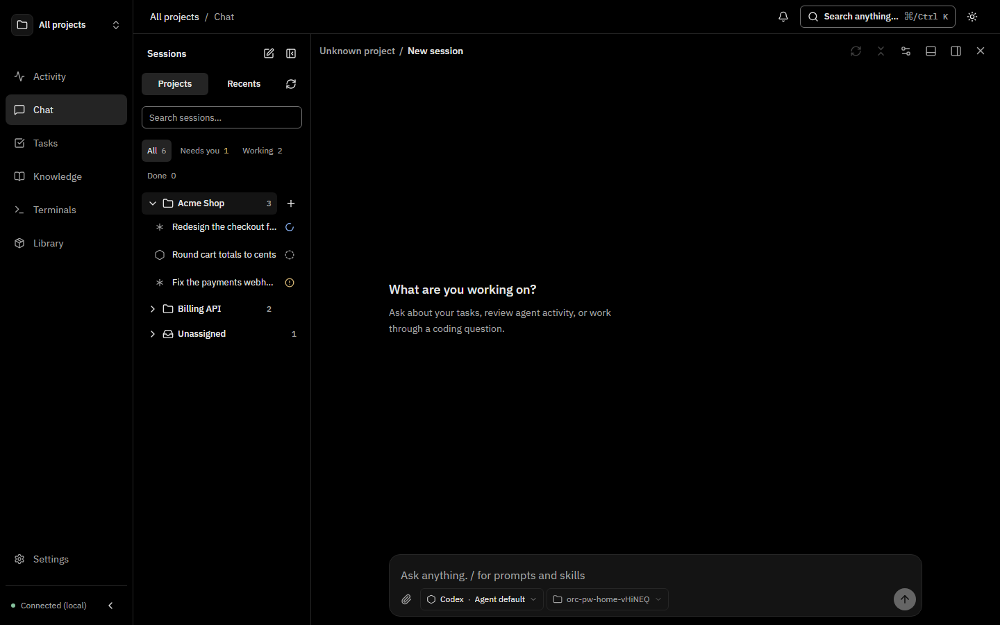
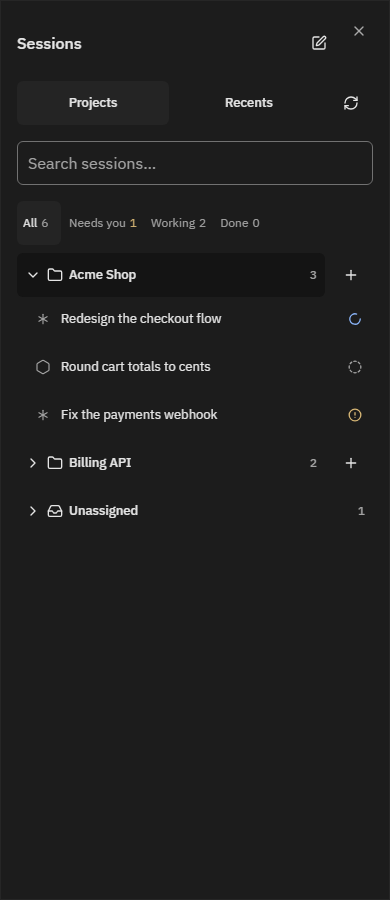

Forking at a response copies the conversation into a new chat. The notice names the
source, whether the fork continued the agent's native session or carried a context
replay, and what that replay included.

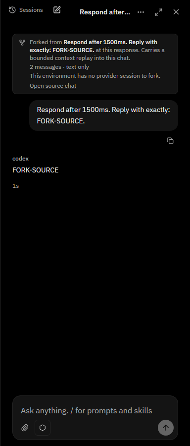
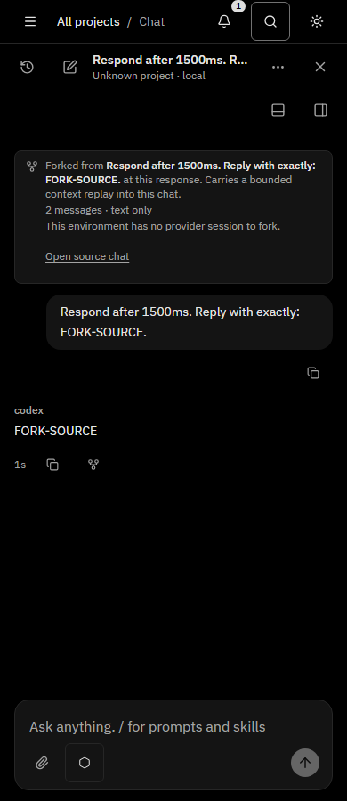

## Activity


The **Activity** page: task metrics plus recent jobs, memories and sessions for the selected project.

## Tasks


The task board. Switch between **Board** (kanban) and **Table** views and filter the list. The GitHub panel lists issues and pull requests from known repositories (yours, assigned to you, or all open) and links them to tasks.

Open a task to see its body, status, comments, linked sessions and Git links, and its flow run:

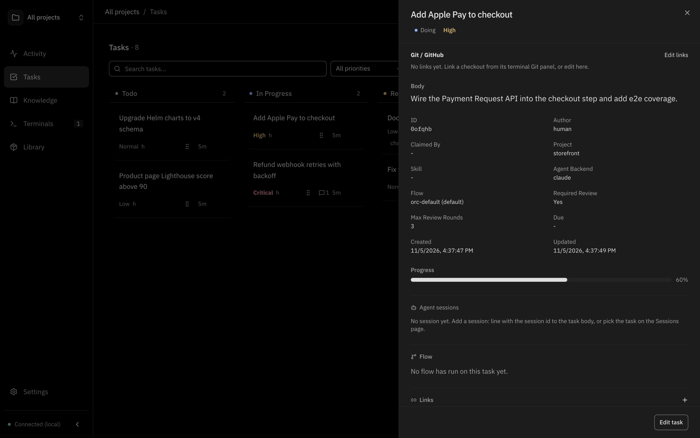

**Edit task → View flow** shows the nodes and edges of the task's [flow](./task-flows.md), including loops back for review:


## Sessions

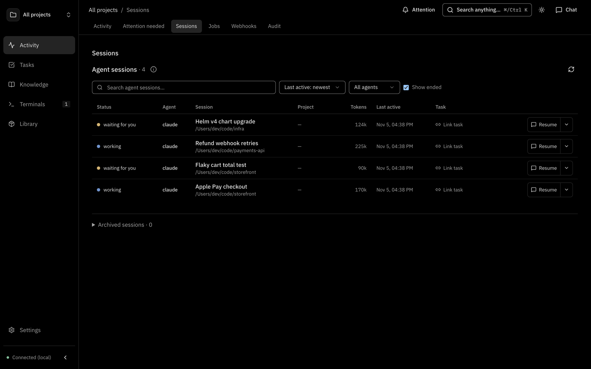

Live and archived sessions from Claude Code, Codex, Cursor, Gemini CLI and OpenCode on this machine or the selected host. Working sessions update live; waiting sessions stay available to resume in a terminal or in chat. Search across archived conversations. See [Live sessions](./live-sessions.md).

Filter the list by state with **All**, **Needs you**, **Working** and **Done**. Each filter shows its count, and failed sessions count as Needs you. A session that finished after you last opened it shows **Done** until you open it. This browser remembers what you have seen. The chat session history has the same filters.

While your pointer is over the list, or a row has keyboard focus, rows stay where they are. States still update in place. When the order would change, an **N updated** button appears. Click it, or move away from the list, to apply the new order.

## Terminals

### Desktop browser, inspector and editor

In the Electron desktop app, **File → Browser and files** (Ctrl/Cmd+Shift+B),
or **Browser and files** in the tray menu, opens the inspector's **Browser** tab
beside your conversation. There is no second panel: the header's panel button
opens the same inspector on desktop and web, and the Browser tab appears only in
the desktop app. Chat links and file attachments open in that tab. Enter an
HTTP/HTTPS address and use Back, Forward and Reload. The external-link icon opens
the page in your system browser; Ctrl/Cmd-clicking a web link does the same. The
panel belongs to the chat page; the side chat stays a plain conversation with no
browser, file or agent-control entry points.

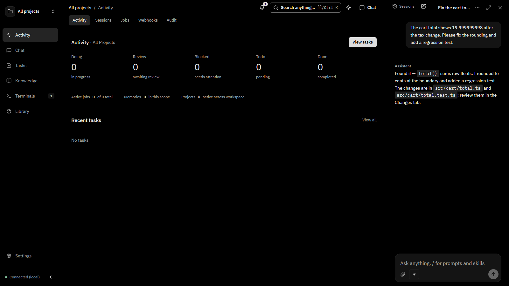

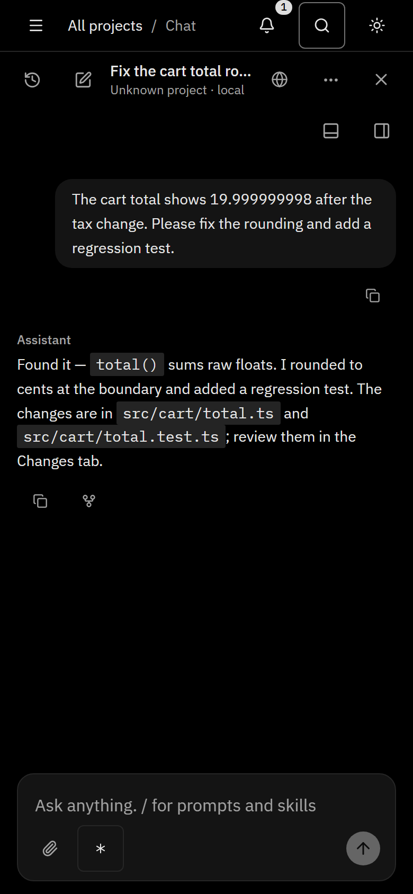

Each conversation keeps its own browser and file tabs within the Browser tab. The
inspector stays docked beside the conversation and opens when you ask for it, follow
a link or an agent preview arrives; drag the divider (or use arrow keys on it) to
resize. The **Files** tab browses the checkout of a running terminal in the
session's folder and opens a file in an editor tab. Closing the panel keeps tabs
and drafts in memory; closing a modified file asks before discarding it. Reloading
or quitting discards these previews after the unsaved-change warning.

The **Changes** tab shows the working-tree changes of the terminal running in the
session's folder, reusing the terminal workspace's Git panel: the changed-file
list, unified or side-by-side diffs, staging and commit, and a GitHub link for the
branch's PR. **Open file** opens a changed file in the inspector's Files tab; the
copy icon copies the changed file's path to the clipboard. The commit draft,
filters and selection are kept per terminal, so closing the panel or switching
chats does not lose them. Wide panels split the file list and the diff; narrow
panels and phones combine them behind the files toggle. When no terminal is
running in the folder, the **Overview** says so quietly and offers **Open
terminal**; a failed terminal list shows an error with **Retry**.
Pull-request review lives in the terminal workspace and in the inspector's
combined **Changes** tab (its PR mode).

The folder icon (**Open file**) uses the native picker for local files. Chat and MCP file paths
resolve inside the selected session's folder on its execution host; paths outside
that folder and symlinks escaping it are denied. Remote file previews require
Python 3 on the SSH host. Files must be UTF-8 text up to 1 MiB. Markdown has Read,
Edit and Split modes; code uses the existing editor. Text up to 200 KB can be
saved explicitly. A save fails if the file changed on disk, keeping your draft
until you reload or resolve the change. HTML stays source code. The external-link
icon opens the source in VS Code, including known SSH hosts; it is disabled when
the desktop cannot identify a remote API host's filesystem.

PNG, JPEG, GIF, WebP, BMP and ICO images can also be previewed, up to 8 MiB and
16 megapixels for native-picker images. Images are read-only; native-picker
images use native decoding and display a static image. Workspace images use the
browser's image decoder. PDF and Office previews are not included.

The browser uses a separate session without ORC's API credentials,
cookies or desktop bridge. Camera, microphone, location and other site permissions
are blocked. Browser downloads are staged privately (16 MB each, four across the
app); **Browser profile, display & recording** lists their status and saves completed files
to the selected chat workspace. Interrupted/failed downloads are never reported
as saved. Each chat starts with a temporary cookie/storage profile.
**Settings → Browser → Saved browser profiles** creates named profiles; select one
under **Browser profile, display & recording** in the Browser tab to remember site logins. Selecting the same profile in another
chat explicitly shares that profile's site storage. Temporary chats stay isolated.
Profile choices and saved cookies survive app restart; session-only cookies follow
the site's expiry rules. Switching profiles closes that chat's browser tabs after
confirmation and preserves file drafts. Use **+** to open a browser tab and each
tab's close button to close it. Popups open another isolated tab. Limits are eight
tabs per chat and 24 total; reaching a limit asks you to close a tab, without eviction.
Tab IDs, URLs and the selected tab restore when you return after app restart.
Temporary mode does not persist cookies; saved tab URLs are still restored.
Browser settings also offers profile rename and removal. Removal asks for native
confirmation, closes its tabs, clears cookies/site data/cache and resets chat selections.

**Import selected browser logins**, under Browser settings, connects to a local
Chrome/Edge debugging endpoint you explicitly enable. Choose the destination ORC
profile, enter the loopback debugging port, approve any source-browser prompt,
then select sites from its open pages. Only those sites' applicable cookies are
copied; their values and the source connection never reach agents or the API.
The connection closes after import or cancellation. Live transfer copies cookies
applicable to the selected site's root and currently open page path; passwords,
localStorage, IndexedDB and device-bound sessions are not transferred. Partitioned
cookies are skipped and counts are reported. Verify the login; some sites require
signing in again. Modern Windows Chrome/Edge app-bound cookie files cannot be
decrypted by ORC. Chrome's newer native consent flow and Mac/Linux interaction have
not been validated here; the verified source was an isolated Windows Edge profile
with a loopback debugging port. Existing personal profiles may not expose one.

**Scan browser profiles** provides direct cookie-store import from Firefox/Zen,
Safari on macOS, and supported Chromium-family stores on macOS/Linux. Legacy
Windows Helium DPAPI stores are supported; app-bound Windows stores require the
live connection. Select a source profile and individual sites. Reads use readonly
SQLite snapshots; keys are obtained only after selection through OS facilities.
macOS may request Keychain/Full Disk Access approval; Linux encrypted stores need
`secret-tool` and an unlocked Secret Service. Missing keys and skipped cookies are
reported, never treated as a guaranteed login. Containers and partitioned cookies
are excluded. Direct Firefox import was exercised with isolated Windows demo data;
other OS integrations still require their native platform acceptance checks.

Expand **Browser display & recording** to change appearance/viewport, record the
guest page, save WebM to the chat workspace, and play/download it. UI recording
lasts up to 60 seconds; agent requests can choose up to 180 seconds. Recordings
are limited to 16 MB and contain only the browser guest, without audio or ORC UI.
If workspace saving fails, the completed file remains downloadable in that window.

Agents can use [preview MCP tools](./mcp.md#desktop-preview-tools) to show a file
or URL in the selected conversation. **Allow agent browser control**, on by
default, is controlled in the chat's **Session settings** before you open a preview.
It permits snapshots, screenshots, clicking, typing, key presses, scrolling,
hovering, selecting, dragging, condition waits, guest JavaScript evaluation,
cross-origin frame targeting, semantic locators, dialogs, recording, appearance,
viewport changes and explicit workspace-file uploads/download retrieval.
This includes
pages you sign into there. Turning the switch off revokes control. These tools
cannot inspect the ORC app or its bridge or edit preview files. Upload paths must
remain inside the chat's trusted workspace. The guest has a minimal standard
`prompt()` adapter because Electron disables that browser function; it exposes no
application API, credentials, filesystem access or general IPC.
Browser content is untrusted page data, never agent instructions.
If a mutating browser command is still pending when control is revoked or its
guest is hidden/switched, ORC closes that guest to prevent delayed execution.
The tab shows an interruption message; **Reload** restores its URL and profile.
File drafts are preserved. An evaluation timeout can require the same recovery.

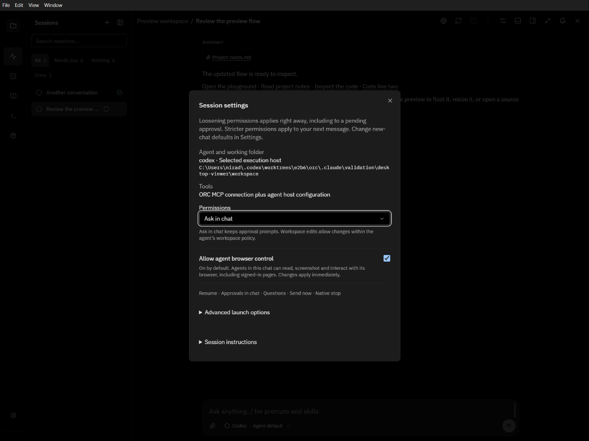

**Settings → Browser** controls agent browser access for the whole desktop and
whether chat web links open in ORC or your system browser. Settings are stored in
`browser-preferences.json` in Electron's user-data folder and survive restarts.
Per-chat permissions use `browser-chat-permissions.json`; named profile metadata
and explicit chat selections use `browser-profiles.json`. These metadata files do
not contain cookies or passwords; Chromium owns the separate profile partitions.
Turning global agent access off overrides every chat's switch immediately. With
global access on, the chat's **Session settings** switch can still disable control
for that conversation. The browser toolbar does not contain a second access switch.
Files and explicit MCP preview requests continue to open in the inspector's
Browser tab.

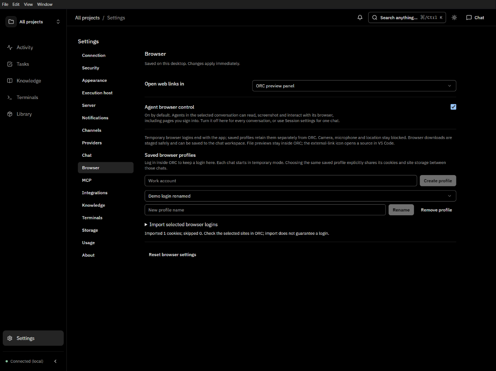

This flow is desktop-only; the web and phone inspector has no Browser tab.

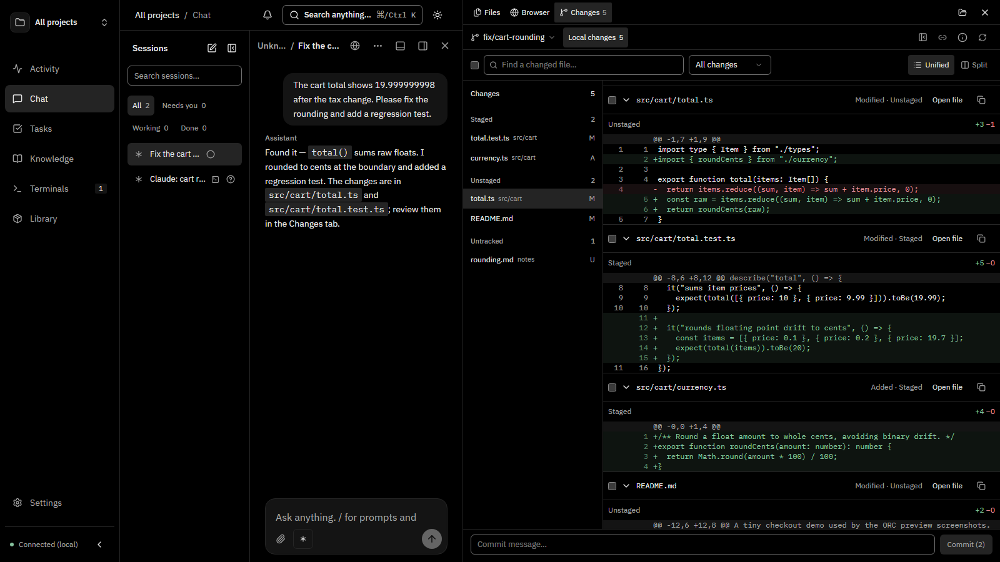

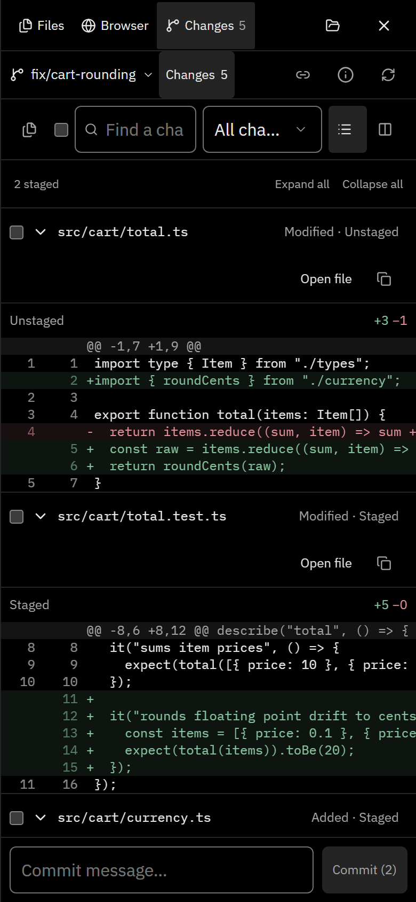

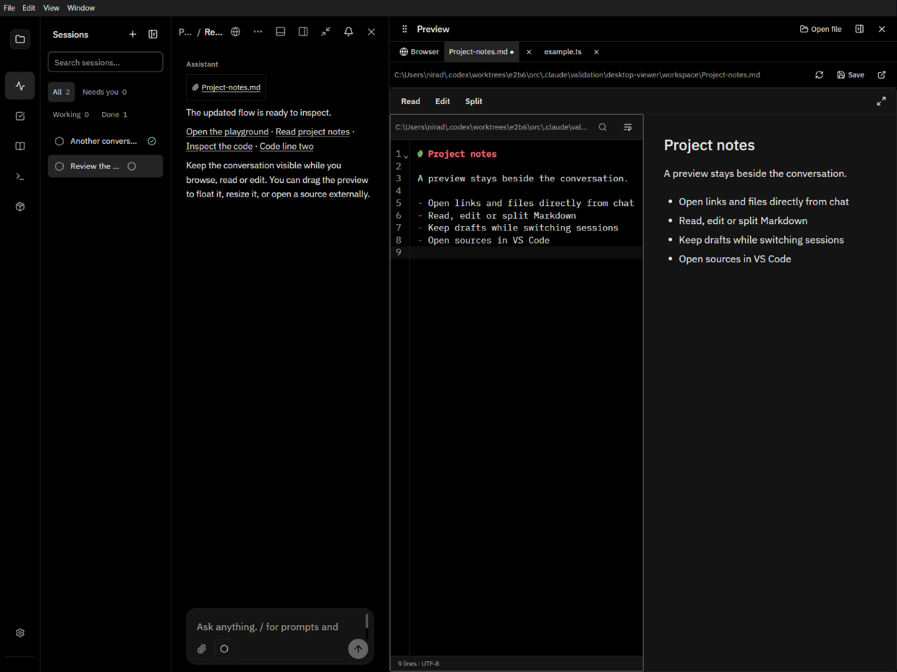

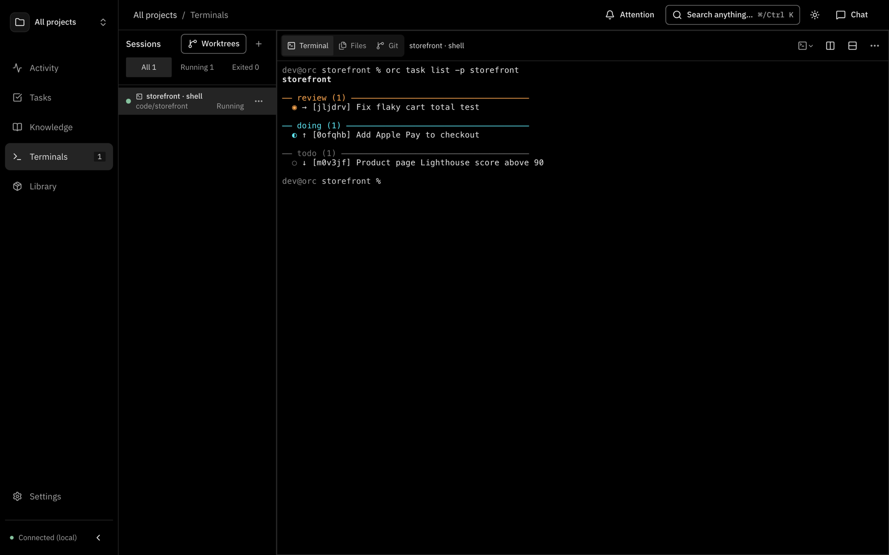

Browser terminals for shells and coding agents, with split panes and Files and Git panels beside them. Terminals run on the selected execution host. See [Terminal workspace](./terminal-workspace.md).

## Projects

Create, edit and archive projects. A project has a name, description, tags and an optional Git remote URL. Deleting a project deletes its memories and scratchpads and keeps its tasks, jobs and sessions without a project.

## Memories

Short project facts (ports, conventions, decisions) that agents load at session start. Create, edit, and view each memory's change history. Under **Knowledge → Memories**.

## Knowledge


Knowledge bases: upload PDFs, Office files, HTML, CSV and Markdown, write Markdown in place, or register a folder to copy in. Search returns cited passages. Each knowledge base can have a digest agent that maintains it on a schedule.

## Jobs


Scheduled and on-demand automation. A job runs a shell command, an agent or creates a task, triggered manually, by cron, by a file watch, once, or by a webhook. Each job keeps its run history with logs and linked agent sessions.

The job editor uses **Trigger**, **Destination** and **Settings** tabs. Choose Manual,
Webhook or Schedule; schedules offer time/day controls and **Advanced cron**, with an
explicit timezone. Existing watch, one-shot and bridge-message jobs keep their trigger.
New jobs stay disabled until you enable them; a disabled job can still run manually.

Destination selects the project, working directory and execution host (local or a
configured SSH host). Commands offer sh, bash, zsh, fish, PowerShell and cmd presets,
plus a custom executable and one argument per line. The script is appended as the
final argument, so a custom interpreter needs its command option, such as `-c`.
The interpreter must be installed on the destination. Host default uses sh on Unix
and Windows PowerShell on Windows; jobs saved before this setting retain sh.

Agent jobs save a prompt, backend, optional model, explicit automatic tool approval
and supported launch options. Agent and model use the same picker as Chat: enabled
agents, models reported by the provider on the job's selected host/directory,
Agent default and an explicit Custom model option. A saved model remains selectable
if discovery is temporarily unavailable. Changing agents clears the previous model
and launch options. New agent jobs default to an isolated, detached Git
worktree for each run. `HEAD` inherits the project checkout's current commit; override
it with a branch or remote-tracking ref. ORC does not fetch, reset or push the base.
**Clean up worktree after a successful run** is off by default. When enabled, cleanup
removes only a successful, clean worktree with no commits absent from its starting
base; failed runs, untracked/ignored files and new commits are retained. Run history
records the path and cleanup result. HTTP-only agent backends cannot use these local
host, worktree or environment settings.

Environment variables live under Settings. Mark a value **Secret** to mask its input,
encrypt it at rest and omit its value from read responses. After saving, leave a saved
secret blank to keep it; enter a replacement to rotate it. Exact secret values are
redacted from job output and saved agent summaries, including across output chunks.
This does not scrub transformed values or files and logs written by the script itself.
Values are single-line; `ORC_` names are reserved. Back up `~/.orc/secret.key` with the
database: saved secrets cannot be decrypted without that machine key.

To see a result, open the job and select **View result** under **Recent runs**.
This shows the saved output and errors. **Session summary** opens the audit record.
For an agent run with a native session ID, **Open agent session** opens the actual
conversation in Sessions, where the existing transcript/resume controls apply.
ORC discovers that conversation on the run's own host without changing the globally
selected host. If the provider has not retained a conversation yet, the saved result
remains available and the interface explains that the native conversation is missing.

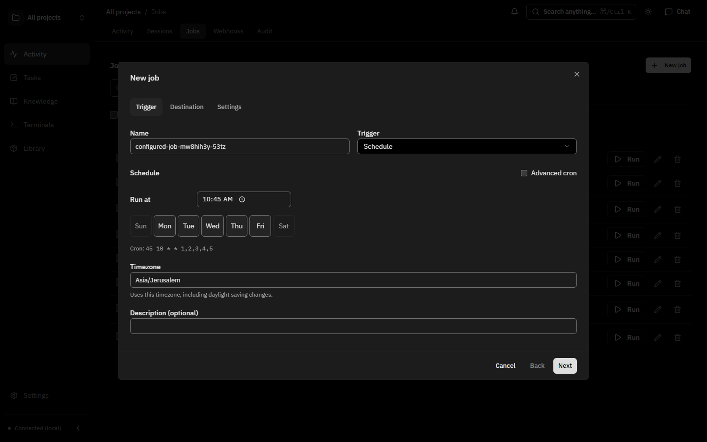

## Webhooks

Inbound event sources. Configure a webhook once, then connect it to one or more jobs, each with its own event filters and action.

## Notifications

When a session you are not viewing needs your approval, has a question or fails,
ORC shows a **Needs you** notification and plays a short chime. Notifications
settle for about one second before appearing and repeated snapshots do not repeat
the alert. The header bell opens a menu containing generic notifications, including
human requests, agent outcomes and job results. Open a request to answer or review
its action. Read and dismissed state is shared across clients.

Desktop browsers show toasts. Needs-you toasts stay until dismissed or resolved;
**Done** toasts are silent and close after six seconds, pausing on hover or focus.
Sessions finishing together collapse into one notification. Use **Alt+N** or
**Open notifications** in the command palette to reach notifications. On a phone,
pull down from the very top of the screen with two fingers to open the
notification center from the chat, like the system shade.

On all screens, the bell in the workspace header shows an unread count, including
while the chat is open. New notifications never open the panel automatically. Tap the bell to read or
dismiss them. History remains until dismissed or expired (30 days by default).
Configure notification and audit retention in Settings → Storage.
See [Notifications](./notifications.md) and [Human requests](./human-requests.md).

**Settings → Notifications → Sound** controls the browser chime, volume and
per-project sound mute. Preferences are saved in this browser. Audio starts after
your first interaction. Browser/PWA push remains separately opt-in and requires
HTTPS (and Home Screen installation on iOS); it delivers background approvals,
questions, chat replies and job results while ORC is unfocused. Job pushes follow
the job's notify setting and start with new runs. See [Installation](./install.md).

The Electron desktop app also sends native notifications while its window is
unfocused, minimized or hidden. Clicking one brings ORC forward, opens its
destination and marks that notification read, clearing it from the inbox.
A grouped done toast opens its destination only; clear the collapsed items from
the notification menu. Done notifications are silent; native Needs-you sound follows the OS.

## Browser app and updates

The dashboard installs as a browser app and serves an offline shell when the network
is unreachable. An open tab or installed app runs the build it was loaded with, and
the server replaces that build when it is updated. Reaching a page whose code is gone
then reloads the app once, without asking, so unsaved input in the current page is
lost; the reload loads the current build. If it does not fix the problem, ORC shows
the failing error with **Reload** and **Copy details** instead of a generic error
page, so a report carries the real message and stack.

## Audit

Lifecycle and knowledge events with filters and expandable details. Recorded
session summaries remain in collapsed history. Audit retention defaults to 90
days and is configurable in Settings → Storage. Use Sessions to read full
conversations or resume an agent.

## Skills

Reusable agent instructions stored as skill folders. Import skills from a repository or from local agent folders, create your own, edit files, view history, and assign skills to projects. See [Skills](./skills.md).

## Packages

Packages bundle instructions, skills and tools for reuse. Launch a package in chat or a terminal on the host and folder you choose. See [Agent packages](./agent-packages.md).

## Agents

Shared specialist agent definitions: instructions, model and tools, reusable across coding agents and packable into packages. Under **Library → Agents**.

## Rules

Applied rules and their outcomes per workspace, plus rule settings for enforcement and agent assignment. See [Agent rules](./agent-rules.md).

## Scratchpads

Working documents, diagrams and HTML pages that you or an agent create and come back to. Agents use the `pad_*` MCP tools. Share one by copying its link.

HTML pads receive the **ORC HTML kit** in both the editor preview and chat artifacts:
dashboard theme tokens, base styles, cards, tables, stats, badges, tabs and chart
wrappers. Use `orc-*` classes to build a native-looking page without a custom
`<style>` block. The kit is inlined at render time, needs no network request, and
does not change the saved HTML. Custom CSS and JavaScript still work.

Pin the kit stylesheet in your HTML head to keep its version as the kit evolves:

```html
<meta name="orc-kit" content="1">
```

Bundled older versions remain available. A missing or unknown version uses the
current kit. Both previews follow the dashboard's light/dark theme; changing the
theme rebuilds the iframe document, resetting its running scripts and local UI
state. The saved pad content stays the same.

Kit tabs support clicking, Left/Right arrows with wrapping, and Home/End. Only
the selected panel is shown. The kit does not grant ORC API access: editor pads
still require **Render with ORC access**, and chat artifacts retain their opaque
sandbox and network-blocking policy. Prefer inline SVG for charts that must work
in both views; a CDN chart library is blocked in chat.

For concise component markup, use built-in custom elements such as
`<orc-card>`, `<orc-stat label="Open tasks" value="12">`,
`<orc-badge tone="success">`, `<orc-table>` and `<orc-chart>`.
`<orc-tabs>` generates accessible tab controls from labeled `<orc-tab>` panels.
These components reuse the kit with no additional dependencies or network
requests; ordinary HTML with `orc-*` classes remains supported.

Agents can load the component list, copy-paste skeleton and chart guidance with
`skill_read` for `orc-platform`, ref `references/html-kit.md`. See [Skills](./skills.md).

## Settings


| Section        | Controls                                                                                                                                                                                                                                                                                                                                                                                                                                                                                                                                                                                                          |
| -------------- | ----------------------------------------------------------------------------------------------------------------------------------------------------------------------------------------------------------------------------------------------------------------------------------------------------------------------------------------------------------------------------------------------------------------------------------------------------------------------------------------------------------------------------------------------------------------------------------------------------------------- |
| Connection     | In a browser, the API URL for this browser. In the desktop app, the local or remote server, optional access token and proxy headers.                                                                                                                                                                                                                                                                                                                                                                                                                                                                              |
| Security       | Sign-in status and sign-out, default sign-in lifetime, allowed web origins, access tokens (minted by entering the secret)                                                                                                                                                                                                                                                                                                                                                                                                                                                                                         |
| Appearance     | Theme (dark or light, saved on the server) and interface font size — default, large or extra large — saved in this browser                                                                                                                                                                                                                                                                                                                                                                                                                                                                                        |
| Execution host | Run agents, terminals and git locally or on an SSH host from `~/.ssh/config`                                                                                                                                                                                                                                                                                                                                                                                                                                                                                                                                      |
| Server         | **Restart ORC server** (closes terminals, keeps settings, reconnects)                                                                                                                                                                                                                                                                                                                                                                                                                                                                                                                                             |
| Notifications  | In-app updates, browser chime/volume/project mute, and opt-in browser/PWA push for background approvals, questions, chat replies and job results. Push needs HTTPS.                                                                                                                                                                                                                                                                                                                                                                                                                                               |
| Agents         | Which coding agents appear in the chat agent picker, channel agent choices and the terminal launcher. Claude Code, Codex and Pi are native; OpenCode runs over direct ACP; Cursor, Gemini CLI, GitHub Copilot, Qwen Code, Factory Droid, Kimi CLI, Kiro CLI and any custom agent id run through ACPX. First startup selects installed agents from Codex, Claude, Cursor, Gemini CLI and OpenCode and saves that selection. Copilot can be enabled in Settings. Later selections are preserved even if an installation is missing. The terminal launcher only lists enabled agents installed on the selected host. |
| Channels       | Telegram and Slack connections                                                                                                                                                                                                                                                                                                                                                                                                                                                                                                                                                                                    |
| Chat           | Default models, instructions, tools and permission mode for chat                                                                                                                                                                                                                                                                                                                                                                                                                                                                                                                                                  |
| MCP            | Build the MCP config snippet for your agent. See [Connect agents](./connect-agents.md).                                                                                                                                                                                                                                                                                                                                                                                                                                                                                                                           |
| Integrations   | APIs and MCP servers in the `spec` CLI registry                                                                                                                                                                                                                                                                                                                                                                                                                                                                                                                                                                   |
| Knowledge      | Parser, embeddings and knowledge defaults                                                                                                                                                                                                                                                                                                                                                                                                                                                                                                                                                                         |
| Terminals      | Terminal font for new terminals                                                                                                                                                                                                                                                                                                                                                                                                                                                                                                                                                                                   |
| Storage        | Where settings are stored                                                                                                                                                                                                                                                                                                                                                                                                                                                                                                                                                                                         |
| About          | Server, desktop and Electron versions, platform, runtime, data folder, uptime, project links, and desktop update channel                                                                                                                                                                                                                                                                                                                                                                                                                                                                                          |

The desktop app stores its selected server, token and headers in `connection.json` in the app's data folder. This is a client-side target, separate from the server's `~/.orc/config.json`; switching servers does not repoint the CLI or stdio MCP. The integrated preview browser, local file picker, update controls and native notifications are available only in the local dashboard, so a remote window does not show them.

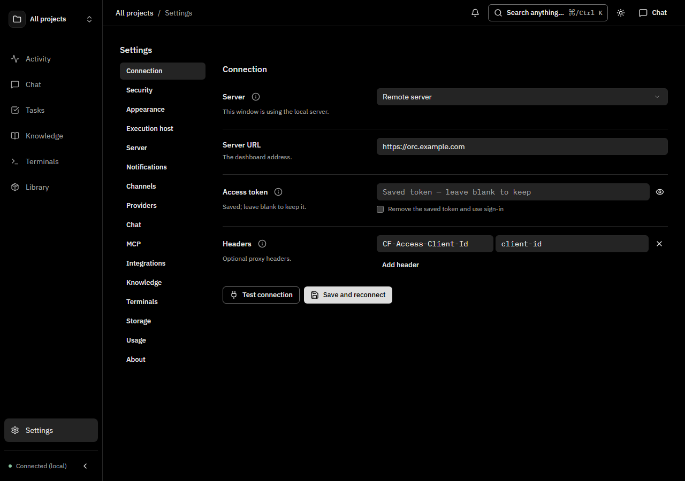

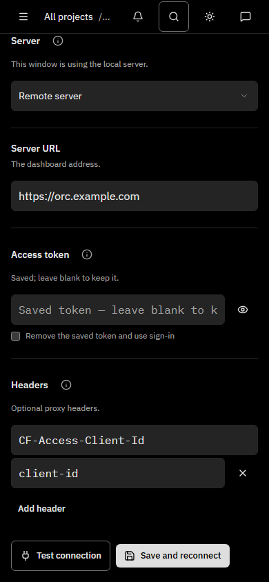

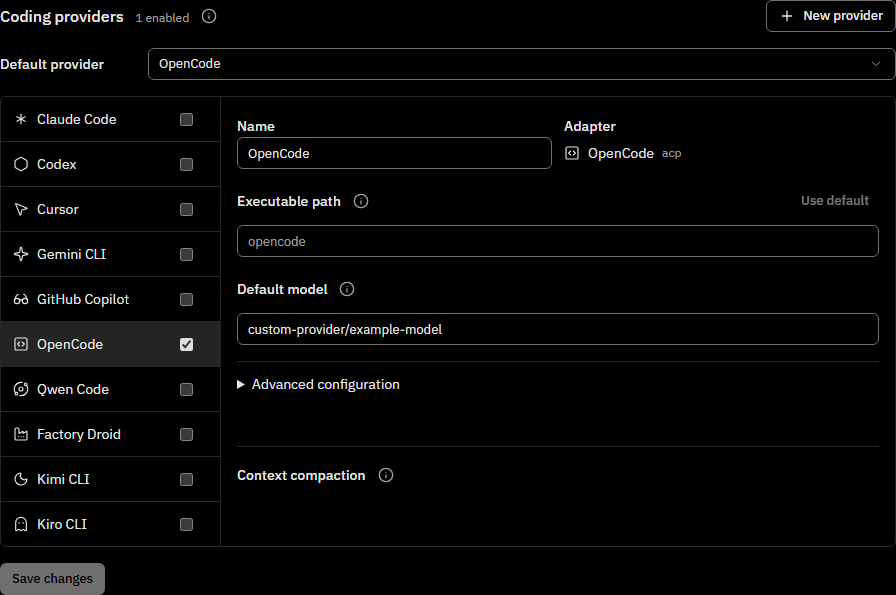

Enabled agents, including custom ACPX ids, appear in the chat agent picker:

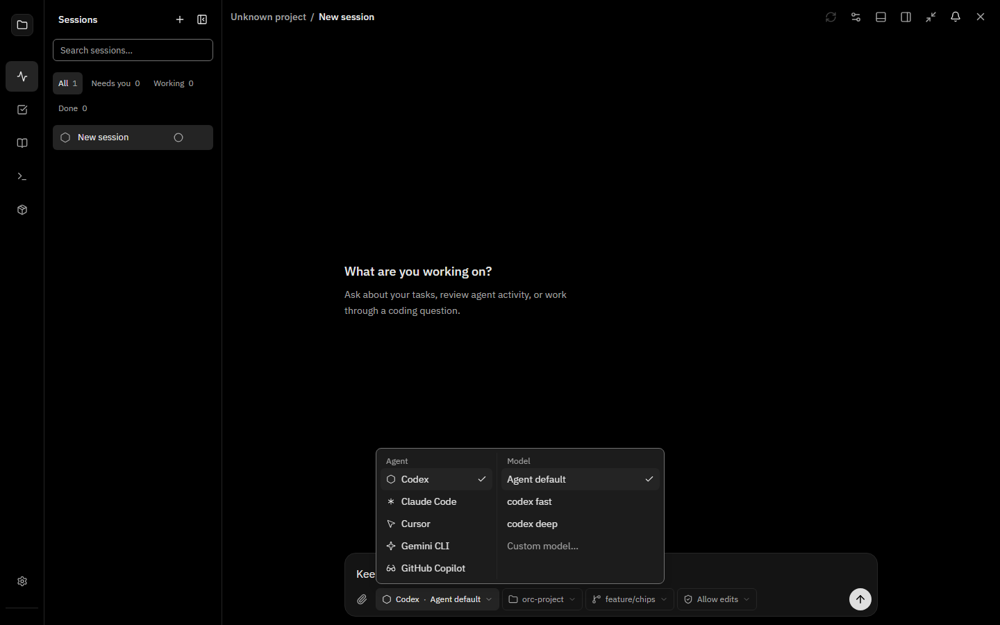

## Chat turn progress

Finished turns fold tool calls and intermediate narration into one expandable line;
your message and the final reply remain visible. Expand it to inspect file diffs,
commands and output, reads, and searches. Failed tools stay marked.

During a response, a quiet status line shows elapsed time and the current tool.
Scrolling up pauses automatic following; **Jump to latest** returns to the bottom.
Stop remains beside Send. Working indicators are static.

Each turn keeps its duration and completed, stopped, or failed outcome across reloads.
Duration uses the agent's reported value when available, otherwise server elapsed
time, including waits for input. Older turns without timing show counts only.
Stopped turns retain partial work; unfinished tool calls read **Incomplete**.
Individual tool durations are not shown.

A turn that goes quiet does not run forever: after 15 minutes without any agent
activity ORC stops it, and the conversation and a notification say it was stopped
for inactivity. A turn waiting for your answer or approval, or with a command
still running, is not idle and is not stopped; a 4-hour absolute limit still
applies so a stuck agent cannot hold a chat worker indefinitely.

## Composer controls

The composer groups folder, branch, agent/model and permissions into compact
controls. Phones and narrow desktop panels use icons; wide composers show labels.
Send queues the next message while a reply is running. If this session is already
responding, or every chat worker is busy, that message stays queued and sends when
the turn ends, without an error. Open the pending list to edit a message, move it
up or down, remove it, or send it ahead of the current reply.
An expanded pending list stays open across busy-worker retries. After it drains,
the next list starts collapsed.
If a first send loses its connection, chat looks for the original message and
reconnects to its thread. Recovery stops after 15 seconds, or 60 seconds when the
server may still be preparing the turn. If recovery cannot find it, the message
returns to a paused queue with its attachments. Retrying keeps the message's ID
so the server can recover the original turn without starting another one.
Every icon has an accessible name and opens its picker with the full details;
phone touch targets are at least 44px. Send stays visible at the right.

The folder picker shows the full path, copy action, recent folders, host choices
when configured, and browsing. Branch/worktree controls appear for Git folders.
**Run in** keeps the current checkout, creates a worktree from the current branch,
creates one from the repository default branch (for example `origin/main`), or
creates one from any local or remote branch you pick. The branch chip shows the
chosen base. Bases come from refs already in the checkout; ORC does not fetch
before creating the worktree. After launch the folder and branch chips stay in
the composer as session information: the folder opens its full path with a copy
action, and the branch shows the checkout's working branch. The execution folder
itself is fixed for the session.

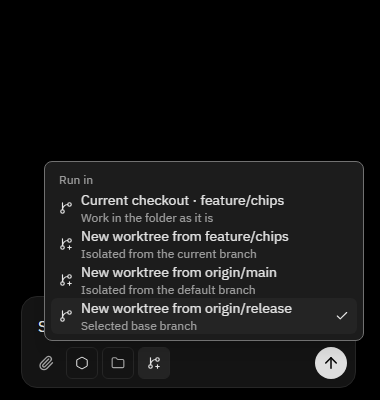
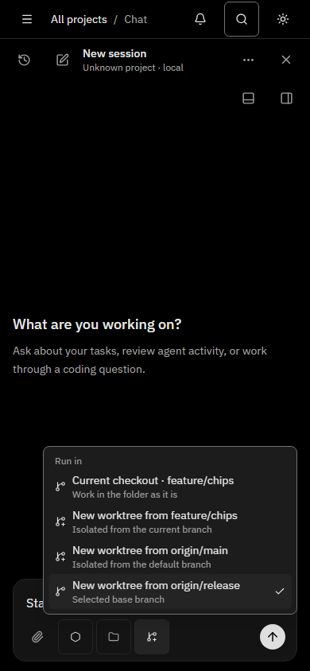


Changing agent after launch starts a separate session. The model picker disables
changes during a response or when the backend selects its own model. Effort stays
in agent options. The permissions chip shows the open session's mode — including
**Ask in chat** — when the backend supports changing it live.

**Session settings** in the chat header organizes the conversation into tabs.
**Overview** shows the agent, model, execution host and folder, backend, last
activity, tools connection and capabilities, plus the identifiers: the ORC chat
ID, the agent's native session ID used for resume, and the discovered session ID
this chat continues when it was resumed. Each identifier can be copied.
**Customize** holds permissions, agent launch options, session instructions and
agent browser control. **Analytics** counts messages, turns, tool calls and
failures from the transcript, shows start, last-activity and turn timings, and
reports context and cache usage when the session records it. Explanations sit
behind the info icon beside each label; new-chat defaults remain in Settings →
Chat.


Pasting at least 16 KiB or 200 lines attaches the text as `pasted-text-N.txt`.
Use **Ctrl/Cmd+Shift+V** to paste inline instead. Typing `@` does not attach files.

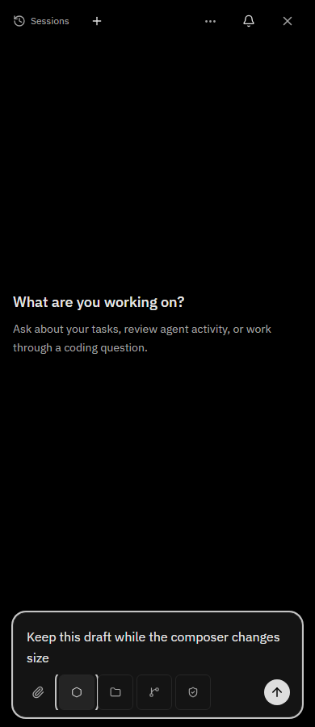

## Desktop app only

The desktop app is an Electron shell around the same dashboard. On top of the browser experience it:

| Capability                                 | Detail                                                                                                                                                     |
| ------------------------------------------ | ---------------------------------------------------------------------------------------------------------------------------------------------------------- |
| Runs the daemon for you                    | Reuses a verified local daemon, including one on another port, or starts the bundled `orc` daemon                                                          |
| Configures auth                            | Generates an API secret for a daemon it starts when none is set, and sends the configured secret automatically. No sign-in screen.                         |
| Installs the CLI                           | `~/.orc/bin/orc`, added to your shell `PATH`                                                                                                               |
| Tray icon                                  | **Open orc**, **Start at login** toggle, **Quit orc**                                                                                                      |
| Start at login                             | On by default, starts hidden in the tray                                                                                                                   |
| Keeps running when closed                  | Closing the window hides it; the tray icon and the daemon keep running. **Quit orc** in the tray (or **Cmd+Q** on macOS) quits.                            |
| Recovers from startup failures and crashes | Waits briefly for a starting daemon, then offers **Retry** or **Quit** if it cannot connect                                                                |
| Remembers the window                       | Size, position and maximized state                                                                                                                         |
| Updates                                    | Installed macOS, Windows and Linux apps check GitHub Releases at startup and every four hours, download in the background, and offer **Restart to update** |

Quitting the app (**Quit orc**) stops the daemon only if the app started it.

If another application occupies the configured port, desktop automatically starts
ORC on an available port bound to `127.0.0.1`. It saves the successful endpoint in
`~/.orc/config.json`, so the CLI and stdio MCP use the same port by default.
Explicit CLI flags, environment variables and project configuration keep their
normal precedence; update pinned ports or URLs in external integrations yourself.

Desktop checks the daemon's runtime identity, compatible version (same major and
minor), database, configuration and authentication before attaching. It never
starts another daemon while the daemon PID is alive, even if that daemon is
unhealthy or uses different data. Authentication and configuration errors offer
**Retry** or **Quit**, with the reason shown. It does not stop an existing daemon
or the application occupying the preferred port.

**Upgrading an already-running older daemon:** releases without `daemon.json`
cannot provide this identity check. Stop that daemon once and start it with the
updated ORC, then choose **Retry** in desktop. Desktop does not attach to an
unverified daemon or send it the configured secret.

Command-line flags for the app executable:

| Flag       | Effect                                              |
| ---------- | --------------------------------------------------- |
| `--hidden` | Start without opening a window                      |
| `--quit`   | Quit the running instance and the daemon it started |

Links to other sites open in the desktop inspector's Browser tab. Use its
external-link icon or Ctrl/Cmd-click a web link to open your system browser.

Install a desktop build containing this updater manually once. Older builds do not have an updater and cannot automatically install the feature itself; subsequent macOS, Windows and Linux updates can use the flow below.

An installed macOS, Windows or Linux app checks [GitHub Releases](https://github.com/niradler/orc/releases) for updates when it starts and every four hours. The download runs in the background. **Settings → About** shows the current version, the update channel, **Check now**, and the last result. **Restart to update** installs the download; quitting alone does not apply it. The app stops the daemon it started, then the new version starts that daemon again. Tasks and sessions stay in `~/.orc`. A daemon the app did not start is left running.

**Stable** uses the latest GitHub release. **Preview** also accepts a newer prerelease. Uncheck **Check for updates** to stop automatic checks; **Check now** still works. These choices are stored in the desktop app's own settings, not in `~/.orc/config.json`. Source runs and `electron .` do not download updates.

Wait for an active check or download to finish before changing channels. Changing channels discards the previous channel's ready update. Failed settings saves retain the prior preferences and show an error; failed update actions can be retried.

Windows installs the NSIS package. Linux replaces the AppImage. macOS verifies the
release disk image and its app bundle, then replaces the app through a separate
installer helper and keeps the previous app for recovery. The Mac installation
folder must be writable; updates work without a paid Apple developer account.
macOS first-open approval for an unnotarized app can still apply. Manual upgrade
steps remain in [Upgrading](./install.md#upgrading).
