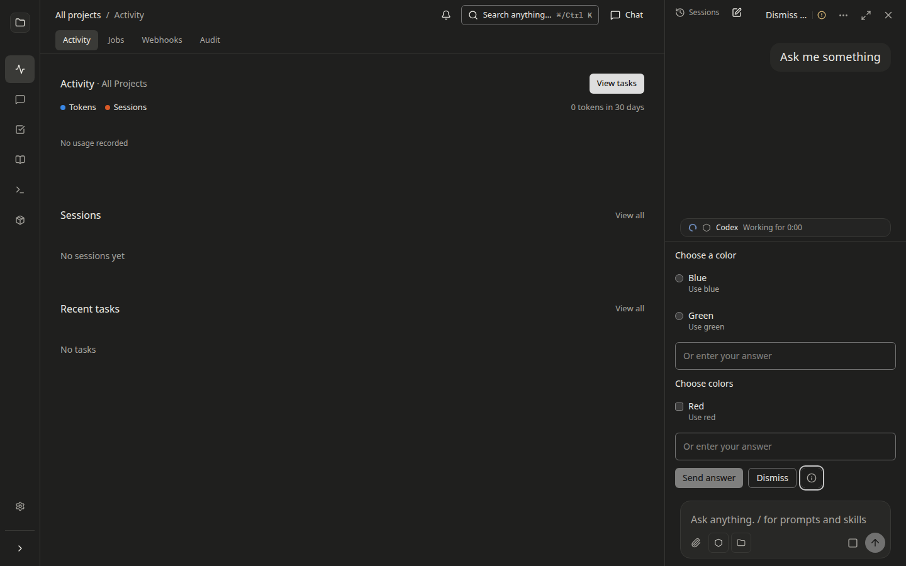

# Agent questions and approvals

The notification menu shows each request's creation date and, when answered, its answer
date in your browser's local time. “Agent unavailable” means the originating
runtime can no longer receive the response; the question heading is the agent's
original prompt, not its status.

Requests automatically expire after 72 hours from creation.
Change this server-wide limit in **Settings → Notifications → Questions and
approvals** (1–8760 hours). A shorter request-specific timeout still applies.
History and saved responses are retained. Supported native hooks also clear
obsolete requests on a matching tool result, session stop/end or new user turn.
Without those hooks ORC cannot infer continuation in an external agent; retention
still applies. Dismissal never grants approval or claims an answer was delivered.
Notification history expires separately after 30 days by default, even for
unresolved requests; audit events default to 90 days. Both periods are configurable
in Settings → Notifications → Automatic cleanup. See [Notifications](./notifications.md).

When an interactive managed agent exposes a structured question or approval, ORC automatically
creates a durable request in the header's **Notifications** menu. Rules can also create
requests. Answer the question or review
the exact tool input, folder and host before approving or denying. The response
goes back to that agent's original pending call. ORC does not execute the command
or add privileges. Privileged execution and Windows UAC are deferred.

Private questions and prompts that cannot be represented in the inbox show a
generic notice linking to the original chat. Their contents remain in that chat.

In chat, the question card lists the agent's suggestions plus a field for your
own answer; **Send answer** needs an answer for every question. The answer stays
in the conversation as your message, in place between the agent's work before
and after the question; a secret answer is recorded as hidden, never as its
value. **Dismiss** skips the question without inventing an answer and lets the
agent continue, keeping the conversation open;
[Connect agents](./connect-agents.md#capabilities-and-direct-acp)
lists what each agent receives. Answering from the inbox instead delivers the
response to the agent but does not add a message to the chat transcript; the
inbox keeps its own record of the answer. Cancelling a pending request from
the inbox instead withdraws it, and a managed agent waiting on that request stops.


[Phone layout](/screens/chat-question-card-phone.png)

The inbox and its header indicator use ORC's shared SSE resource feed. A periodic
snapshot also recovers missed events and time-based expiration. Closing or
reloading the browser does not discard the request or answer.
Notices identify their execution host. Duplicate suppression uses agent, host and
native session identity, so a prompt on one host cannot hide another host's question.
To view a completed chat after reloading, open **Resume a conversation** in the
chat panel and select its saved conversation.

## Configure Rules

Native questions and approvals do not require Rules. To customize when Rules ask
for review, enable Rules (`rules.enabled: true` in the existing ORC JSON
configuration) and add these catalog templates to the workspace policy:

- **ORC · Agent questions**: managed Claude/Codex structured questions and supported
  non-secret MCP forms.
- **ORC · Agent tool approvals**: managed Claude/Codex native permission requests,
  including command, file and additional-permission requests.

Noninteractive job runners retain their immediate-denial policy. A rejected
prompt does not become an artificial human wait; explicit rule reviews still apply.

Select the Claude SDK backend (`claude`) or native Codex backend (`codex-cli`).
Use the agent's default permission mode when you want native approval prompts.
An agent configured to approve tools automatically may have no permission pause
to report. For Claude, a separate PreToolUse Ask user rule can require review even
when the agent otherwise auto-approves tools. Existing deny rules take precedence.

Rules can filter these events using the same filters as other actions. The
native question's actual text and choices appear in the inbox; its configured
rule prompt is used for ordinary approvals. Multi-select questions preserve
their selected values; a typed answer is also supported.

Question and approval rules are distinct. A question response does not approve a
tool. Ordinary approval only answers the native permission prompt; the agent's
own sandbox, deny rules and operating-system permissions still apply.

## Independently started agents

Explicit requests work through ORC's HTTP MCP endpoint or the existing CLI on any
machine that can securely reach ORC. No helper service is installed. This is also
the supported independent remote-agent path on a Windows central server. Native
SSH launches retain the existing Linux/macOS central-server requirement.

MCP workflow:

1. Call `human_request` with a stable origin session/backend/request identity,
   request kind, prompt and optional choices. Approval requests must also include
   the exact action, folder and host. Retain the returned request ID.
2. Call `human_request_get` with `id` and `wait_seconds: 30`. Repeat while pending.
   Only use the answer belonging to this workflow. Do not proceed on cancellation,
   expiration or unavailability; denial never authorizes execution.
3. After consuming the answer, call `human_request_acknowledge` with its returned
   ID and answered version. Acknowledgement records delivery, not command success.

The MCP tools accept readable project names and honor selected MCP project
bindings. A stdio caller's native session identity, when available, must match the
request origin.

CLI equivalents:

```sh
orc attention request request.json --wait
orc attention list
orc attention get REQUEST_ID
orc attention respond REQUEST_ID response.json --version 1
orc attention snooze REQUEST_ID --for 1h
orc attention unsnooze REQUEST_ID
orc attention acknowledge REQUEST_ID --version 2
orc attention cancel REQUEST_ID --version 1
```

## Snoozing pending requests

Snooze hides a `pending` question, approval or command from **Needs you** and
the header bell unread count until a chosen time (`15m`, `1h`, `3h`,
`Tomorrow 9:00` or a custom timestamp) without answering, denying or cancelling
it. The request stays `pending` and answerable, its `expires_at` deadline is
unchanged, and the waiting session still shows **Waiting for you · snoozed until …**
with **Wake now**.

- Snoozed items move into a separate **Snoozed** group in the notification
  center, where you can answer them early or click **Wake now**.
- Push notifications and channel reminders are suppressed while snoozed. When
  the snooze ends, the request returns to **Needs you** with one notification
  (a periodic sweep also recovers due snoozes after a restart).
- Answering, cancelling, making unavailable or expiring a request clears its
  snooze automatically. Only `pending` requests can be snoozed.
- REST API: `POST /api/human-requests/{id}/snooze` with `{ version, until | after_seconds }`
  and `DELETE /api/human-requests/{id}/snooze` (optional `?version=<n>`).
- MCP tools: `human_request_snooze` and `human_request_unsnooze`.
- CLI: `orc attention snooze <id> --for 1h` (or `--until <iso>`) and
  `orc attention unsnooze <id>`.

Use `-` instead of a file for JSON on stdin. Example question:

```json
{
  "origin": {"session_id": "my-session", "backend": "my-agent", "request_id": "color"},
  "kind": "question",
  "prompt": "Which color?",
  "choices": ["Blue", "Green"]
}
```

A response file contains `{"kind":"question","answer":"Blue"}` or
`{"kind":"approval","approved":false}`. Reusing an origin with changed content
is rejected. Concurrent, duplicate and stale-version responses are rejected.

### Claude native command hooks

The catalog also includes external Claude question/approval templates. Hook
timeouts must exceed the human request lifetime. For the 30-minute templates:

```sh
orc rules install-hook claude --target .claude/settings.local.json --events PreToolUse,PermissionRequest,PostToolUse,PostToolUseFailure,Stop --timeout-seconds 1815
```

This explicitly updates ORC handlers in that settings file and preserves unrelated
handlers. Install on a machine where the existing ORC CLI and policy database are
already available. Configure its authenticated API connection through existing
secure configuration/environment references.

PreToolUse approvals are qualified against a real independent Claude process.
Approved execution is acknowledged by its post-tool hook; a denied tool has no
post-tool hook, so its natural Stop acknowledges the denial. Keep those lifecycle
handlers installed. PermissionRequest uses its distinct native JSON decision
envelope and does not rely on exit code 2 to deny.

Native hook availability depends on the installed agent and launch mode. In the
tested Claude CLI 2.1.310, print mode did not expose AskUserQuestion with a command
hook alone. Use the proven managed SDK question path or explicit MCP/CLI requests
for that case. An independently running Codex terminal cannot be intercepted by
ORC's separate app-server session; use explicit MCP requests there. Plain text
such as “Should I continue?” is not a structured pause event.

The session watcher also detects a live Codex `request_user_input` question from
its transcript and shows a read-only session notice until the matching answer or
turn cancellation is recorded. With the lifecycle hooks installed, a Claude
permission prompt or question and a Gemini tool-permission prompt set the same
**Waiting for you** state and send one attention push. Open its existing ORC
terminal when available, or view the session and answer in its original
interface. The watcher does not infer approval prompts from unfinished tools or
deliver answers through transcripts.
Live Codex ownership is also refreshed every 30 seconds on local and remote hosts,
so a process exiting without a final file write clears its stale status and notice.
Other independent prompts need the explicit MCP/CLI request or qualified native
hook described above. ACPX handles permissions in its own CLI and does not expose
a pending interactive approval to ORC's runtime adapter. Secret questions remain
in the native interface.

### Cursor Agent

Real Cursor Agent validation covers explicit MCP questions and approval replies,
plus native Shell approval through its existing `preToolUse` Rules hook. For
native Shell review, configure an event rule scoped to Cursor, `pre_tool`, with
tool equal to `Shell`, and an **Ask user → Approval** action. Install the matching
receipt hooks as well:

```sh
orc rules install-hook cursor --target .cursor/hooks.json --events preToolUse,postToolUse,postToolUseFailure --timeout-seconds 1815
```

Supply a valid working directory; ORC rejects an empty native hook directory.
Approval returns Cursor's native permission response. The original Cursor process
executes the command; its tool result acknowledges delivery. A denied tool's
failure event acknowledges the denial.

For questions, use the explicit MCP workflow above. Cursor native question
interception is not qualified. In unattended Cursor CLI runs, approving the MCP
server with `--approve-mcps` can still leave individual tool calls blocked. Allow
only the required tools in the workspace's `.cursor/cli.json`, following
[Cursor's permissions reference](https://prod.cursor.com/docs/cli/reference/permissions):

```json
{
  "permissions": {
    "allow": [
      "Mcp(orc:human_request)",
      "Mcp(orc:human_request_get)",
      "Mcp(orc:human_request_acknowledge)"
    ]
  }
}
```

Replace `orc` with that server's name in `.cursor/mcp.json`. This permits calling
the request service; it does not approve the requested action.

## Secret requests and project secrets

Use `kind: "secret"` on `human_request` when an agent needs one or more credentials without pasting them into chat:

- Supply 1–10 `fields` (`key`, `label`, optional `description`, `required`, `multiline`, `link`, `reference_name`) and optional `save_to_project`. `choices` are rejected.
- Each field renders masked with a per-field show/hide eye toggle, a paste button (never blocking native paste), password-manager autocomplete hints, multiline support, and an optional wrapping/copyable sign-in link.
- Raw secret values are **never** persisted in `human_requests.payload`, `human_requests.response`, audit snapshots, notifications, or push payloads.
- When **Save to project secrets** is unchecked, values live in an encrypted, short-lived in-memory delivery vault (machine key in `~/.orc/secret.key`, aggressive 5-minute TTL) and are cleared on first claim, cancellation, or expiry. If the daemon restarts before delivery, the request becomes `unavailable` and values cannot be recovered.
- `human_request_get` (backed by `POST /api/human-requests/{id}/claim`) returns values once with `secret: true` and marks them consumed immediately; subsequent reads return `consumed` without values.
- When **Save to project secrets** is checked, values are stored encrypted at rest in `project_secrets` and the agent receives only `project/<name>` references, never raw values.
- Channel sessions (Telegram/Slack) **never** accept secrets in chat text. When an ORC web URL is configured under notification forwarding, ORC sends a link to the web card (`/notifications?request=<id>`); if no web surface is configured, the request fails visibly with `"Open ORC to answer this secret request"` instead of hanging.
- Secret requests are rate-limited per session (10 per 10-minute window) and pending requests expire within 30 minutes.
- Manage saved secrets per project in **Settings → Secrets** (or the **Secrets** tab of a project): create, rotate, delete, copy `project/<name>` reference, view `last_used_at`, and run **Check** (stored decryption check, optional HTTP check, or optional command check without revealing the value).
- Reference saved secrets as `project/<name>` in job environment variables, workspace environment variables, or opt-in `secret_refs` on terminal and chat launches. Rotating or deleting a secret applies to the next launch.
- Saved project secrets and delivered secrets are registered with ORC's output redactor for command outputs, job logs, and channel redaction.

> **Best-effort redaction warning:** An agent that prints a secret value into its own transcript can still leak it. Redaction covers known exact values (and URL/base64/JSON-escaped forms), not transformed or partial forms (such as substrings, reversed text, or hashes). Prefer **Save to project secrets** whenever a secret only needs to be injected into ORC-launched jobs, terminals, or checks.

## Telegram and Slack

Enable either notification checkbox on the Ask user action. A channel
connection's authorized recipients get the request on that platform when its
selected project matches the request. Select the intended project in the
channel chat first with `/project`. Notifications are off by default.

The notification supplies an explicit response command:

```text
/attention REQUEST_ID VERSION answer My answer
/attention REQUEST_ID VERSION approve
/attention REQUEST_ID VERSION deny
/attention REQUEST_ID VERSION snooze 1h
```

Snoozing suppresses channel reminders until the due time, while a channel reply
still answers the request and clears the snooze.

Replies are checked against the current authorized user and the original
chat/thread/request/version binding before they reach agent chat. Large requests
that cannot be shown completely, and multi-select forms, require the web inbox.
Notification failures retry through durable leases; a repeated notification cannot
cause a repeated decision. Telegram/Slack routing is tested at the adapter boundary;
live provider credentials were not used during validation.

A channel-originated turn has no chat surface to fall back to, so a secret
question or any question or approval that cannot enter the durable inbox stops
the turn with a visible failure in the originating chat instead of leaving the
agent waiting silently. Secret input is never written to the inbox or channel
logs; continue in ORC chat or the agent's native client when a tool requires a
secret. The failure reason is recorded in the ORC logs.

## Lifecycle and limits

| Situation | Behavior |
| --- | --- |
| Browser disconnect/reload | Request and answer remain in SQLite; SSE reconnect fetches the current snapshot. |
| Native call cancelled | Pending request is cancelled; a late answer is rejected. |
| Native connection lost | Request becomes unavailable and cannot authorize anything. An abruptly lost waiting owner is detected after its 30-second heartbeat lease. |
| Rule changed/disabled while waiting | The old review is invalidated. Every matching rule revision must remain active. |
| Answer saved | Shows answered until delivery is acknowledged; this does not mean a command ran. |
| Managed daemon dies | Requests remain, but a dead native process is not automatically recreated. Its outstanding owned request becomes unavailable. |
| Independent CLI/MCP workflow restarts | It can reconnect using its retained request ID and stable origin. |
| Expired or unavailable request | No approval is granted; unavailable answers remain visible for inspection and can be dismissed. |

Supported MCP forms contain non-secret primitive fields. URL authentication,
secret fields and unsupported schema constraints are explicitly cancelled with a
status explaining that the native client is required. Passwords belong in a
separate credential flow, never in an inbox answer.

Implementation evidence and opt-in native verification commands are recorded in
[Attention verification](https://github.com/niradler/orc/blob/master/docs/internal/verification/attention.md).
