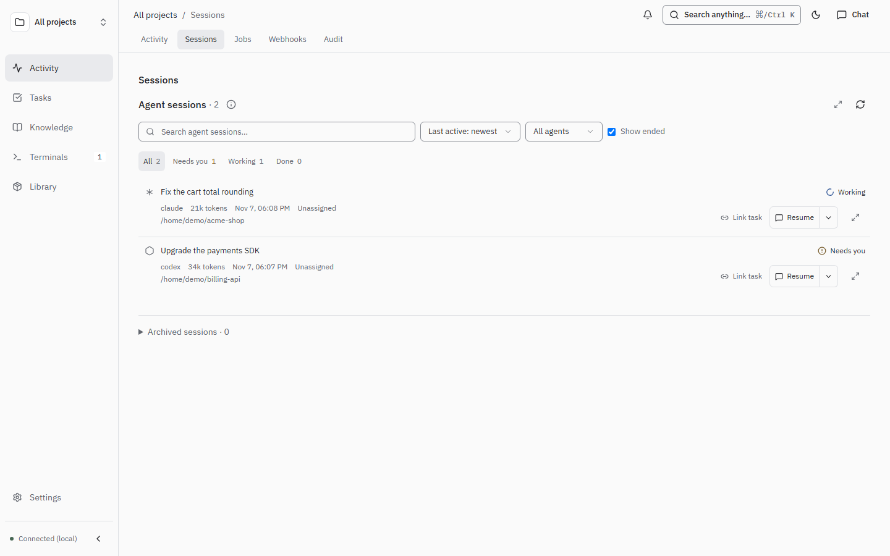
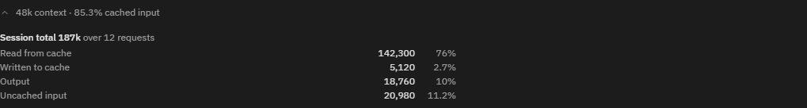
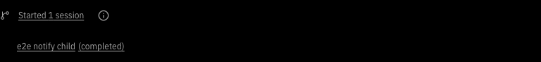

# Live agent sessions

The chat page's session list and viewer use the same working, waiting and ended states, task links, search and conversation viewer for all agents. Waiting sessions stay in the active view; inactivity alone does not end a registered session.

Opening a chat verifies a stale **Working** claim before showing it: when the session has no native activity for 30 seconds, ORC re-checks the agent's own store and settles the row if the turn has ended, so an idle session does not pop the working panel. Returning to the tab re-checks it the same way. A claim with recent activity stays trusted and settles through the usual process and file watches.

A parent whose turn has ended but whose children still work does not read as idle.
The status strip above the composer stays up and names the work in flight
(**Waiting on 2 subagents**, or **Running 1 command** for detached commands), with a
row per child that keeps its own clock and opens or stops that child. Spawned chat
sessions and the provider's own native subagents both count, and the rows come from
live session state, not the finished turn's transcript. The session list rolls the
same truth up: the parent reads **Working** while a child holds a turn and
**Needs you** when a child waits for a human, while its own status stays idle so a
new message still starts a turn immediately. **Stop** shows **Stopping…** until the
agent actually ends the turn, rather than flipping to idle on the request.

Opening a linked task keeps you on that task even while a session search is updating.

Sessions without a title use a readable folder name, including Windows extended
paths, network shares, file URLs and POSIX paths. For example,
`\\?\C:\Projects\orc` displays as `orc` rather than the full path in session and
notification titles. Named sessions keep their titles; execution uses the original
folder path. Codex uses the first prompt when its native title is only the folder.
Claude Code sessions use the conversation title Claude writes (or your `/rename`),
then the first prompt; the `<folder>-<hex>` name Claude Code gives its process is
never used, so each `/clear` in one terminal is its own row with its own title, and
a conversation with no prompt yet reads **New session**. Recency comes from the last
message, not from the transcript file's modification time.

Subagents show inside the parent's chat, under the turn that started them, as a
tree collapsed to one summary line (`3 subagents · 1 failed`): Claude Code
subagents (their `.meta.json` description is the title, `parentAgentId` nests a
subagent under the one that spawned it), Codex spawned threads, Cursor subagent
composers and OpenCode child sessions, at any depth. Each row shows the subagent's
title and state, and a branch with a failed or waiting subagent reads **Needs you**;
pressing a row opens the subagent's own chat, whose header back arrow names the
parent and returns to it. A call is matched to its subagent by
the id each agent records (Claude `toolUseId`, Codex `SubAgentActivity`, OpenCode
`task` metadata); Cursor records none, so its subagents match calls in start order.
Subagents are not listed in the session list, but a parent row still takes the most
urgent subagent state (a failed subagent at any depth marks it **Needs you**) and
matches a search for a subagent's title. Subagents do not
raise notifications of their own. Cursor IDE chats take their folder from the
workspace that holds them, and a transcript whose worktree was deleted falls back to
the deepest folder that still exists.

Independent sessions nest in the session list under the session that started them:
a session started through ORC's session spawn tool (any agent) and a Claude Desktop
session started with `start_session`, read from `spawnedFrom` in the Desktop session
files. They form a tree, so a spawned session that starts more shows them under
itself, and the parent row counts them as **N sessions**. A spawned session keeps
its own notifications and usage.

The list shows only sessions that can be opened. An ended Claude, Codex, Gemini or
Pi session leaves it when its transcript file is gone, including a session that
ended before any prompt was sent, and returns when the file comes back. A Pi session
file that exists but holds no message — the file Pi creates when it launches — is
not listed either, so a Pi started without a prompt leaves no empty row once it ends.
While an older `@orc/pi` still has such a Pi open, that row stays in the list as idle or
running: the live registration, not the transcript, carries its status, and it leaves
when Pi exits. A task's session list keeps its linked sessions either way. A Codex
rollout compressed in place (`.jsonl.zst`) stays listed and opens as before. Codex's
own review and approval runs are not listed. Titles skip slash-command and IDE
wrappers and terminal color codes, and a Cursor chat whose title was never generated
is named from its first message or folder.

Choosing a session never changes the project filter in the header: **All projects**
stays on **All projects**. A session whose project no longer exists groups by its
folder, and folders that share a name show as much of the path as tells them apart.

## Rename, hide and fork

A session's viewer, **Rename**, stores your name on the ORC row. The agent's
title still updates underneath, and **Use agent title** in the rename dialog drops
the override, so a re-sync never resurrects a name you removed. **Hide** keeps the
session and its transcript and only removes it from the default list; the
**hidden** toggle above the list brings hidden rows back with a **Hidden** label,
and **Show in list** in the viewer restores one. Both survive a restart and a session
re-sync. Hiding does not mute notifications, tasks or terminals that already point
at the session.

**Fork in terminal** (in the resume actions on Activity, terminal sessions and task
session rows) starts a new native session from the session's history when
the agent CLI supports it: Claude runs `claude --resume <id> --fork-session` and Pi
runs `pi --fork <id>`. The fork is a new terminal and a new session row, and the
original conversation is not touched. Codex, Cursor, Gemini, OpenCode and agents
without a CLI fork do not offer the action; fork those conversations from an
assistant response in chat instead, which uses the agent's native session fork or a
bounded context replay.

**Send to host…** (the send icon in the same resume actions) moves a Claude Code,
Codex, OpenCode or Pi session to another ORC installation saved under [Settings → Hosts](./desktop-and-web.md#settings):
pick the server and one of its projects, optionally leave a note, and send. The source
snapshots the repository (secret-looking files stay local), pushes it to the shared Git
remote and uploads the conversation; the destination shows the session as **Ready to
resume** and the source row keeps a **Sent to …** badge with a link back to the send
result. The first resumed turn carries a handoff briefing so the agent knows it changed
machines. Both installations must reach the same Git remote, and the session must run on
the source server's own machine. Details: [Session handoff](./session-handoff.md#send-from-the-dashboard).

Activity and full-width session history share compact title/provider/state rows.
An ORC terminal agent without observed session activity shows **Unknown**, rather
than assuming it is idle. A session's working folder decides its project: the most
specific project folder wins, and a worktree resolves to its shared checkout even
when it lives outside the project's folder. Opening a session from the session
list adopts its project in the workspace header, so the session list and
notification inbox follow the project you are actually working in. The mapping is
re-evaluated when project folders change, and live sessions and their
notifications move with them; a session whose project folder was moved away stops
claiming the old project. Each project has one folder scope. Worktrees resolve to
their shared checkout, and a project without a scope takes the repository roots of
its known sessions as derived folders, so no second folder list is stored.
OpenCode's session store is watched alongside the other agent stores, so its new
sessions appear without waiting for another agent's activity.



Open a Codex or Claude session's viewer to see its last reported cached-input percentage.
Expand the cache indicator for input, cached reads, cache writes when reported, and
recorded session totals. Cached input is a share of **input** tokens, not output
or total billed cost. Claude input includes uncached input plus cache reads and
writes; Codex reports input with its cache reads already included. Claude totals
deduplicate repeated messages; Codex totals use the provider's cumulative snapshot.

When Claude records a cache-write lifetime and activity timestamp, the indicator
can change to **Cache may need rebuilding** after that lifetime has elapsed
since the recorded activity. This is a conservative hint, not an exact expiry or
a guarantee about the next request: request generation time, prompt changes and
other requests can affect reuse. Missing cache metrics or timing are omitted;
there is no expiry-unavailable message. Codex does not currently provide timing
evidence here. Other backends omit the indicator until native cache metrics are
supported. Metrics refresh when ORC records new usage for the session; opening
an ended session reads its recorded data once.



Codex uses its native writer locks and latest turn status. A held lock identifies an open session; a completed turn is waiting, and a turn in progress is working. A released lock ends the session. Older Codex versions without a writer-lock directory retain the legacy activity fallback.

Cursor IDE history, Cursor CLI (`agent` / `cursor-agent`) history and Gemini conversations are discovered separately. CLI and IDE Cursor histories are separate stores: neither can continue in chat, and only Cursor CLI records offer a CLI resume command. Their viewer stays read-only and says so. Gemini keeps **Continue in chat**, and **Copy resume command** appears in the viewer for Claude, Codex, Gemini, OpenCode, Pi and Cursor CLI.

OpenCode sessions are read from its SQLite store (`$XDG_DATA_HOME/opencode/opencode.db`, default `~/.local/share/opencode/opencode.db`) on the local machine or the selected SSH host. Top-level sessions appear with their folder, title and token count; the conversation viewer shows messages, reasoning and tool calls with their output. OpenCode has no lifecycle hooks, so its sessions are listed as ended. **Continue in chat** imports its transcript and continues the same session in chat; **Copy resume command** offers `opencode --session <id>` for a terminal.

Pi 1.5.2+ sessions are discovered from the native `~/.pi/agent/sessions` JSONL store on the selected execution host. Absolute `PI_CODING_AGENT_DIR` paths in Pi provider environment settings (and the local server environment) are also scanned under their `sessions` directory. The viewer follows the active branch and context edits and shows text, reasoning, tool calls/results and image placeholders. Native names and recorded token totals are retained. A Pi session open with the `@orc/pi` package shows as running or idle with its process id, ORC refuses session messages for it until Pi exits, and chat turns while it runs a turn. Without the package, Pi sessions appear as ended; close the native Pi conversation before resuming it in ORC to avoid concurrent writers.

Resume in chat imports the visible history and continues the original Pi UUID in its original folder and execution host. It uses the enabled default Pi provider, the enabled built-in Pi provider, or the sole enabled Pi provider, in that order. If several named Pi providers are enabled, choose the intended one as the default first. Native history is not replayed as a new prompt. The viewer's copied resume command uses `pi --session <uuid>`. Custom `--session-dir` stores outside these directories, older session formats, cross-host handoff and embedding/archive ingestion are not supported for Pi.

A Claude permission prompt, Claude question, or Gemini tool-permission prompt sets that session to **Waiting for you** within a few seconds of the hook firing. ORC sends one browser push on the attention topic for that transition. Answering the prompt, or the turn ending, clears the flag. A session that stays waiting does not send another push. Codex questions continue to come from its transcript. An OpenCode session with an open question shows **Waiting for you** from its database, including sessions started outside ORC. Codex and OpenCode approval prompts are not written to disk, so a discovered session waiting on one is not flagged. Cursor's installed hooks do not include a permission event, so Cursor waits are unchanged.

Lifecycle hooks are a choice, per agent. Install the native adapter into the settings
file you pick — the same explicit install also enables [agent rules](./agent-rules.md):

```bash
orc rules install-hook claude --target ~/.claude/settings.json
orc rules install-hook cursor --target ~/.cursor/hooks.json
orc rules install-hook gemini --target ~/.gemini/settings.json
```

The installer preserves existing hook entries and other settings and writes a dated
backup. Nothing is installed globally or automatically; each agent is a separate
decision, and `--events` can narrow the listeners. New/resumed sessions register their
owner PID in `~/.orc/live-sessions/`. Start, prompt, response, tool and stop hooks update
the shared state; session-end hooks and dead owner processes end it. Existing sessions
may need to resume or reload hooks once before they register. Hook-captured conversations
begin when hooks are installed; old native history is retained when its transcript exists.

Hooks need the `orc` executable on the installation machine. They run a bounded owner
lookup, write private local registry/transcript files, and never grant tool permissions
or inject prompts. Native agent transcripts remain read-only. Full prompt/tool content
belongs to the local conversation history and is not sent to external services by these
hooks.

Other local agents can use `LiveRegistration`, `readRegistrations` and `writeRegistration` from `@orc/core/live-session` to participate in the same PID-backed lifecycle. Native discovery/resume commands still require a supported adapter; the dashboard automatically includes registered backend names in its filter.

## Sending a message to a session

Open a session and use **Send message** to queue a note for it. ORC delivers
queued notes at the session's next safe point: before a tool call, at a prompt
submit or stop hook, or when the agent reports session start. For an ended
session, ORC resumes it with a bounded turn. Messages wait in a compact queue
you can reorder or cancel until delivery starts. A delivered message records
whether it arrived through a native hook (`hook`), an ORC chat turn (`chat`), a
resume (`resume`) or native steering into a running chat turn (`steer`).

Live sessions of agents without a context-capable hook (for example Cursor or
OpenCode) cannot receive a message while they are running; queue it after the
session ends. Claude, Codex and Gemini sessions accept messages through their
installed hooks and the ORC-managed Claude SDK hook.

Delivery is not approval. ORC tells the recipient the message came from another
session or a human relay, that it cannot approve a tool, permission, plan or
configuration change, and that configuration must be changed by a human. An
agent-to-agent message chain ends after three hops, and one agent session may
queue at most 20 messages per target in a rolling hour. Pass a stable
`request_id` when retrying the same send. Messages still delivering when ORC
restarts become `interrupted` and are never retried; queued messages remain
queued. In web chat, delivered relay and child-outcome messages render as quiet
collapsed cards showing sender/child title, outcome, one-line summary,
timestamp, and a link to the source session (click to expand the full body),
while the agent still receives the full text and delivery-is-not-approval
envelope.

The same queue is available to agents through the `session_send` MCP tool
(ORC-managed sessions bind the connection automatically with `?session=<session id>`
and `X-ORC-Session`, and stdio MCP reads `ORC_SESSION_ID`; an authenticated
unbound HTTP connection sends as its coordinator session, and other explicitly
unbound MCP clients can still `queue` via the human-relay fallback, while
`steer` and `interrupt` require a bound ancestor session) and to chat channels
with `/send <session id> <message>`.
Agent-origin sends default to `mode: "queue"`; `steer` and `interrupt` are
explicit choices. The delivery receipt reports `queued`, `steered`, `resumed`,
`failed`, or `unsupported` so callers do not need to poll.

```text
/send                  list live sessions
/send <id>            choose a target
/send <id> Fix the failing test
```

## Delegating to other sessions

An agent can start and drive other sessions, the way Claude Code drives its
subagents:

| MCP tool                          | Does                                                                                                                                                                                                                                                                                                                                                      |
| --------------------------------- | --------------------------------------------------------------------------------------------------------------------------------------------------------------------------------------------------------------------------------------------------------------------------------------------------------------------------------------------------------- |
| `session_options`                 | Reads effective session defaults, configured hosts, provider accounts, composer profiles, and optional agent models/efforts/capabilities                                                                                                                                                                                                                  |
| `session_start`                   | Starts a headless ORC chat with a prompt (`profile`, `agent`, `provider_id`, `model`, `effort`, `permission_mode`, `send_while_running`, `project`, `cwd`, `host`, `worktree`) and returns its `session_id` immediately. A failed start still reports the effective `defaults` alongside the error                                             |
| `session_send`                    | Messages a chat or native session (accepts chat, live, or native id; auto-adopts stopped native sessions into chat): `queue` (default), or explicit `steer` / `interrupt`                                                                                                                                                                                 |
| `session_status` / `session_list` | Unified paginated listing (`GET /api/sessions/live/list`) merging chats and discovered native sessions (`scope: all\|children\|chats\|native`, filters, `total`/`has_more`/`next_offset`) and live status (`queued`, `running`, `waiting`, `idle`, `interrupted`, `failed`, `stopped`, live activity, `background_tasks`, `runtime_model`, `start_error`) |
| `session_update`                  | Updates a chat or discovered session via `PATCH /api/sessions/live/{id}` (`title`, `hidden`, `task_id`, `model`, `effort`, `permission_mode`, `send_while_running`)                                                                                                                                                                                       |
| `session_delete`                  | Hides a failed, stopped or finished session it started so it leaves the default list; `restore: true` brings it back. This is the `session_update` hidden flag with a direct name; the transcript remains readable, and only the starter or an ancestor may hide it                                                                                     |
| `session_wait`                    | Blocks until it stops running, waits for a human, or replies (`until: message`); `session_ids` with `mode: all` or `any` waits on several children                                                                                                                                                                                                        |
| `session_stop`                    | Stops its current turn (or reconciles a discovery-only live record) and, by default (`cascade`), every session it started; queued children are cancelled; messages still queued for a stopped session are cancelled, and messages sent after the stop deliver normally; sessions stay resumable                                                           |

`session_list` omits hidden sessions unless `include_hidden` is set. A failed or stopped probe is removed from the default list with `session_delete` (the `session_update` hidden flag), and `session_status` still finds it by id.

While a headless turn is running, `GET /api/sessions/live/{id}/status` (and MCP `session_status`) advances `last_activity_at`, `updated_at`, `last_activity` (such as `tool:bash`, `thinking`, `text`, `plan`, or `waiting:approval`), and `activity_count` on every streamed event before the turn completes, so callers can distinguish active workers from hung turns. If launch, preflight, or the turn fails, `start_error` exposes the failure reason explicitly (and `last_message` falls back to it when no assistant prose was emitted). `session_start` also normalizes canonical backend aliases (`codex-cli` to `codex`, `claude-cli`/`claude-code` to `claude`, `cursor-agent` to `cursor`), and provider/adapter mismatches report both the mismatched provider and the valid provider IDs for the requested agent.

Live session routes (`GET /api/sessions/live/list`, `GET /api/sessions/live/{id}`, `PATCH /api/sessions/live/{id}`, `/status`, `/transcript`, `/stop`, `/cache`, `/analytics`, `/children`) and `orc session show <id>` resolve any session identifier form interchangeably: chat thread UUIDs returned by `session_start`, live record IDs from `GET /api/sessions/live`, or native runtime IDs such as `ses_...`. Calling `POST /api/sessions/live/{id}/stop` on a discovery-only live record without a chat thread signals its local process when still alive and settles the row to `stopped`.

`session_start` takes `project`, `cwd`, `host`, `worktree`, `profile`, `agent`, `provider_id`, `model`, `effort`, `permission_mode`, and `send_while_running`:

| Input            | Behavior                                                                                                                                                     |
| ---------------- | ------------------------------------------------------------------------------------------------------------------------------------------------------------ |
| _(none)_         | The caller's folder and host, sharing uncommitted edits                                                                                                      |
| `project`        | That project's main checkout becomes the folder (and its configured `host`, when set, becomes the execution host)                                            |
| `cwd`            | That folder on the resolved host; overrides the project/parent folder and auto-detects the matching project from that folder                                 |
| `host`           | A configured execution host (SSH alias); `null` runs on the ORC server; omitted uses the project's configured `host` if set, else inherits the caller's host (or the Settings default on cross-project start) |
| `worktree: true` | A new git worktree under `.orc/worktrees/` on a new branch cut from the resolved folder's committed HEAD (uncommitted edits stay behind)                     |
| `base`           | With `worktree`, the branch it branches from; omitted uses the checkout's current HEAD                                                                       |
| `profile`        | Composer profile id or name from Settings (`agent`, `provider_id`, `model`, `effort`, `permission_mode`), overridden by any explicit field                   |

The resolved folder must exist on the resolved host.

When all four chat workers are busy, `session_start` still returns at once: the child is `queued` and starts when a worker frees, even across an ORC restart.

With `notify` (default on), ORC queues a notice for the parent when the child finishes, fails,
is stopped or waits for a human. While the parent is mid-turn, the notice waits in
the parent's pending-message queue (visible in chat with **Deliver now**, reorder
and cancel controls; never injected as an answer while waiting on a human prompt)
and delivers when the turn finishes, or starts the parent's next chat turn when it
is idle. Each note starts with a header line,
`[orc child-session id=<id> outcome=<outcome>]`, so the parent can tell it from human text. The same delivery path
carries human messages and channel relays.

Guardrails:

- Only a session's parent, or an ancestor of the parent, can `steer`, `interrupt`
  or stop it. Any other session can only `queue`.
- A child inherits its parent chat's permission mode, agent options and tool
  allowlist; a child of any other session starts in the default permission mode.
  A child's permission prompt or question goes to a human, never to the parent.
- A child's notifications to its parent count toward the 20-messages-per-hour cap
  for that pair.
- A chain of started sessions stops at three levels, and a session can start
  at most ten sessions an hour.

External coordinators: an authenticated MCP HTTP client without `?session=`
gets a lightweight coordinator session (one per `?client=<name>`, reused across
requests) and can drive the same tools — `session_start` returns
`coordinator_session_id` plus the Settings `defaults` (children keep inheriting
the live defaults even after they change), children default `notify` to false,
and `session_wait`/`session_status`/`session_read` follow them. The client name
is attribution, not a security boundary: any holder of the shared API secret
may claim any name, and coordinators are never garbage-collected — each name
leaves a permanent root session, and unnamed clients share the default `mcp`
coordinator and its hourly spawn limit. See [MCP →
Transports](./mcp.md#transports).

Chat and the session detail show the lineage: **Started by** links the parent,
and **Started N sessions** lists the children, including the worker sessions
of tasks the agent created with `task_create`.



[Phone layout of a child chat](/screens/session-lineage-phone.png)

### Following background work in chat

A conversation can keep working after its last message. Detached commands and
child sessions show up over the composer, so a quiet transcript does not read as
a stuck one:

- A tool call that starts detached work — a command or a subagent run in the
  background — is marked from its own input, so it works the same for every
  agent that can detach work.
- A running, queued or waiting child session appears as a row with **Open**
  (switch to its chat) and **Stop** (stop it and the sessions it started).
  Rows come from live session state — both sessions the chat spawned and the
  provider's own native subagents — follow the child's real status and clear
  when it settles.
- Each row keeps its own clock. One job reads as a single line; several fold
  into one summary row that expands to the full list. While the parent's turn
  has ended but children still work, the strip header reads **Waiting on N
  subagents** with a running timer instead of going quiet.
- The session list rolls the same truth up: a parent reads **Working** while a
  child holds a turn and **Needs you** when a child waits for a human, while
  its own status stays idle so a new message starts a turn immediately.
- Detached tool rows come from the agent's latest turn and clear when the agent
  replies again: a backend that never reports a background command's exit
  cannot be checked, so ORC does not keep claiming it is running.
- In a chat ORC runs, the agent reports its subagents live and the turn's tree
  shows each one's status, tokens and duration as it works: Claude from its
  `task_started` / `task_progress` / `task_notification` events (nested by
  `parent_task_id`), Codex from `subAgentActivity` items and each child thread's
  token usage, OpenCode from its `task` tool calls (and from child-session updates
  when the agent streams them, nested by `parentID`). A subagent waiting on a
  permission prompt reads **Needs you**, and so does the chat while a subagent in
  its latest turn failed or waits. Running subagents also show over the composer.
- A Claude turn stays open while any subagent or background command (`local_bash`,
  `Monitor`, or other non-ambient background task) still runs, deferring the idle
  watchdog and surfacing live `background_tasks` on `session_status`; the agent's
  follow-up reply lands in the same turn. Claude sessions stay resident across
  turns while idle so process-local background work is not torn down between turns.
  If a daemon restart or unexpected provider exit kills in-flight background work,
  the session reports `interrupted` (with `interruption_reason`) and notifies the
  agent on the next turn so it never assumes lost jobs succeeded. For long commands
  that must survive a full ORC daemon restart, use the detached `shell_run` /
  `shell_status` / `shell_stop` MCP tools (or `/api/background-jobs`).
- Observed runtime model names (including custom `ANTHROPIC_BASE_URL` /
  `ANTHROPIC_MODEL` endpoints) are tracked separately from configured aliases in
  `runtimeModel` / `runtime_model` and shown across chat headers, session settings,
  and session lists. Pi and the ACPX agents report no subagents, so nothing is
  shown, and **Capabilities** in the conversation details lists **Subagents** only
  for agents that report them.
