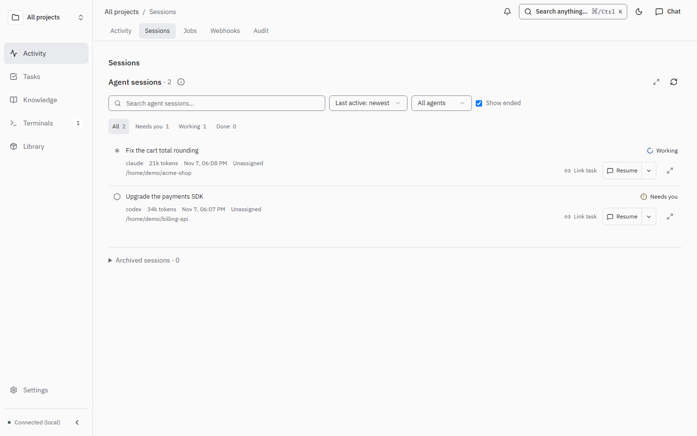
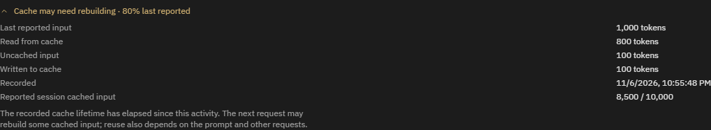

# Live agent sessions

The Sessions view uses the same working, waiting and ended states, task links, search and conversation viewer for all agents. Waiting sessions stay in the active view; inactivity alone does not end a registered session.

Opening a linked task keeps you on that task even while a session search is updating.

Activity and full-width session history share compact title/provider/state rows.
An ORC terminal agent without observed session activity shows **Unknown**, rather
than assuming it is idle. Terminals without recorded project ownership remain in
All projects until that association is available.



Open a Codex or Claude session to see its last reported cached-input percentage.
Expand that compact row for input, cached reads, cache writes when reported, and
recorded session totals. Cached input is a share of **input** tokens, not output
or total billed cost. Claude input includes uncached input plus cache reads and
writes; Codex reports input with its cache reads already included. Claude totals
deduplicate repeated messages; Codex totals use the provider's cumulative snapshot.

When Claude records a cache-write lifetime and activity timestamp, the indicator
can change to **Cache may need rebuilding** after that lifetime has elapsed
since the recorded activity. This is a conservative hint, not an exact expiry or
a guarantee about the next request: request generation time, prompt changes and
other requests can affect reuse. Missing cache metrics or timing are omitted;
there is no expiry-unavailable message. Codex does not currently provide timing
evidence here. Other backends omit the indicator until native cache metrics are
supported. Metrics refresh every 15 seconds while an active session's details
are open; opening an ended session reads its recorded data once.



Codex uses its native writer locks and latest turn status. A held lock identifies an open session; a completed turn is waiting, and a turn in progress is working. A released lock ends the session. Older Codex versions without a writer-lock directory retain the legacy activity fallback.

Cursor IDE history, Cursor CLI (`agent` / `cursor-agent`) history and Gemini conversations are discovered separately. CLI and IDE Cursor histories are separate stores: only Cursor CLI records offer a CLI resume command. Gemini and Cursor CLI support Resume in a terminal, Copy resume command, and Copy terminal link alongside Claude and Codex.

OpenCode sessions are read from its SQLite store (`~/.local/share/opencode/opencode.db`) on the local machine or the selected SSH host. Top-level sessions appear with their folder, title and token count; the conversation viewer shows messages, reasoning and tool calls with their output. OpenCode has no lifecycle hooks, so its sessions are listed as ended. Resume opens `opencode --session <id>` in a terminal.

A Claude permission prompt, Claude question, or Gemini tool-permission prompt sets that session to **Waiting for you** within a few seconds of the hook firing. ORC sends one browser push on the attention topic for that transition. Answering the prompt, or the turn ending, clears the flag. A session that stays waiting does not send another push. Codex questions continue to come from its transcript. Cursor's installed hooks do not include a permission event, so Cursor waits are unchanged.

Install lifecycle hooks for Claude, Cursor and Gemini from this checkout:

```powershell
bun scripts/install-session-hooks.ts
```

The installer preserves existing hook entries and other settings, makes dated backups, and adds lifecycle events to `~/.claude/settings.json`, `~/.cursor/hooks.json` and `~/.gemini/settings.json`. Claude gains permission, notification, question and stop hooks. Gemini gains the notification hook beside its existing lifecycle events. New/resumed sessions register their owner PID in `~/.orc/live-sessions/`. Start, prompt, response, tool and stop hooks update the shared state; session-end hooks and dead owner processes end it. Existing sessions may need to resume or reload hooks once before they register. Hook-captured conversations begin when hooks are installed; old native history is retained when its transcript exists.

Hooks need Bun on the installation machine. They run a bounded owner lookup, write private local registry/transcript files, and never grant tool permissions or inject prompts. Native agent transcripts remain read-only. Full prompt/tool content belongs to the local conversation history and is not sent to external services by these hooks.

Other local agents can use `LiveRegistration`, `readRegistrations` and `writeRegistration` from `@orc/core/live-session` to participate in the same PID-backed lifecycle. Native discovery/resume commands still require a supported adapter; the dashboard automatically includes registered backend names in its filter.
