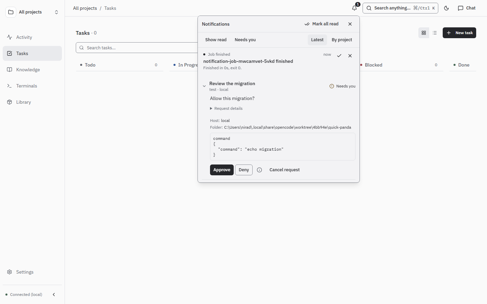
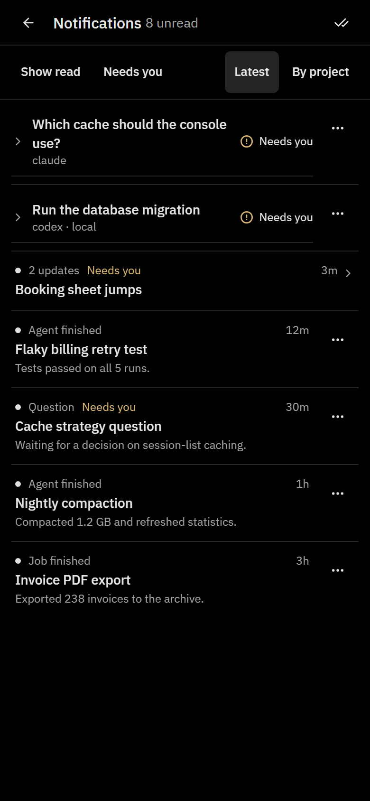
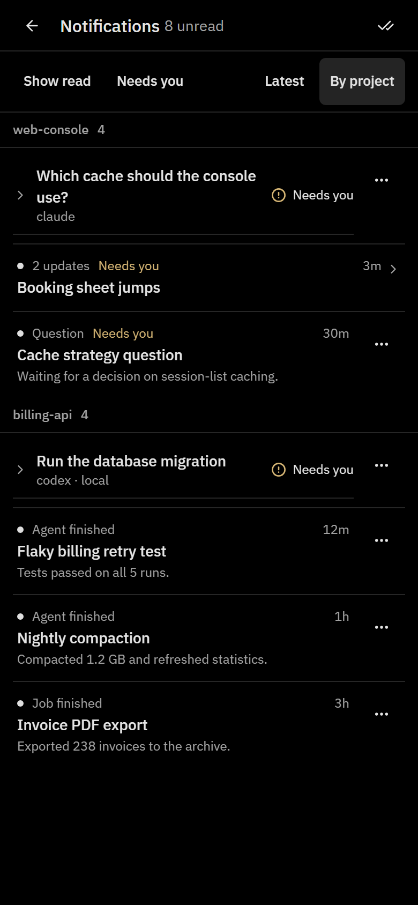
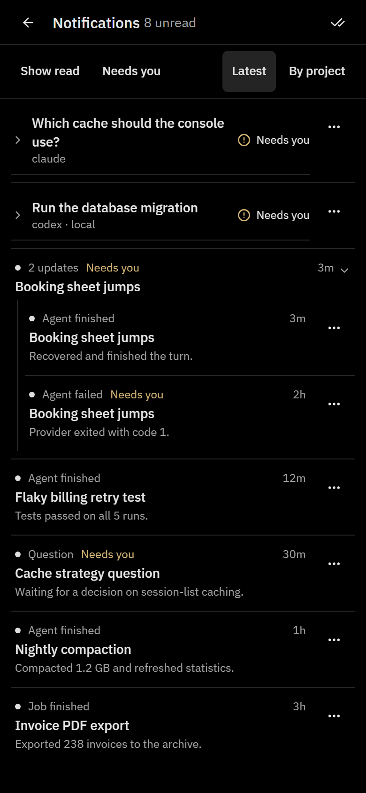

# Notifications

The bell in the workspace header opens your notification inbox: an anchored
menu on desktop and a full page at `/notifications` on phones, including while
the chat is open. New arrivals show an unread indicator without opening it. Use
**Alt+N** or **Open notifications** in the command palette to open it; on
phones both navigate to the page, and its back bar returns to where you were.

Notifications cover human questions, approvals and commands, agent questions and
outcomes, and job outcomes. Open an item to review the request or visit its source.
Every alert names where it came from: the owning project, or the session's folder
when no project owns it. The label appears in inbox rows, toasts, desktop
notifications and browser push, while **By project** grouping and per-project
muting keep working as before. Labels follow the source: assigning a session to a
project or renaming that project updates the notifications still in the inbox.
Request forms stay collapsed until opened; drafts survive closing and reopening
the menu. Read and dismissed state is stored on the server and shared by clients.
Dismissal does not approve, answer, cancel or delete a source request.

The inbox shows **unread notifications** by default. Opening an item or choosing
**Mark read** clears it from the inbox. Clicking a native desktop notification
opens its destination and marks that item read; a grouped done toast only opens
its destination. **Show read** includes read history; use
**Mark unread** to return an item to the inbox, or **Mark all read** to clear it.
An opened human request stays available while you answer it.

Desktop and phone share one inbox logic. Updates from the same session or
request collapse into a quiet summary row with a count and the most urgent
state; expand it to see each update. **Latest** lists groups newest first;
**By project** adds a section per project with sticky headers and counts, and
the choice persists across reloads. When the workspace header has a specific
project selected, the inbox and its unread count follow that project, including
items recorded before the session's folder was assigned, and **Mark all read**
only clears the items in that project. Choose **All projects** to see every
project again. **Needs you** narrows the inbox to items
that require an action. Human requests keep their review card in the row, so
questions, approvals and commands are answered inline without leaving the
inbox; drafts survive closing and reopening. Phone rows keep mark-read and
dismiss in one named row menu with 44px targets; desktop rows keep direct
icons.

Each session keeps only its latest **Agent finished** notification. A newer finish
physically replaces older completion notifications, including read and dismissed
ones. Existing duplicates are cleaned automatically in bounded batches; lists and
unread counts show only the latest even while cleanup is catching up.
Saved chat views and the native session share that latest completion using the
agent backend, execution host and native session ID. The alert opens where the
latest turn ran; opening another read-only view creates no new completion alert.
Matching native IDs on different hosts or agent backends stay separate.
When a session continues, its latest completion alert is automatically marked read.
A completion for a chat or session that is already open and focused is marked read
and dismissed as soon as it arrives, so the bell stays quiet while you watch it.
This applies to workspace chats and observed agent sessions. **Show read** includes
the retained latest completion, rather than a history of every turn.
Failures and pending questions or approvals are kept independently.









Job delivery follows `notify_on`: `never` creates no alert, `failure` reports
failed runs, and `always` also reports successful runs. Notification types are
extensible strings; unknown types use the same common menu and source link.

## Expiry and audit history

Every notification has an expiry date. **Settings → Notifications → Automatic cleanup** sets
notification retention (default **30 days**) and audit retention (default
**90 days**), each from 1 to 3650 days. These are server-wide preferences.
All notifications expire, including unresolved ones. The underlying request has
its own timeout and lifecycle; notification expiry never resolves it.

Expired entries disappear from reads immediately. The API server cleans stored
rows at startup and every minute in bounded batches of 1000. A backlog drains
over successive passes. Lowering retention also hides older entries immediately.
SQLite reuses freed pages; cleanup does not guarantee a smaller database file.

**Activity → Audit** retains notification creation, resolution, read, dismissal,
expiry and supersession events independently, including the actual notification
title and message. Audit events expire under their own retention period even if the alert
has already been cleaned up. New lifecycle events also cover human-request
status changes, job starts/outcomes and task creation/status transitions.
They exclude unrelated source prompts, command payloads, responses and output.
Repeated polling and unchanged state do not create audit events. Existing audit
snapshots keep their original content until their retention period ends.

## Sound, push and channels

Desktop browsers show settled toasts; Needs-you alerts can chime and Done alerts
are silent. **Settings → Notifications → Sound** controls browser-local sound and
project muting. Browser/PWA push remains separately opt-in for background human
requests, chat replies and job results; see [Installation](./install.md).
A device receives job pushes only after **Job results** is enabled there.
Existing devices subscribed to every topic receive this new topic on upgrade;
you can turn it off independently, and that choice survives restarts.
Enabling it does not replay older runs. Each alert follows `notify_on` and
includes the job name, exit status, duration and a link to the run. `failure`
sends failed runs, `always` also sends successful runs, and `never` sends nothing.

### Forward notifications to Telegram or Slack

In **Settings → Connections → Channels → Notification forwarding**, enter the ORC origin reachable
from your channel client (for example `https://orc.example.com`), enable forwarding
and save. The URL must have no credentials, path, query or fragment. Links open the
existing authenticated ORC app; forwarding supplies no login or approval authority.
The forwarding switch and URL stay disabled while saved settings load or save.
If loading fails, the form shows the error and stays disabled.

Edit a connection, open **Recipients**, edit a recipient and select **Forward
notifications**. Apply the recipient and save the connection. The connection and
**Allow outbound** must be enabled. Inbound messaging and sender IDs are unnecessary
for these outbound-only alerts. Existing recipient project restrictions apply;
restricted recipients never receive unassigned or other-project notifications.

**Notification filters and preview** selects types, categories (`human`, `agent`,
`job`), severity (`needs-you`, `done`) and outcome (`waiting`, `success`, `failure`).
Values within a group are alternatives; selected groups must all match. Empty
groups match all known values. Unknown types are excluded unless **Include new or
unknown types** is selected; they have no known outcome and cannot match an outcome
filter. **Preview filters** evaluates the draft without sending a message.

Forwarding sends fixed, escaped summaries and source links, prefixed with the
project name when the source belongs to a project. A folder name is never
forwarded, so an unassigned source keeps the plain summary. It excludes titles,
question text, command arguments, tool payloads, logs and credentials. Job events
honor `notify_on`; human requests also retain their producer's `notify` provider
selection. Selecting forwarding replaces the recipient's legacy **Interactive
questions and approvals** delivery with safe links, avoiding duplicate request
messages. Interactive delivery retains its own inbound/sender permissions.

Clear a recipient's **Forward notifications**, or pause globally, without
disconnecting the channel or changing in-app alerts. Activation or changes to a
recipient's filters, destination or project restrictions start with new events;
history and events produced during a global pause are not replayed. An in-flight
send can finish after a pause. Saved configuration survives restart.

### Inbound rules

Settings → Connections → Channels → **Inbound routing** turns an incoming message
into an agent turn. Rules run in saved order; the first enabled rule whose
condition matches wins. Conditions nest `all` (AND), `any` (OR) and `not`, up to
5 levels and 100 condition nodes. Fields: `sender`, `chat`, `thread`, `text`,
`command`, `is_direct`, `is_mention`, `is_followup` (the message continues a
thread an agent already answered on this connection), `kind`. Operators: `is`,
`in`, `contains`, `contains_any` (case-insensitive keyword list), `starts_with`
— regex is deliberately unsupported (inbound text is untrusted). A `time`
condition restricts a rule to a window (`days` 0=Sun..6=Sat, `from`, `to`, `tz`,
overnight ranges allowed; wrap it in `not` for "outside hours"). An optional
**Otherwise** rule (`condition: {"always": true}`) must be last if present.

A rule's action is `ignore`, `agent`, or `job`. An `agent` action names the
agent and project, and an optional `model` and `profile` — an [agent
profile](./agent-packages.md) whose instructions, tool allowlist and model
become that rule's persona. `session` picks `continue` (one rolling
conversation per chat/thread/sender, the default), `thread` (one session per
thread; a top-level Slack message starts a new thread and the reply lands in
it) or `message` (a fresh session every message). `permissions` picks `ask` (approvals come to you), `read_only` (only Read, Grep, Glob, LS, WebFetch and WebSearch; ORC MCP is off; backends that cannot enforce a tool allowlist refuse to run), `accept_edits` or `auto` (no prompts); senders matched only through `*` never get more than `read_only`, never get ORC MCP, and cannot trigger a job whose agent runs with `accept_edits` or `auto`. `options` carries the same per-agent launch options as the chat composer, such as effort; options that approve more than `permissions` (Claude `bypassPermissions` or `acceptEdits`, ACPX `--approve-all` or `--approve-reads`) are rejected. A `job` action runs that job
with the message text on stdin and `ORC_CHANNEL_CONNECTION`,
`ORC_CHANNEL_PROVIDER`, `ORC_CHANNEL_CHAT`, `ORC_CHANNEL_THREAD`,
`ORC_CHANNEL_SENDER`, `ORC_CHANNEL_SENDER_NAME` and `ORC_CHANNEL_ROUTE` in its
environment; the job's stdout becomes the reply.

Worked example: any DM to the bot gets a read-only assistant persona; a mention
in `#ops` during work hours that names a deploy or rollback runs Codex in the
ops project with one session per thread; everything else is ignored.

```json
[
  {
    "id": "dm-assistant",
    "name": "DMs to the bot",
    "enabled": true,
    "condition": { "field": "is_direct", "op": "is", "value": true },
    "action": {
      "type": "agent",
      "agent": "claude",
      "project_id": "PROJECT_ID",
      "profile": "read-only-assistant",
      "session": "continue",
      "permissions": "read_only"
    }
  },
  {
    "id": "ops-deploys",
    "name": "Ops deploy mentions during work hours",
    "enabled": true,
    "condition": {
      "all": [
        { "field": "is_mention", "op": "is", "value": true },
        { "field": "chat", "op": "is", "value": "C0OPS" },
        { "field": "text", "op": "contains_any", "value": ["deploy", "rollback"] },
        { "time": { "days": [1, 2, 3, 4, 5], "from": "09:00", "to": "18:00", "tz": "Asia/Jerusalem" } }
      ]
    },
    "action": { "type": "agent", "agent": "codex", "project_id": "OPS_PROJECT_ID", "session": "thread" }
  },
  { "id": "otherwise", "name": "Otherwise", "enabled": true, "condition": { "always": true }, "action": { "type": "ignore" } }
]
```

Rules only see messages from an inbound destination. To let anyone DM the bot,
add a destination with **Any chat** and **Any sender** (`chat_id: "*"`,
`user_ids: ["*"]`). A sender matched only through `*` gets replies only: no chat
controls, no `/project`, `/agent` or `/model`, and approvals or questions from
their turns go to ORC Notifications, never to them. A `*` chat cannot carry
notifications, Attention or a fixed thread, a `*` sender cannot carry
Attention, and API or `channel_send` messages cannot target a `*` chat. Pair
such a destination with `permissions: "read_only"` and a profile with a limited
tool allowlist.

Preview which rule a message would hit without invoking an agent:
`orc channels test --connection <id> --sender <id> --chat <id> --text "..."
[--thread <id>] [--direct] [--mention] [--followup]`, or
`POST /api/channels/{id}/route-test`.

**Recent deliveries** shows status, attempt count, safe errors and a channel receipt
ID through the API. Stable notification/destination IDs prevent replay of completed
deliveries after restart. Definite provider rate limits retry at most four times
with bounded exponential backoff (4, 8, 16 seconds). Ambiguous network/timeouts and
interrupted sends are marked `unknown` for inspection, rather than automatically
resent. Permanent errors are `failed`. Expired events are never newly dispatched;
errors stay in delivery history/logs and do not create recursive notifications.

The authenticated API exposes `GET/PUT /api/channels/notification-policy`,
`POST /api/channels/notification-preview` and
`GET /api/channels/notification-deliveries?limit=50` (maximum 100).
The preview body is `{filter, project_ids, event: {type, level, project_id}}`.
These use the existing `channel_send` transport, destinations and secure credentials.

Links to `/activity?notifications=open` (optionally with `&request=<id>`) open the
notification menu on desktop and redirect to the phone page, which expands the
linked request. `/notifications` is shareable at every viewport size.
See [Human requests](./human-requests.md) for source request actions and timeouts,
and [API reference](./api.md) for notification and audit routes.

### Slack user session

The `slack-user` provider connects ORC to Slack through **your own user session**
instead of a Slack app, for workspaces where installing an app is not possible.
It uses [earshot](https://github.com/niradler/earshot) to hold the same realtime
socket your Slack web client uses. Replies post **as you**, in the same thread.

| Provider | Needs | Posts as |
| --- | --- | --- |
| `slack` | Slack app: bot token + Socket Mode app token | the bot |
| `slack-user` | your session: `xoxc` token + `d` cookie | you |

Setup in **Settings → Connections → Channels**: add a **Slack (user session)**
connection and paste the two session values:

- **User token (`xoxc`)** — in the Slack web client (`app.slack.com`), DevTools →
  Console → `TS.boot_data.api_token`.
- **Session cookie (`d`)** — DevTools → Application → Cookies → the `d` cookie
  value (starts `xoxd-`). On macOS, `bunx @niradler55/earshot token` prints both
  from the installed Slack desktop app.

The cookie is a full-access session secret — treat it like a password. Stored
values are encrypted; `env:ORC_SLACK_USER_TOKEN` and `env:ORC_SLACK_USER_COOKIE`
keep them out of the database entirely. Verify identity, then **Pair my Slack**:
send the pairing text in a direct message to **yourself** (the “you”
conversation) and confirm the recipient.

Inbound rules work exactly as for the bot. There is no bot user to mention, so
the trigger is the literal text `@orc`: ORC marks messages starting with `@orc`
(or mentioning your own Slack user) as `is_mention`, and the text is kept intact
for keyword rules. A typical route — one session per thread, replies in-thread:

```json
{
  "id": "orc-trigger",
  "name": "@orc mentions",
  "enabled": true,
  "condition": { "field": "is_mention", "op": "is", "value": true },
  "action": { "type": "agent", "agent": "claude", "project_id": "PROJECT_ID", "session": "thread" }
}
```

Type `@orc <message>` in any channel or thread you are a member of; the reply
lands in the same thread as you, and follow-ups in that thread resume the same
session. A new thread starts a new session. `text starts_with "@orc"` and
keyword rules (`contains_any`) work too, so different keywords can route to
different agents or projects.

Differences from the bot provider:

- **No button interactions.** A user session has no app to receive clicks, so
  chat controls and approvals render as typeable commands (`/status`,
  `/attention <id> approve`, …) instead of buttons.
- **No file attachments.** Text messages only.
- **Reconnect gap.** Messages sent while the socket reconnects are not
  replayed; earshot is push-only.
- **Session expiry.** When Slack rejects the session, the connection shows
  `session_expired`. Log in to Slack again, paste a fresh token and cookie, and
  save the connection to reconnect.
- **Unofficial transport.** This rides Slack's internal client transport and
  can break if Slack changes it; it is outside Slack's API terms of use. Use
  the bot provider where an app is allowed.

Advanced: the connection's provider configuration accepts
`{"transport": "auto" | "rtm" | "gateway"}` (default `auto`) to force earshot's
socket transport when `rtm.connect` is blocked on your workspace.
