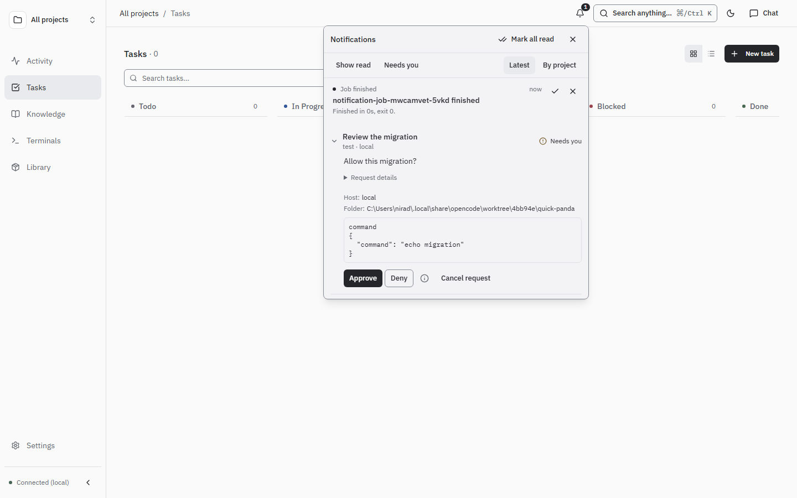

# Notifications

The bell in workspace and chat headers opens your notification menu on desktop
and phone. New arrivals show an unread indicator without opening the menu. Use
**Alt+N** or **Open notifications** in the command palette to open it.

Notifications cover human questions, approvals and commands, agent questions and
outcomes, and job outcomes. Open an item to review the request or visit its source.
Request forms stay collapsed until opened; drafts survive closing and reopening
the menu. Read and dismissed state is stored on the server and shared by clients.
Dismissal does not approve, answer, cancel or delete a source request.

The menu shows **unread notifications** by default. Opening an item or choosing
**Mark read** clears it from the inbox. **Show read** includes read history; use
**Mark unread** to return an item to the inbox, or **Mark all read** to clear it.
An opened human request stays available while you answer it.

Each session keeps only its latest **Agent finished** notification. A newer finish
physically replaces older completion notifications, including read and dismissed
ones. Existing duplicates are cleaned automatically in bounded batches; lists and
unread counts show only the latest even while cleanup is catching up.
Saved chat views and the native session share that latest completion using the
agent backend, execution host and native session ID. The alert opens where the
latest turn ran; opening another read-only view creates no new completion alert.
Matching native IDs on different hosts or agent backends stay separate.
When a session continues, its latest completion alert is automatically marked read.
This applies to workspace chats and observed agent sessions. **Show read** includes
the retained latest completion, rather than a history of every turn.
Failures and pending questions or approvals are kept independently.

Job delivery follows `notify_on`: `never` creates no alert, `failure` reports
failed runs, and `always` also reports successful runs. Notification types are
extensible strings; unknown types use the same common menu and source link.

## Expiry and audit history

Every notification has an expiry date. **Settings → Storage → Automatic cleanup** sets
notification retention (default **30 days**) and audit retention (default
**90 days**), each from 1 to 3650 days. These are server-wide preferences.
All notifications expire, including unresolved ones. The underlying request has
its own timeout and lifecycle; notification expiry never resolves it.

Expired entries disappear from reads immediately. The API server cleans stored
rows at startup and every minute in bounded batches of 1000. A backlog drains
over successive passes. Lowering retention also hides older entries immediately.
SQLite reuses freed pages; cleanup does not guarantee a smaller database file.

**Activity → Audit** retains notification creation, resolution, read, dismissal,
expiry and supersession events independently, including the actual notification
title and message. Audit events expire under their own retention period even if the alert
has already been cleaned up. New lifecycle events also cover human-request
status changes, job starts/outcomes and task creation/status transitions.
They exclude unrelated source prompts, command payloads, responses and output.
Repeated polling and unchanged state do not create audit events. Existing audit
snapshots keep their original content until their retention period ends.

## Sound, push and channels

Desktop browsers show settled toasts; Needs-you alerts can chime and Done alerts
are silent. **Settings → Notifications → Sound** controls browser-local sound and
project muting. Browser/PWA push remains separately opt-in for background human
requests, chat replies and job results; see [Installation](./install.md).
A device receives job pushes only after **Job results** is enabled there.
Existing devices subscribed to every topic receive this new topic on upgrade;
you can turn it off independently, and that choice survives restarts.
Enabling it does not replay older runs. Each alert follows `notify_on` and
includes the job name, exit status, duration and a link to the run. `failure`
sends failed runs, `always` also sends successful runs, and `never` sends nothing.

### Forward notifications to Telegram or Slack

In **Settings → Channels → Notification forwarding**, enter the ORC origin reachable
from your channel client (for example `https://orc.example.com`), enable forwarding
and save. The URL must have no credentials, path, query or fragment. Links open the
existing authenticated ORC app; forwarding supplies no login or approval authority.
The forwarding switch and URL stay disabled while saved settings load or save.
If loading fails, the form shows the error and stays disabled.

Edit a connection, open **Recipients**, edit a recipient and select **Forward
notifications**. Apply the recipient and save the connection. The connection and
**Allow outbound** must be enabled. Inbound messaging and sender IDs are unnecessary
for these outbound-only alerts. Existing recipient project restrictions apply;
restricted recipients never receive unassigned or other-project notifications.

**Notification filters and preview** selects types, categories (`human`, `agent`,
`job`), severity (`needs-you`, `done`) and outcome (`waiting`, `success`, `failure`).
Values within a group are alternatives; selected groups must all match. Empty
groups match all known values. Unknown types are excluded unless **Include new or
unknown types** is selected; they have no known outcome and cannot match an outcome
filter. **Preview filters** evaluates the draft without sending a message.

Forwarding sends fixed, escaped summaries and source links. It excludes titles,
question text, command arguments, tool payloads, logs and credentials. Job events
honor `notify_on`; human requests also retain their producer's `notify` provider
selection. Selecting forwarding replaces the recipient's legacy **Interactive
questions and approvals** delivery with safe links, avoiding duplicate request
messages. Interactive delivery retains its own inbound/sender permissions.

Clear a recipient's **Forward notifications**, or pause globally, without
disconnecting the channel or changing in-app alerts. Activation or changes to a
recipient's filters, destination or project restrictions start with new events;
history and events produced during a global pause are not replayed. An in-flight
send can finish after a pause. Saved configuration survives restart.

**Recent deliveries** shows status, attempt count, safe errors and a channel receipt
ID through the API. Stable notification/destination IDs prevent replay of completed
deliveries after restart. Definite provider rate limits retry at most four times
with bounded exponential backoff (4, 8, 16 seconds). Ambiguous network/timeouts and
interrupted sends are marked `unknown` for inspection, rather than automatically
resent. Permanent errors are `failed`. Expired events are never newly dispatched;
errors stay in delivery history/logs and do not create recursive notifications.

The authenticated API exposes `GET/PUT /api/channels/notification-policy`,
`POST /api/channels/notification-preview` and
`GET /api/channels/notification-deliveries?limit=50` (maximum 100).
The preview body is `{filter, project_ids, event: {type, level, project_id}}`.
These use the existing `channel_send` transport, destinations and secure credentials.

Links to `/activity?notifications=open` (optionally with `&request=<id>`) open the notification menu.
See [Human requests](./human-requests.md) for source request actions and timeouts,
and [API reference](./api.md) for notification and audit routes.
