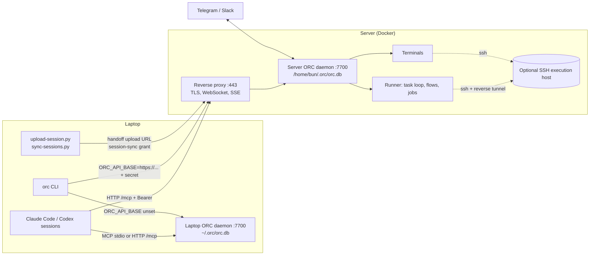

# Self-hosted ORC

This page covers running ORC on a server next to the ORC on your laptop: deploying it, connecting clients and agents to both, moving sessions and work to the server, and copying artifacts between the two.

## Two installations, not one cluster

A laptop ORC and a server ORC are two independent installations. Each has its own database, config, secret, projects and runner. ORC does not replicate or federate between installations. What moves between them moves through explicit transfers, listed on this page.

| | Laptop ORC | Server ORC |
| --- | --- | --- |
| Typical install | Desktop app or `orc daemon start` | Docker Compose |
| Address | `http://127.0.0.1:7700` | `https://orc.example.com` behind a reverse proxy |
| Data | `~/.orc` on the laptop | `/home/bun/.orc` inside the container, on a volume |
| Agents run on | The laptop (or its SSH execution host) | The container (or its SSH execution host) |
| Sees live sessions from | Agents on the laptop | Agents in the container or its SSH host |



## Deploy the server

### Compose file

Use the repository's `docker-compose.yml`. Put secrets in a `.env` file next to it:

```bash
# .env
ORC_API_SECRET=<output of: openssl rand -hex 32>
ANTHROPIC_API_KEY=sk-ant-...
OPENAI_API_KEY=sk-...
```

Add what a server needs to the `environment:` list:

```yaml
      - ORC_AGENT_LOOP_ENABLED=true      # the task loop is off by default
      - ORC_AGENT_LOOP_MAX_WORKERS=2
```

```bash
docker compose up -d
docker compose exec orc bun run packages/cli/src/index.ts doctor
curl -fs http://127.0.0.1:7700/api/health
```

The image includes Node, ACPX, Claude Code and Codex CLI. The default backend is `claude` through the Anthropic SDK. Installed tools do not bring credentials: set `ANTHROPIC_API_KEY` for `claude`, `OPENAI_API_KEY` or a container Codex login for `codex-cli`.

### Volumes

| Mount | Holds | Required |
| --- | --- | --- |
| `orc-home:/home/bun` | `~/.orc`: `orc.db`, `secret.key`, `config.json`, knowledge originals, agents, packages, flows; agent CLI logins and session histories | Yes |
| `orc-data:/data` | `ORC_HOME`: daemon PID file | Recommended |
| `${HOME}/.ssh:/ssh-host:ro` | SSH keys and config, copied into `/home/bun/.ssh` at start | Only for Git over SSH or an SSH execution host |
| Your repositories | Checkouts that projects point at | For any agent work |

::: warning
The container runs as user `bun` with `HOME=/home/bun`, and ORC stores its database at `~/.orc/orc.db`. A `docker run` with only `-v orc-data:/data` does not persist the database. Mount a volume at `/home/bun` as the Compose file does, or set `ORC_DB_PATH=/data/orc.db`; note that `secret.key` and the rest of `~/.orc` still live under `/home/bun`.
:::

Project folders are container paths. Mount a repository, for example `- /srv/repos/my-app:/repos/my-app`, and set the project's folder to `/repos/my-app`.

### Binding and authentication

The image sets `ORC_API_HOST=0.0.0.0`. The Compose file publishes the port on `127.0.0.1:7700` only, so the reverse proxy is the only way in. Keep it that way.

`ORC_API_SECRET` turns on authentication. Without it, every endpoint is open, including job execution. The daemon logs a `SECURITY:` warning when it binds a non-loopback address without a secret.

| Path | Auth |
| --- | --- |
| `/api/*`, `/openapi.json`, `/docs`, `/mcp` | Bearer secret, Bearer access token, or browser session cookie |
| `/health`, `/api/health`, `/api/auth/session`, `/api/auth/token` | Public |
| Webhook receivers | Per-source HMAC signature |
| Handoff upload, session-sync, skill download, scratchpad content URLs | Signed, scoped, expiring capability in the URL |

Credential options for clients:

| Credential | How to get it | Lifetime |
| --- | --- | --- |
| The API secret | `ORC_API_SECRET` | Until you change it |
| Access token | `POST /api/auth/token` with `{"secret": "...", "expires_at": <unix seconds>}` | Default `api.session_days` (30), at most 365 days |
| Browser session | Sign in on the dashboard with the secret | `api.session_days` |

```bash
curl -s https://orc.example.com/api/auth/token \
  -H 'Content-Type: application/json' \
  -d "{\"secret\":\"$ORC_API_SECRET\"}"
# {"token":"eyJ...","expires_at":1767225600}
```

Give laptops and agents an access token instead of the secret. Rotating the secret revokes every token and browser session. Authentication is installation-wide: anyone with a credential has full access. There are no per-user accounts.

### TLS and reverse proxy

ORC serves plain HTTP. Terminate TLS in a reverse proxy. The proxy must:

- preserve the `Host` header and send `X-Forwarded-Proto: https`. ORC builds handoff, session-sync and download links from them; the session cookie is marked `Secure` on HTTPS.
- pass WebSocket upgrades. Terminals use `/api/terminals/{id}/ws`.
- not buffer Server-Sent Events, and allow idle reads of at least 255 seconds. The dashboard's live updates and chat streams use SSE.
- accept request bodies of at least 64 MiB. Session handoff and archive uploads go up to that size.

Caddy does all of this by default:

```text
orc.example.com {
    reverse_proxy 127.0.0.1:7700
}
```

nginx:

```nginx
server {
    listen 443 ssl;
    server_name orc.example.com;
    client_max_body_size 70m;

    location / {
        proxy_pass http://127.0.0.1:7700;
        proxy_http_version 1.1;
        proxy_set_header Host $host;
        proxy_set_header X-Forwarded-Proto https;
        proxy_set_header Upgrade $http_upgrade;
        proxy_set_header Connection $http_connection;
        proxy_buffering off;
        proxy_read_timeout 300s;
    }
}
```

Set `api.cors_origins` (or `ORC_API_CORS_ORIGINS`) only if a dashboard on a different origin calls this API. The default is same-origin only.

### Optional: run agents on an SSH host

The server ORC can run agents, terminals, Git and jobs on another machine over SSH instead of inside the container.

1. Mount `~/.ssh` (the Compose file does) with a `Host` alias for the machine.
2. Set `ORC_API_SECRET`. Without it the reverse tunnel exposes an unauthenticated API on the SSH host's loopback.
3. Select the host: `ORC_SSH_HOST=<alias>` in the environment (fixed), or **Settings → Execution host** / `PUT /api/ssh`.
4. Check it with the connection test in **Settings → Execution host** or `POST /api/ssh/test`. It reports OS, shell, installed agent CLIs and Claude login.

ORC opens a multiplexed SSH connection with a reverse port forward, so agents on that host reach ORC at `http://127.0.0.1:<port>` and get `ORC_API_BASE` and `ORC_API_SECRET` in their environment. The SSH key must allow remote forwarding, or set `ssh.remote_port` to a port where the API is already reachable. Native Windows ORC does not support SSH execution.

## Connect a laptop to both

No client stores multiple server profiles. Each CLI process, MCP connection and browser tab targets one ORC. Pick the target per process.

### CLI

The CLI calls the API at `ORC_API_BASE` with `ORC_API_SECRET` as the Bearer credential. Unset, it uses the local daemon from `~/.orc/config.json`.

```bash
orc task list                                   # laptop ORC

export ORC_CLOUD_TOKEN=eyJ...                   # from POST /api/auth/token
alias orc-cloud='ORC_API_BASE=https://orc.example.com ORC_API_SECRET=$ORC_CLOUD_TOKEN orc'
orc-cloud status
orc-cloud task list -p my-app
```

| Note | Detail |
| --- | --- |
| Use `ORC_API_BASE` for HTTPS | The global `--host` and `--port` flags always build an `http://` URL |
| Active project is local | `orc project use` writes `activeProject` to the laptop's config, so it also applies to `orc-cloud`. Pass `-p` or set `ORC_ACTIVE_PROJECT` |
| Server-side paths | `orc mem import/export`, `orc skill local`, `orc skill export-to` and `orc kb sources add` read and write folders on the ORC server, not the laptop |

### Agents (MCP)

Connect agents to the server over HTTP MCP. Keep the local ORC as a second server with a different name.

```bash
claude mcp add --transport http orc-cloud \
  "https://orc.example.com/mcp?project=my-app" \
  --header "Authorization: Bearer $ORC_CLOUD_TOKEN"
```

With the `spec` CLI bridge, register both once and pick per call:

```bash
spec add orc-local --mcp-http http://127.0.0.1:7700/mcp \
  --header 'Authorization=Bearer ${ORC_LOCAL_SECRET}'
spec add orc-cloud --mcp-http https://orc.example.com/mcp \
  --header 'Authorization=Bearer ${ORC_CLOUD_TOKEN}'

spec call --spec orc-cloud context --data '{"project":"my-app"}'
```

`/mcp` query parameters set connection defaults: `project=<name>` or `projects=a,b`, and `mode=meta|full`. See [MCP](./mcp.md).

::: warning
Do not point stdio `orc mcp` at a remote server. Stdio MCP reads and writes the local `~/.orc/orc.db` directly for most tools and only forwards a few calls (channels, human requests, session sync and handoff, skill and scratchpad downloads, knowledge-base digests) to `ORC_API_BASE`. Against a remote server it would split state between two databases. Use HTTP `/mcp` for any remote ORC.
:::

### Hooks and live sessions

Session lifecycle hooks and the live-session registry (`~/.orc/live-sessions/`) are local to the machine. Sessions you run on the laptop appear in the laptop ORC's Sessions view only. To get their history onto the server, sync or hand them off (below).

### Dashboard and desktop app

Open each ORC's dashboard in its own browser tab: `http://127.0.0.1:7700` and `https://orc.example.com`. The server prompts for the secret and keeps a session cookie. The desktop app manages only the local daemon on `127.0.0.1`.

## Move work to the server

### Hand off a running session

A handoff moves a Claude Code or Codex conversation from the laptop into a new native session on the server's execution host, in a fresh Git worktree, and opens it in a terminal there. The laptop's original stays untouched.

Prerequisites on the server:

| Requirement | Why |
| --- | --- |
| The project exists with its folder pointing at a checkout on the execution host | ORC creates the worktree inside that repository |
| The checkout's remote matches the repository you report | ORC does not clone arbitrary URLs |
| Git can fetch from that remote on the execution host | ORC fetches the branch and checks the commit |
| The agent CLI and its credentials are installed there | The resumed session runs there |
| Python 3, for an SSH execution host | Remote file operations |

Steps, from the laptop session, with `orc-cloud` connected over MCP:

1. Commit and push the work. Confirm the remote branch tip equals your `HEAD`.
2. Call `session_handoff` on `orc-cloud` with project, agent, native session ID, source cwd, repository, branch and the pushed commit. It returns a single-use upload URL valid for 15 minutes.
3. Upload the transcript with the `orc-platform` skill's helper:

   ```bash
   python scripts/upload-session.py --agent claude \
     --session-file ~/.claude/projects/<dir>/<session-id>.jsonl \
     --upload-url '<upload_url>'
   ```

4. On the server dashboard, **Sessions** shows the session as **Ready**. Choose **Resume → Terminal**.

The worktree is `<repo>/.orc/worktrees/<handoff-id>` on branch `orc/handoff/<handoff-id>`. Only Git-tracked state and the native transcript move. Ignored files, dependencies, environment variables and running processes do not. The agent can run the whole sequence when asked to hand off; the `orc-platform` skill documents it. Details: [Session handoff](./session-handoff.md).

### Sync session history

To make laptop history searchable on the server without running anything, sync it into the session archive.

1. Ask an agent connected to `orc-cloud` to call `session_sync({projects:["my-app"]})`. It returns a private grant valid for one hour, scoped to those projects.
2. Run the helper with the grant on stdin or in a private file:

   ```bash
   python scripts/sync-sessions.py --grant-file /private/grant.json \
     --project my-app --cwd ~/code/my-app --dry-run
   python scripts/sync-sessions.py --grant-file /private/grant.json \
     --project my-app --cwd ~/code/my-app
   ```

   Alternatively pass `--url https://orc.example.com` with `ORC_API_SECRET` in the environment. HTTPS is required except on loopback.

Synced sessions appear under **Sessions → Archived sessions** and in `session_search`. Re-running uploads only changed sessions; diverged histories are kept as conflicts and never overwrite. An archived session can later be resumed from its **Continue on ORC** section with **Resume → Terminal**, which runs the same handoff checks (`POST /api/sessions/archive/{id}/resume`).

### Run tasks on the server runner

Tasks run on the installation that holds them. Create them on the server:

```bash
orc-cloud task add "Implement user auth" -p my-app --flow orc-default --backend claude
```

or with `task_create` / `task_batch_create` on the `orc-cloud` MCP connection, or in the server dashboard. With `ORC_AGENT_LOOP_ENABLED=true`, the server's runner claims queued tasks and runs workers in the container or on its SSH execution host. Review and approve them in the server dashboard, the CLI, or Telegram/Slack connected to the server.

There is no command to move an existing task from the laptop ORC to the server ORC.

### Terminals on remote hosts

The server dashboard's **Terminals** open shells and agents on the server. **New terminal** offers **Local** (the container) or any `Host` alias from the server's `~/.ssh/config`. The choice scopes launchers, folder browsing, worktrees and Git to that host. Existing terminals keep their host. See [Terminal workspace](./terminal-workspace.md).

## Share artifacts between installations

| Artifact | Copy laptop → server | Notes |
| --- | --- | --- |
| Session history | `sync-sessions.py` or handoff | See above |
| Scratchpads | `orc pad pull <id> plan.md`, then `orc-cloud pad new doc "Plan" -f plan.md` | Plans, mermaid docs, Excalidraw diagrams, HTML pages |
| Skills | `orc skill export <name> ./out`, then `orc-cloud skill create <name> -d ./out` | Includes supporting files |
| Public skills | `orc-cloud skill import <github-or-skills.sh source>` | Fetched by the server |
| Agent profiles | `orc agent export <id> ./a.agent.md`, then `orc-cloud agent create <id> --file ./a.agent.md` | |
| Agent packages | `orc agent-package export <name> ./pkg`, then `orc-cloud agent-package import ./pkg` | File contents are uploaded |
| Flows | `orc --json flow show <name> \| jq .definition > flow.json`, then `orc-cloud flow create -f flow.json` | Or copy `~/.orc/flows/<name>/flow.json` |
| Knowledge base documents | `orc-cloud kb add <kb> ./docs/*.pdf` | Uploads from the laptop. `kb sources add` registers a folder on the server instead |
| Memories | Recreate with `orc-cloud mem add` | `mem import/export` use folders on the server; copy files into a mounted path first to use them |
| Tasks, jobs, webhooks, channels, rules, settings | Recreate on the server | No export or import |

Each installation keeps its own `secret.key`. Encrypted values such as embedding API keys and channel credentials do not transfer; enter them again on the server.

## Backup

Stop the container, then copy the `orc-home` volume. It holds `orc.db` with its `-wal` and `-shm` files, `knowledge/originals/` and `secret.key`. Search indexes rebuild on start.

## Related

- [Install](./install.md) and [Configuration](./configuration.md)
- [Connect agents](./connect-agents.md), [MCP](./mcp.md), [CLI](./cli.md), [API](./api.md)
- [Session handoff](./session-handoff.md) and [Live sessions](./live-sessions.md)
- [Terminal workspace](./terminal-workspace.md)
