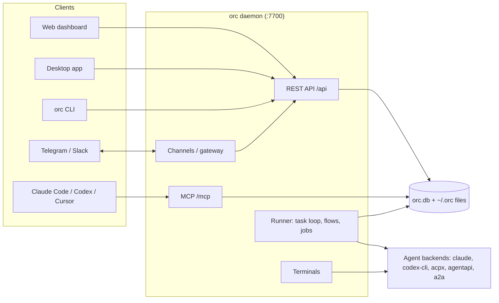

# What is ORC

This page explains the problem ORC solves, what it gives you, who it is for, and how its parts fit together.

## The problem

Every coding-agent session is an island.

- A new Claude Code, Codex or Cursor session knows nothing about the last one.
- Two sessions running in parallel cannot coordinate.
- Switching agents means starting from zero.
- There is no shared board: work in flight lives in terminal tabs and your head.
- There is no middle ground between full autonomy and watching every step. You cannot say "do the work, but check with me before it lands."

You end up as the integration layer, copying context between sessions by hand.

## What ORC gives you

ORC is a self-hosted hub that every agent session connects to. It holds shared state, routes work, and puts your approval between "the agent thinks it is done" and "done".

| Capability | What you get |
| --- | --- |
| Task board | `todo → queued → doing → review → done`, with dependencies, priority and a `review` gate you approve |
| Agent orchestration | A task loop that claims queued tasks and runs workers on Claude, Codex, ACPX agents, agentapi or A2A endpoints |
| Task flows | Per-task graphs: build, verify, review loops, parallel fan-out, human gates, hard termination limits |
| Shared memory | Short project facts loaded into every session's context |
| Knowledge bases | Uploaded documents and folders with full-text and vector search, cited passages |
| Sessions | One view of live and ended Claude Code, Codex, Cursor and Gemini sessions, with transcripts, resume and handoff |
| Scratchpads | Plans, diagrams and HTML pages that you and agents edit together, with revisions |
| Jobs and webhooks | Commands, agent runs or task creation on cron, file-watch, webhook or manual triggers |
| Channels | Telegram and Slack: get notified, approve, chat with agents from your phone |
| Attention | Agent questions, approvals and command requests in one inbox |
| Rules | Deterministic allow/deny/ask decisions on agent tool calls |
| Skills and packages | A shared library of skills and agent profiles every backend can use |

Everything is stored in one SQLite file plus a folder of files under `~/.orc`. There is no account and no hosted service.

## Who it is for

Developers who:

- run several agent sessions, serial or parallel, that need shared context
- use more than one coding agent and want one board across them
- want agents to work unattended and submit results for review
- want scheduled agent work they review when convenient
- need a record of what was done, decided and why

ORC does not write code or replace your agents. It coordinates them.

## How the pieces fit

| Component | Package | Role |
| --- | --- | --- |
| Daemon | `packages/cli` (`orc daemon start`) | One process that runs the API, runner, channels and terminals |
| REST API | `packages/api` | Hono server on port 7700; OpenAPI at `/openapi.json`, Swagger at `/docs` |
| MCP server | `packages/mcp` | Agent tools over Streamable HTTP at `/mcp` or stdio via `orc mcp` |
| CLI | `packages/cli` | The `orc` binary; talks to the API |
| Web dashboard | `packages/web` | React UI served by the daemon at its root URL |
| Desktop app | `packages/desktop` | Bundles the daemon, dashboard and CLI; attaches to a running daemon or starts one |
| Runner | `packages/runner` | Task loop, flow engine, job executor and scheduler |
| Agent runtime | `packages/agent-runtime` | Backend adapters that launch and drive coding agents |
| Channels / gateway | `packages/channels`, `packages/gateway` | Telegram and Slack transport, routing and agent chat |
| Database | `packages/db` | SQLite via Drizzle, at `~/.orc/orc.db` |

Data flows `Agent → MCP → API/DB` and `CLI → SDK → API → DB`.

## Next

- [Install](./install.md) and [Quick start](./quick-start.md)
- [Concepts](./concepts.md) for the core model
- [Connect agents](./connect-agents.md)
- [Self-hosted ORC](./self-hosted.md) to run a remote instance next to your local one
