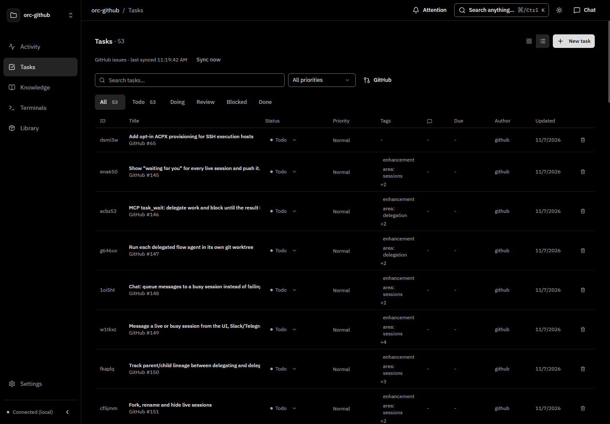
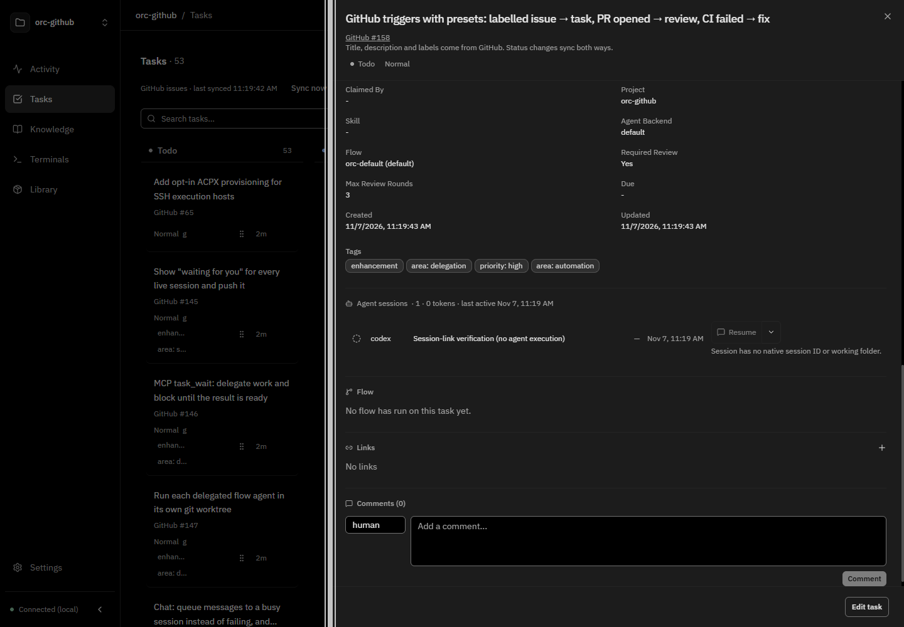

# GitHub issues rendered as native tasks

Verified on November 7, 2026 against PR #216. The dev API imported 53 actual open
issues from the public `niradler/orc` repository into an isolated in-memory project.
GitHub access was GET-only; no issue statuses, labels or comments were changed.

## Real repository issues in Tasks

This is the ordinary Tasks table, using the existing task rows, filters, priority,
status controls and detail sheet. Each imported issue has a stable ORC task ID and
a GitHub source badge. It is not the separate GitHub feed.

## Connected session on an imported issue

The detail sheet is for real GitHub issue [#158](https://github.com/niradler/orc/issues/158).
Its Agent sessions section uses the existing native task/session link.
The visible session is a deliberately created, stopped verification record named
"Session-link verification (no agent execution)". It demonstrates linking and
rendering; it is not evidence that an agent ran or could resume that verification
record. No private workspace conversations were copied into these screenshots.

## Native-task parity checked

The integration regression `should retain connected sessions, comments,
dependencies and workflow settings across issue resync` exercises the normal API
routes to link/unlink a session, add a local comment and related-task link, and set
priority, progress, backend and workflow. After the upstream issue changes and
sync runs again, the same task ID, session link and local fields remain intact.
The browser also verifies the session hyperlink and its persistence after reload.

GitHub owns imported titles and descriptions; edit those in GitHub. ORC comments
and workflow/session metadata remain local. GitHub issue comments are not mirrored.
Status is synchronized both ways. Imported issues never start agents automatically.
Actual agent execution and resume were not exercised by this screenshot check.
