# Unified session workspace mock review

Production follow-up: the application now composes these controls in
`SessionWorkspace.tsx`, backed by the existing chat and terminal providers. The
mock descriptions and screenshots below remain the visual reference for PR #237.
See [Desktop and web](../docs/desktop-and-web.md#full-width-sessions-view) for
the implemented behavior. Production validation covers actual Codex streaming,
uploads, queues, approval denial, same-runtime chat/terminal handoff, reported
token counts, files/Git/worktrees and touch-terminal continuity. The integration
also retains the original components named in the audit below: prompt/command
menus, approval/question cards, terminal splits and lifecycle actions, Git/PR
operations, file conflict protection, discovery/archive and history filters.
Local automated coverage includes desktop and phone viewports; live SSH and
physical mobile devices remain unverified. This follow-up does not change Tasks
or other page layouts and is not a merge or release.

### Production user-journey checks

The production integration was exercised in the actual authenticated source app
with an isolated checkout and real Codex/shell runtimes. Desktop and phone journeys
covered upload/read plus queued responses, concurrent streams in separate chats,
busy handoff guards, chat/terminal identity, dirty file save/reopen, terminal input,
reload/scrollback and retained PID. Touch checks used Pixel 7 emulation; physical
phones and live SSH remain unverified.

Exploratory testing reproduced a duplicate-PTY defect: selecting the other session's
terminal in the global picker moved its canvas and left its original pane blank.
Workspaces now focus the existing presentation across the group. Container-owned
attach/detach also protects restored duplicate URLs and their cleanup. Desktop and
phone regressions cover both cases. Phone terminal tab names and title truncation
were corrected during visual review.

Production screenshots are in `docs/public/screens/`: `session-home-desktop.png`,
`session-home-phone.png`, `session-list-phone.png`, `workspace-settings-desktop.png`,
`workspace-settings-phone.png`, `workspace-parallel-desktop.png`,
`workspace-parallel-phone.png` and `workspace-touch-terminal.png`. They show the
actual application with synthetic fixture conversations, rather than new mock variants.

This draft proposes full-page web chat as ORC's starting workspace, retains side
chat on existing pages, and gives sessions consistent chat/terminal controls.
It is a design prototype, not a live session integration or a production default
change. Tasks and other existing product pages are unchanged. The Tasks surface
inside the side-chat mock is illustrative context only.

## Run and compare

From `packages/web`, run:

```sh
bun run dev --host 127.0.0.1 --port 3077 --strictPort
```

Open `http://127.0.0.1:3077/workspace-next.html`. The UI uses real workspace
controls for split, expand and side chat. There is no mock-scenario toolbar in
the application or screenshots. Review states can also be opened directly:

| Scenario | URL suffix | Review focus |
| --- | --- | --- |
| New session | `/workspace-next.html` | Default full-page chat and project navigation |
| Conversation | `/workspace-next.html?scene=session` | One session with Chat / Terminal representations |
| Parallel sessions | `/workspace-next.html?scene=parallel` | Two independently selected sessions and drafts |
| Side chat | `/workspace-next.html?scene=side` | Existing-page context beside the same conversation |

The original layout comparison is retained at `/workspace-draft.html`.
Both are standalone Vite development entries; the shipped application's entry,
routes, authentication and pages are unchanged.

## Proposed behavior

- Projects and Recents navigation; Recents is flat and sorted by latest activity
  across projects. Project rows expose a plus action on hover, keyboard focus and touch.
- New session is the default action. Its dropdown also offers New terminal with
  Shell (default), Codex, Claude and an Agent configuration entry.
- The shared compact composer row contains settings, refresh, attach files,
  project/folder, Git branch/worktree, model and Send. The gear reveals detailed
  configuration above the input: host, agent, permissions, model/effort, tools,
  instructions and advanced options. No default-permissions label occupies the row.
- Attachments remain visible when configuration is closed and survive view changes.
  This mock selects file metadata only; production upload/preview is not implemented here.
- A shared inspector exposes Changes, Diff, Files, Worktrees and PR entry points
  from chat and terminal. It uses ORC's real DiffLines renderer with synthetic data.
- Switching representations, expanding a pane, or closing/reopening side chat
  preserves the selected session's in-tab message draft.
- Parallel panes have separate sessions and drafts. On phones, tabs select which
  pane is visible rather than squeezing two columns onto the screen.
- The project-nested sidebar is a proposal based on the supplied desktop
  reference. Recents remains available for comparison. Production
  `DESIGN.md` flat-list behavior is not superseded by this mock.
- Theme switching uses ORC's existing neutral tokens. The mock reuses shared
  Button, AgentIcon, StateBadge and Markdown components.

## Screenshots

Captured at 1500 × 1000 desktop and 390 × 844 phone using synthetic data only.

### New-session home

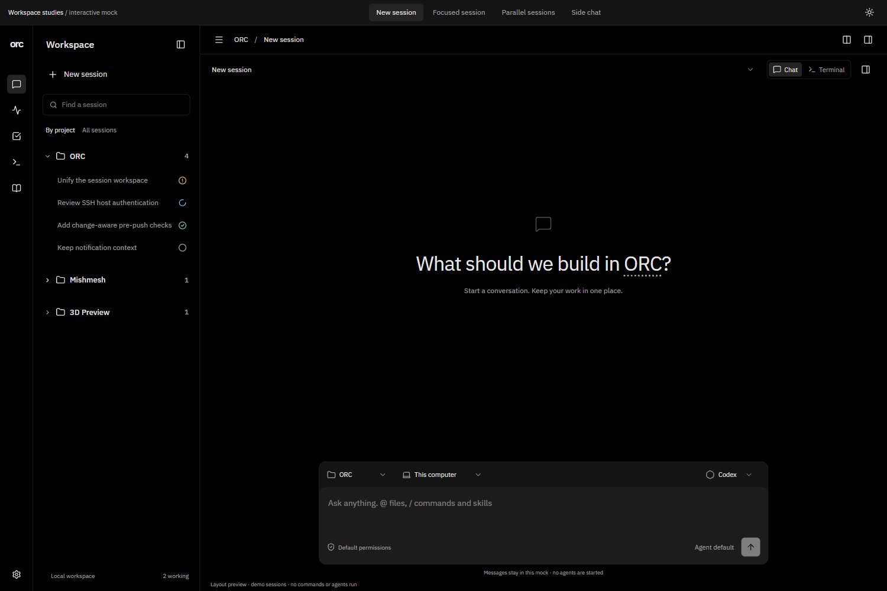

### Conversation

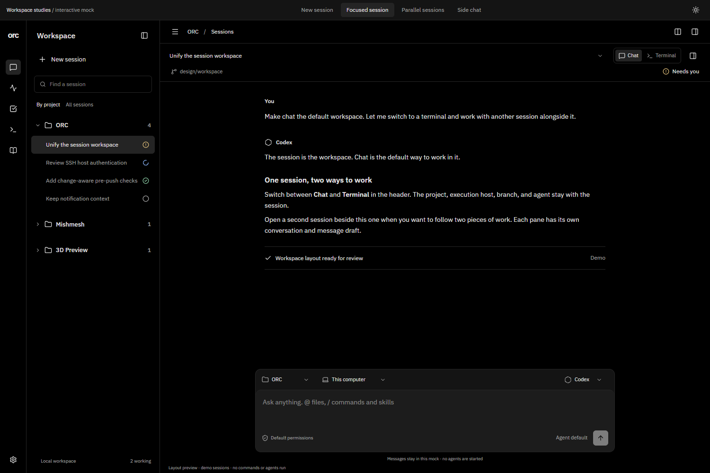

### Parallel chat and terminal

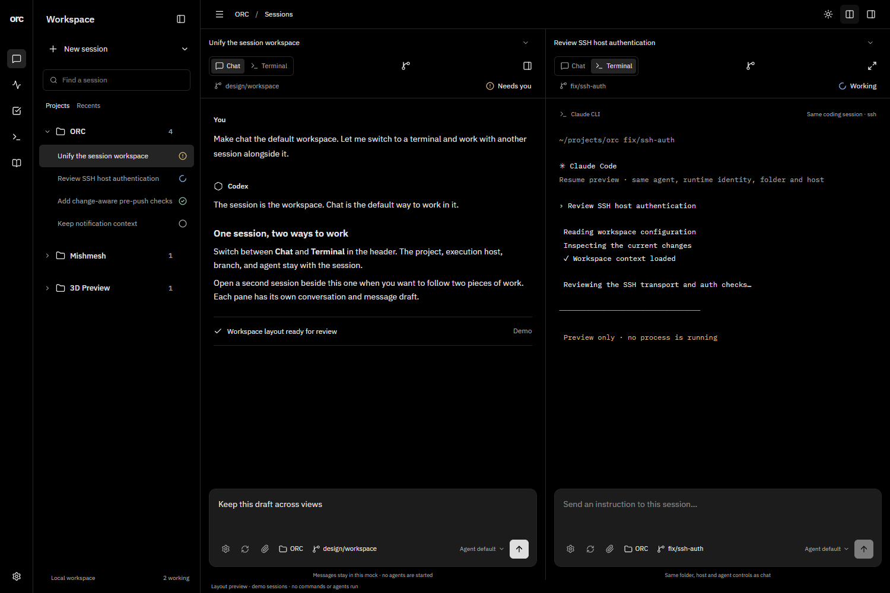

### Terminal representation

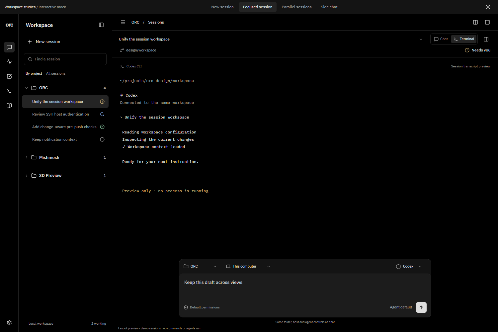

### Side chat

The task list shown here is mock context, not a proposed Tasks redesign.

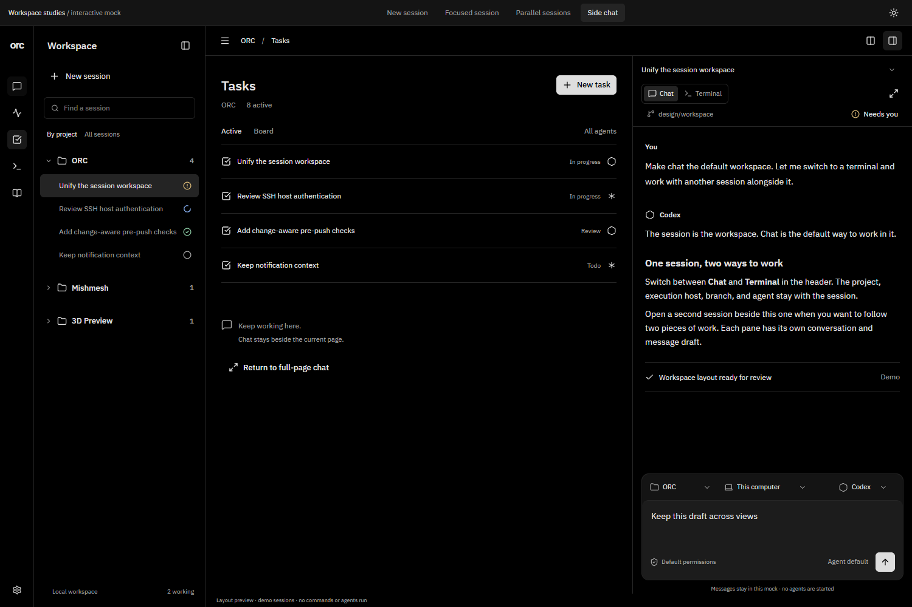

### Phone

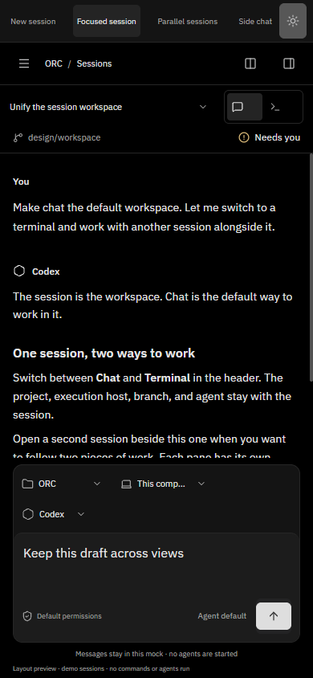

### Detailed composer settings

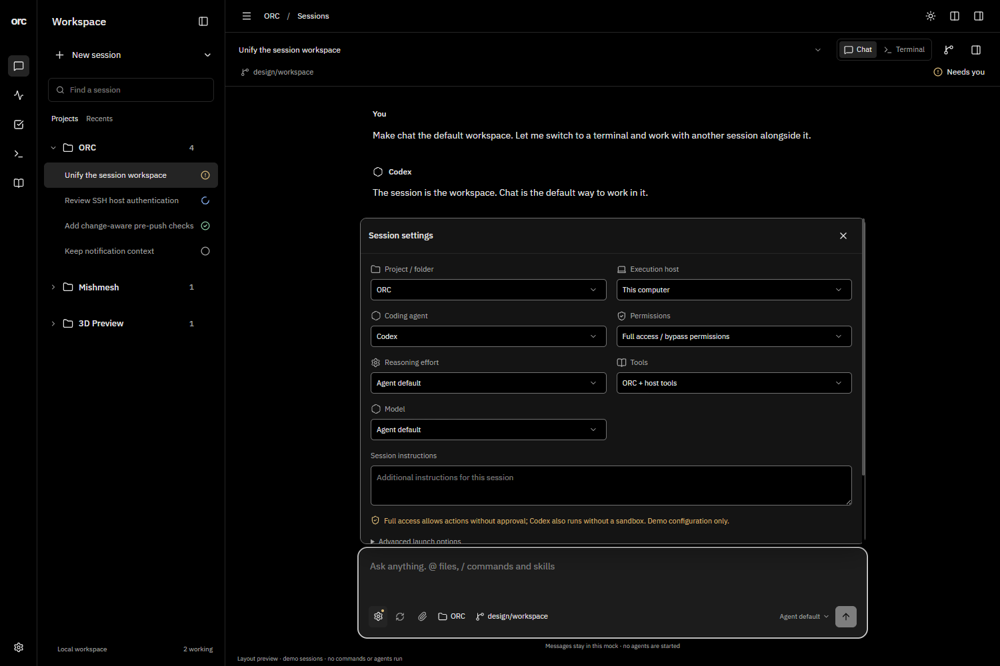

### Attachments

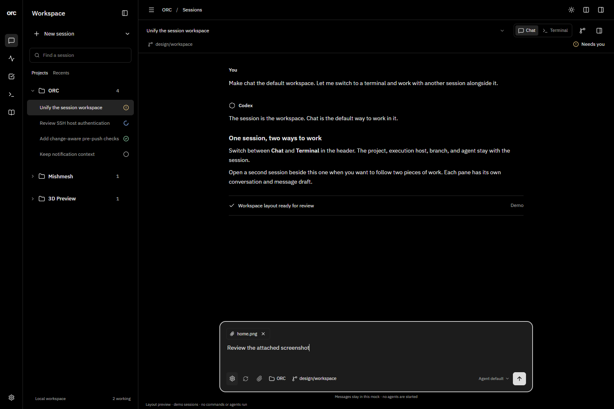

### Git and worktrees

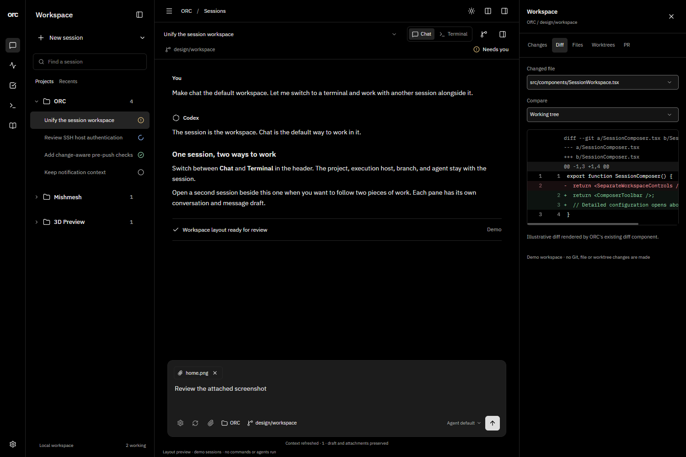
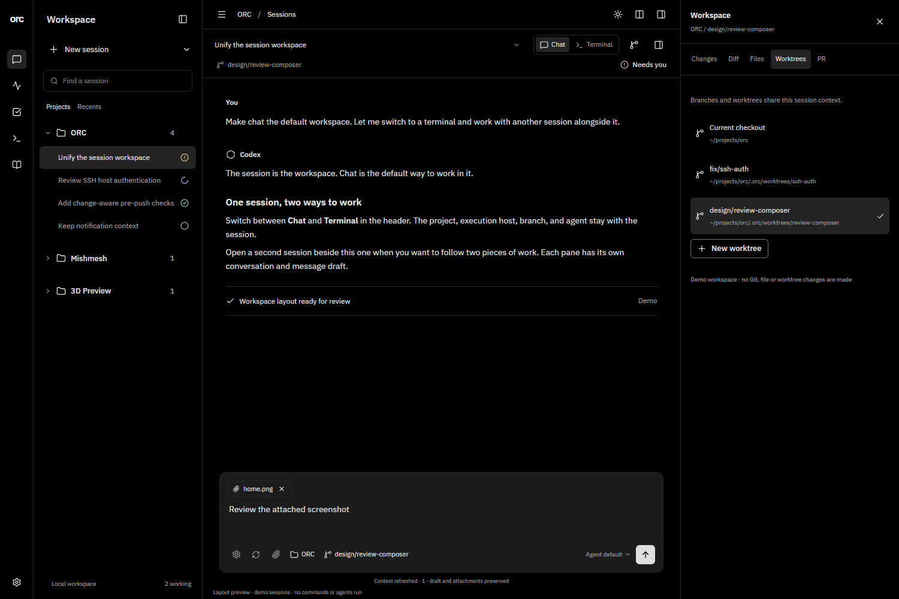

### Mobile configuration and attachments

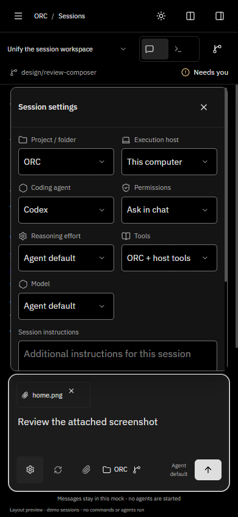
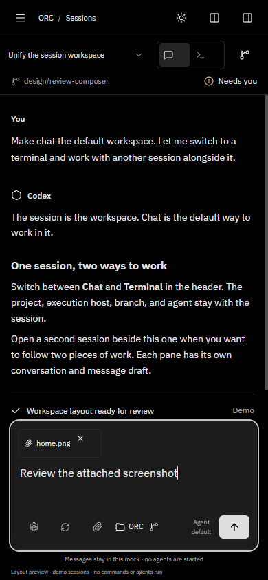

### Mobile Git, terminal and parallel sessions

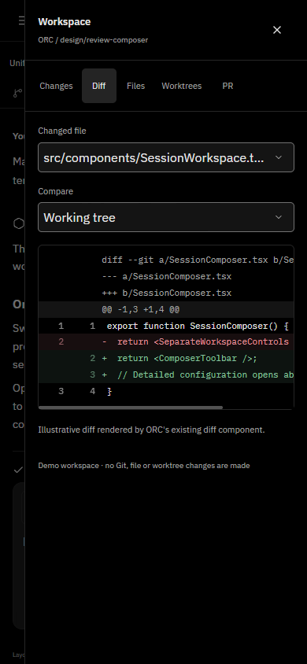
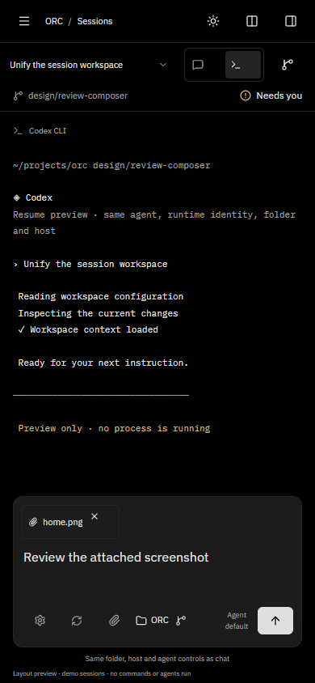
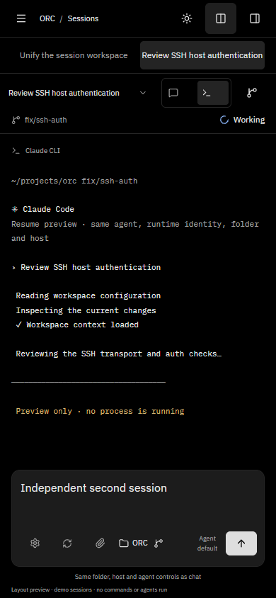

### Mobile project navigation and light theme

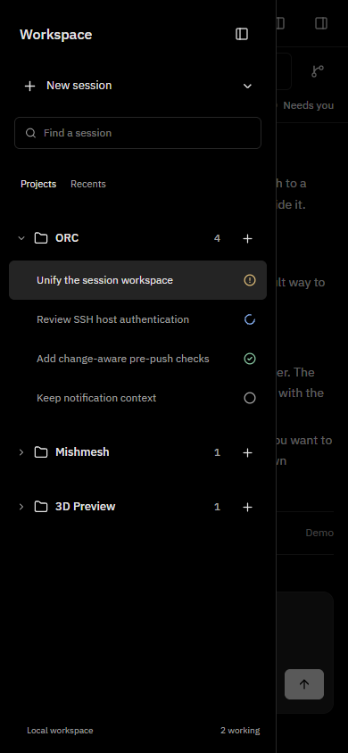
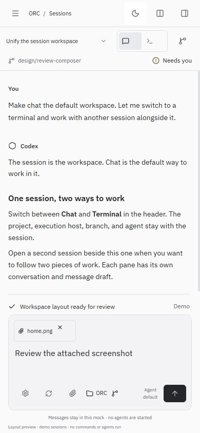

## Feature preservation audit — 2026-11-09

This is a source/entry-point audit and a mock interaction check, **not proof of
production integration**. Existing product source files are unchanged in this PR.
All production capabilities below still exist in their original surfaces. The
implementation must compose those components and contracts rather than replace
them with these synthetic previews.

| Existing capability / source | Proposed common entry | Mock coverage / implementation requirement |
| --- | --- | --- |
| Streaming conversation, Markdown, live tools: `ChatPanel.tsx`, `ChatActivityList.tsx`, `useChat` | Default chat representation | Synthetic transcript only; retain real streams, errors, reconnect and tool output |
| Attach/upload, previews, remove, remote transfer: `ChatPanel.tsx`, `ChatAttachments.tsx`, `session-uploads` routes | Always-visible paperclip and selected-file chips | File metadata selection/removal shown; real upload, 20 MB total limit, preview and SSH transfer must be retained |
| Agent/model/effort/capabilities, permissions, instructions: `ChatAgentModelPicker`, `ChatPermissionSelect`, `ChatConversationInfo`, `ChatAgentOptionsEditor` | Compact model plus gear panel | Configuration layout shown; actual provider catalogs, capability limits and permission timing must be retained |
| Prompts, commands, skills, long-paste attachments: `ChatPromptMenu`, chat composer hooks | Existing composer and its prompt menu | Not implemented by mock; retain existing parsing, picker and paste flow |
| Queue edit/reorder/remove/force-send, Stop, Send now: `ChatPanel.tsx`, `useChat` | Same selected session composer and live status | Not implemented by mock; keep dispatch, busy, closed-session pause and interrupt behavior |
| Approval/question UI and notifications: `ChatQuestionForm`, request cards, `AgentNotifications` | Conversation plus global notifications | Not implemented by mock; never hide pending requests, errors or permission decisions in settings |
| Local/remote folder and host selection: `ChatWorkspaceControls`, `FolderPickerDialog`, `RecentFolders`, `useTerminalLaunchDraft` | Shared detailed configuration and compact folder | Fixture projects/hosts only; preserve browser/native/SSH folder workflows and saved launch preferences |
| Shell/coding-agent/agent launches: `NewTerminalMenu`, `TerminalSelect`, `/terminals` REST | New session dropdown → New terminal → Shell / Codex / Claude / Agent | Mock launcher creates separate synthetic entries; reuse real launchers/probes and unavailable-backend errors |
| Same-runtime chat → terminal: `ChatContinueInTerminal`, `useTerminals.openLiveSession`, `/terminals` REST | Terminal representation | Demonstrates identity only; production reuses attached terminal or resumes the exact runtime after handoff verification, preserving host/cwd. Codex/Claude availability and busy guards remain |
| Terminal → chat: `ContinueInChat`, `api.chat.resume` | Chat representation | Demonstrated only; retain live_session_id mapping, registration wait, busy/ownership checks and history |
| Terminal process/input/WebSocket continuity, mobile controls and search: `TerminalViewport`, `TerminalTouchControls`, `TerminalTextSheet` | Real terminal representation | Synthetic text only; preserve actual interactive terminal, reconnect, scroll/copy/paste and phone keyboard behavior |
| Pane splits horizontal/vertical, zoom, select, close-without-kill: `TerminalWorkspace`, `TerminalPaneLinks` | Unified pane header | Mock shows two side-by-side sessions and phone tabs; preserve the real pane layout model, resize, zoom and process lifetime |
| Rename/kill/remove/lifecycle: `TerminalActions`, `RenameTerminal`, `useTerminals` | Session actions menu | Not implemented by mock; closing a pane must not kill its process; retain explicit destructive confirmations |
| Git status, staged/unstaged, diffs and commit/push: `GitPanel`, `FileDiffCard` | Shared Git inspector | Mock tabs, local staging state and actual DiffLines rendering; production must retain all existing operations and unified/split comparison |
| Branch selection, worktree create/select/cleanup: `TerminalCheckout`, `WorktreeManager`, `NewTerminalMenu`, `GitPanel` | Branch chip and Worktrees inspector | Mock creation/context selection only; preserve dirty-tree guards, host binding and cleanup confirmations. A resumed session cannot silently change cwd/host |
| File browsing/edit/save and unsaved changes: `FilePanel`, `FileEditor` | Files inspector | Mock read-only file fixture only; retain real local/SSH file operations and dirty-navigation protection |
| PR checks/review/comments/actions: `PullReviewPanel`, Git/PR API | PR inspector | Entry point only; keep real CI, comments, review, provider capabilities and publishing authorization |
| Live/discovered/archived history, filters/unseen/stable ordering: `ChatSessionPicker`, `LiveSessions`, `ArchivedSessions`, `chat-history-list` | Projects / Recents, shared row | Mock ordering/status shown; real list must retain filters, unseen state, stable hovered/focused order, archive and discovery |
| Project scope, task links, URLs/Back/reload, draft persistence: `ProjectPicker`, `SessionTaskLink`, `useSessionHome`, `useChat` | Shared session identity and workspace context | Mock state lasts only in tab; real deep links, selected pane, scopes, tasks and saved drafts must survive navigation/reload |
| Existing Tasks, Activity, Knowledge, Settings and other pages | Existing app rail; optional side chat | Existing product views unchanged. Side mock uses illustrative task context, not a replacement Tasks design |

### Mobile acceptance requirements for implementation

Preserve 44px touch targets, 16px text inputs, visual-viewport/keyboard handling,
focus return and Escape/Back behavior. Verify 320/390px and tablet widths, long
paths/titles, both themes, attachments, permissions/questions, file save/reopen,
queues, terminal keyboard/input continuity and Git/worktree flows with actual
runtime data. Screenshots alone do not prove those flows.

## Validation and limits

Local web TypeScript and Biome checks passed. Existing agent-state/session-home
unit tests passed 9/9 (32 assertions). Expanded browser checks cover default chat,
shared context, independent drafts, view switching, side-panel lifecycle, detailed
configuration, attachments, Git/diff/worktrees, creation and Recents ordering,
and 320/390px phone layouts. The first comparison passed16 browser checks.
Browser inspection confirmed zero live API requests and no reported runtime errors
in the final validation batch (48 passing browser assertions). The normal PR gate
is recorded in the PR description for the published revision.

All sessions, messages, task context and CLI output are synthetic and stay in the
open tab. No agents or shell commands are started. No provider model catalog is
invented; the model label remains Agent default. Production integration still
needs real session/terminal continuity, persistent state, catalog-driven controls,
complete drawer keyboard/focus behavior and corresponding live-flow tests.

This PR is for layout review. It does not close the underlying feature issues.
