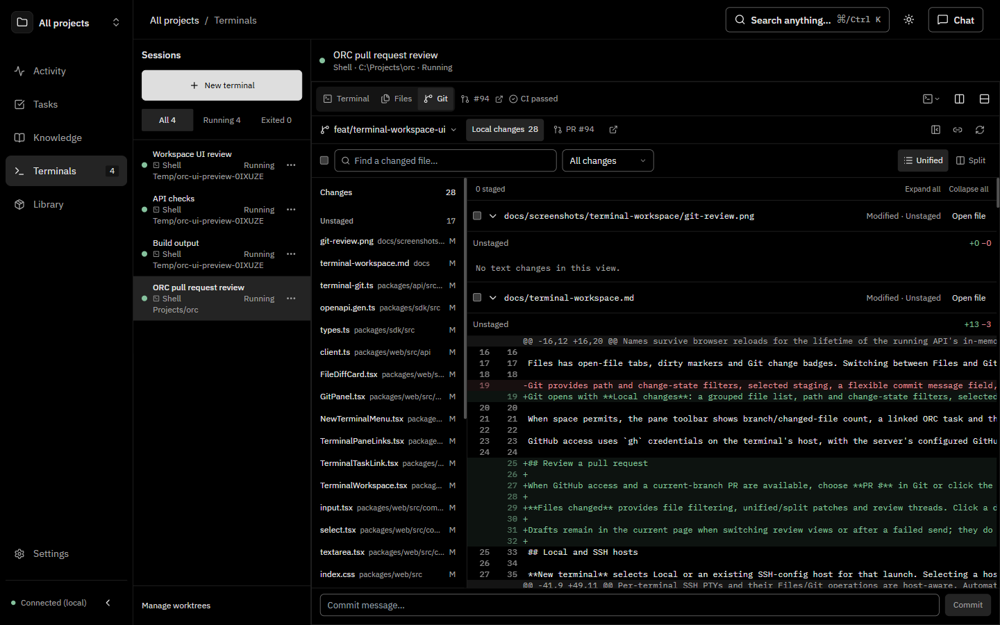
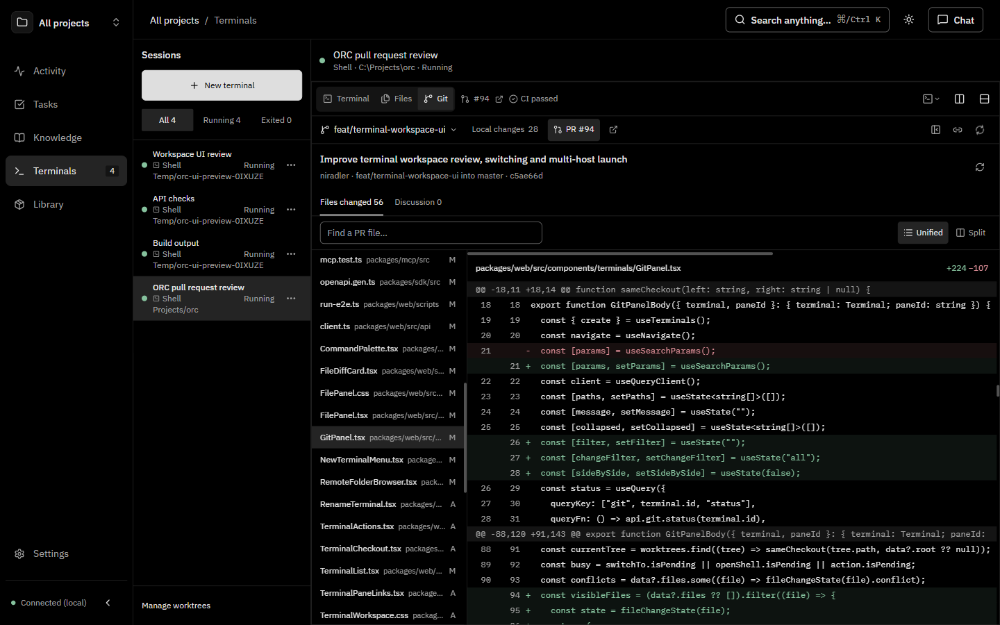
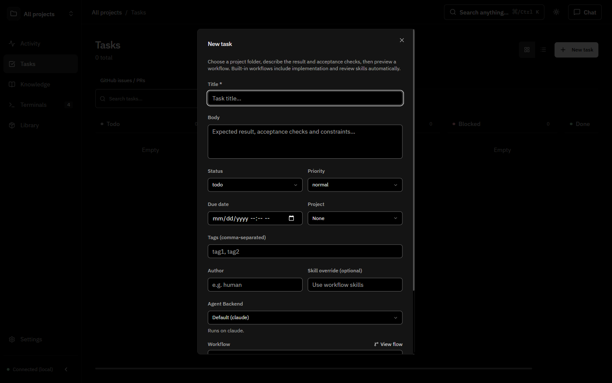
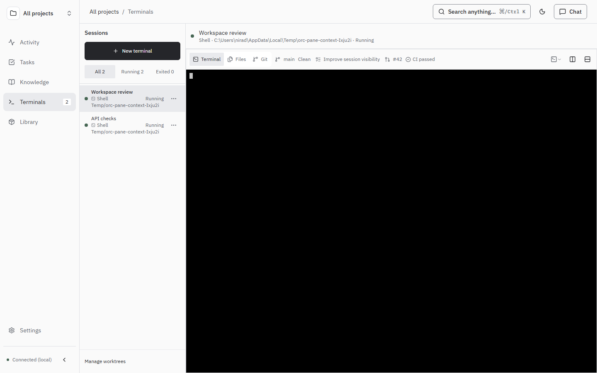
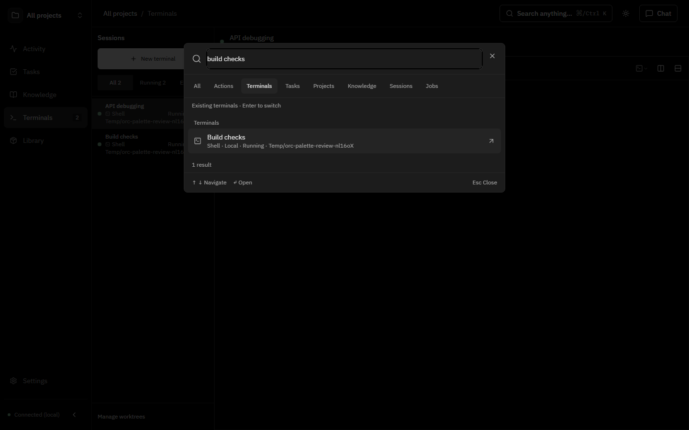
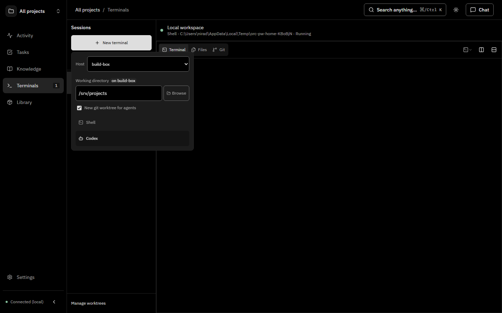

# Terminal workspace

Use Terminals to keep shells and coding agents beside Files and Git views. Splitting or expanding a pane preserves running terminal processes.

## Find and manage terminals

- Press **Ctrl+K** (**Cmd+K** on macOS) and choose **Terminals**, or use the terminal picker icon beside the split controls.
- Search friendly names, full folder paths, agent types or host aliases. An empty terminal search shows recent terminals for this browser session.
- Select a result to open the existing terminal. A terminal already visible in another pane is focused there, rather than mounted twice.
- Use a session's three-dot menu or right-click its name to **Rename**, **Duplicate** or **Close**. Duplicate starts a fresh session of the same type on the same host and in the same folder; it does not copy an agent conversation or create a worktree.
- **Expand pane** temporarily fills the terminal workspace with one pane. **Restore split layout** restores the other panes. This does not enter browser fullscreen or stop their processes.

Names survive browser reloads for the lifetime of the running API's in-memory terminal. Closing a pane preserves its terminal; closing the terminal stops it.

## Files and Git

Files has open-file tabs, dirty markers and Git change badges. Switching between Files and Git or arranging panes preserves in-page file tabs and editor drafts. Drafts are not durable storage; save before closing the page. Saves detect conflicting disk changes and retain the draft for explicit resolution.

Git opens with **Local changes**: a grouped file list, path and change-state filters, selected staging, unified or side-by-side diffs, and links into Files. The commit message stays full width at the bottom. Click the branch name to expand branch/worktree controls; use the task-link icon beside the file-sidebar toggle to link an ORC task. **New worktree** sits beside the worktree selector. The file list collapses into a picker in narrow panes. Opening a worktree preserves the selected terminal host.

When space permits, the pane toolbar shows branch/changed-file count, a linked ORC task and the current branch's open PR. CI appears beside the PR when GitHub provides its current head-commit checks and statuses. Inaccessible or incomplete CI is hidden; no reported checks is shown separately from passing checks. CI refreshes while the workspace is open. The wider task and PR details disappear in narrow panes.

GitHub access uses `gh` credentials on the terminal's host, with the server's configured GitHub token as a fallback. A checkout without a GitHub `origin` remote is reported separately from unavailable authentication.

## Review a pull request

When GitHub access and a current-branch PR are available, choose **PR #** in Git or click the pane toolbar PR link. The separate external-link icon opens GitHub in your browser. PR review shows committed PR changes separately from dirty local files.

**Files changed** provides file filtering, unified/split patches and review threads. Scroll continuously through the loaded files, or use the file list/picker to jump to a file. Click a diff line number to write an inline comment, or **Reply** below a thread. **Discussion** shows the description, general comments, review summaries and inline threads; use its comment field for a general PR comment. Sending requires an explicit **Send comment** action and uses the authenticated GitHub account. This view does not approve reviews, request changes or merge PRs.

Drafts remain in the current page when switching review views or after a failed send; they do not survive reloading the page. A changed PR head requires refreshing and explicitly selecting a line again before sending an inline draft. After an uncertain network result, check GitHub before retrying. Closed PRs are read-only. Large/partial or binary changes link back to GitHub for complete inspection. Descriptions and comments display as plain text without loading embedded remote images.

## Local and SSH hosts

**New terminal** selects Local or an existing SSH-config host for that launch. Selecting a host scopes launcher availability, folder browsing and worktrees to that host. The global SSH setting is unchanged. Searching a supported SSH host in the terminal palette offers **New terminal on that host**, which opens the launcher without executing anything automatically.

Remote folder choices are kept separately from Local during the launch menu's lifetime. The new-worktree checkbox preference is remembered. Existing terminals retain their host, and resumed agent sessions retain their saved execution host.

### Supported execution hosts

| API platform | Local PTYs | SSH terminals |
| --- | --- | --- |
| Windows with Bun 1.4.2+ | Supported through ConPTY | Existing SSH transport is unsupported natively |
| Linux/macOS with supported Bun PTYs | Supported | Requires OpenSSH multiplexing, trusted host keys and noninteractive key authentication |

The SSH transport needs a callback to the ORC API. Automatic reverse forwarding requires the SSH key/server to permit forwarding. A restricted key is reported as an error; the application does not change SSH permissions or trust settings. An explicitly configured callback port can use an already reachable API endpoint.

Per-terminal SSH PTYs and their Files/Git operations are host-aware. Automatic agent-history discovery still follows the globally configured execution host; this change does not add discovery across every terminal host.

Shared Input, Select and Textarea components use compact desktop controls with the same larger touch sizes on phones. Page-specific size overrides are preserved.

## UI examples

The Local changes and PR review screenshots below show the real source checkout and a read-only fetch of PR #94. The shared-controls screenshot shows an unsaved task form in the isolated preview. The mobile PR and light Git screenshots below use explicit review fixtures. The other examples use disposable test checkouts: host names, linked task, PR and CI there are explicit fixtures, not evidence of live remote execution.

[Mobile PR review fixture](screenshots/terminal-workspace/pr-review-mobile.png) · [Light Git fixture](screenshots/terminal-workspace/git-review-light.png)

