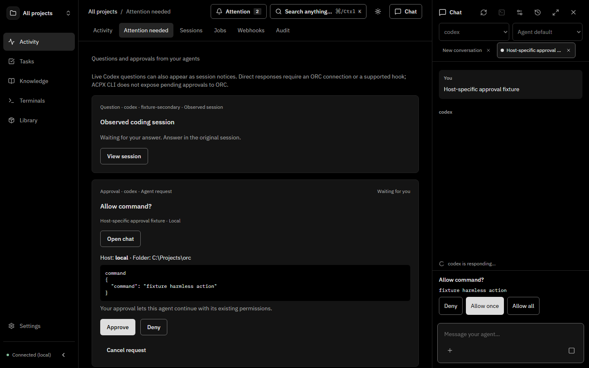

# Attention and session ownership verification

This report covers PR #122. The source regressions and opt-in scripts below are
part of the PR, so the evidence can be reproduced without modifying a live ORC
installation. Native checks use installed provider credentials and temporary
workspaces; they are explicit opt-in runs rather than CI tests.

## Reproduced defects

| Defect | Before correction | Corrected behavior and proof |
| --- | --- | --- |
| Historical remote Codex turn mistaken for ownership | Old `inProgress` records stayed working after exit. | Actual advisory writer locks determine ownership; failed probes preserve the previous state. A read-only lab inspection found 76 native sessions, no held writer locks and 3 stale `inProgress` records. No native responses were sent or DB writes made. |
| Local silent exit missed | A real OS lock holder exited without changing the transcript. After 32.5 seconds the session was still idle and waiting for a human. | A periodic ownership check now covers local and remote Codex. The same real-process fixture becomes stopped and its notice clears in about 31 seconds, without new file writes. The regression runs in local CI. |
| Cross-host notice hidden | A managed request and an observed question shared a native ID on different hosts. The browser expected two notices but showed one. | Deduplication now uses agent, execution host and native identity. The browser regression sees both notices and their host details. |
| Permission-mode persistence failure | Injecting an inbox cancellation failure showed the native mode had already changed. | Inbox writes happen before the native mode call; the regression verifies no native change on failure. |
| Headless job denial deferred | The broad package suite found the noninteractive runner's denial never reached the backend. | Automatic brokerage applies to interactive waits; noninteractive immediate-denial behavior and rule-required reviews remain enforced. |

The broad browser run also exposed an unrelated bulk-jobs fixture assumption:
an asynchronously created knowledge-digest job made a project contain three
displayed jobs while the test expected exactly two. The corrected test deliberately
adds an extra unselected job, checks select-all, and then explicitly selects the
two jobs used by its retry assertions. It verifies the extra job remains unchanged;
no product behavior or assertion was disabled to obtain a passing result.

## Real native evidence

Verified on Windows with Bun 1.4.2, Codex CLI 0.162.1, Claude Code 2.1.310 and
Cursor Agent 2026.10.22-27dcf5f. The managed tests use the actual API routes and
native runtimes, without mocked permission callbacks.

| Path | Observations required by the executable verification |
| --- | --- |
| Managed Codex question answered in Attention | Real structured prompt; authenticated inbox record; pending native transcript visible to the adapter; response delivered; agent emits its completion marker; late answer rejected; notice cleared. |
| Managed Codex resume in chat | Completed real session becomes stopped; discovered source prepares a chat; native continuation completes with the original session ID. |
| Managed Codex approval denied in chat | Real native approval; exact pending record; denial reaches agent; delivery acknowledged; notice cleared. No command approved. |
| Managed Claude question answered in chat | Real AskUserQuestion callback; durable inbox record; chat answer reaches Claude; completion marker and cleanup verified. |
| Managed Claude approval denied in Attention | Actual Bash permission callback; denial reaches Claude and clears. A harmless Python command is used because simple read-only commands can be allowed without prompting. The existing empty-policy Rules guard isolates user auto-allow settings; no matching rule creates the notice. |
| Managed cancellation | Cancelling a real waiting Codex run cancels the durable request, rejects late answers and removes the chat notice. |
| Independent Claude native hook | Separate CLI process, source CLI hook and isolated authenticated API. Approval and denial both return to the native tool; PostToolUse or Stop acknowledges delivery; notice disappears. The test requires successful native tool output only for approval, rather than relying on the agent's reply. Only a harmless print command is approved. |
| Independent Cursor native hook | Separate installed CLI and its actual Shell hook. Approval and denial both round-trip through Attention; lifecycle receipt and dismissal verified. The test checks structured native command stdout only for approval. Only a harmless print command is approved. |

The external checks create settings only inside temporary workspaces. They do not
alter installed agent settings or install hooks into user projects. Provider
credentials, private transcripts and native session IDs are excluded from this report.

## Repeatable checks

From the repository root:

```sh
# Normal lint, formatting, workspace typechecks, package/security/web unit gates
bun run ci

# All browser regressions, including source isolation and mobile workflows
bun packages/web/scripts/run-e2e.ts

# Real OS-lock exit regression (also exercised by live-lifecycle.test.ts)
bun packages/api/scripts/verify-codex-silent-exit.ts

# Actual managed Codex/Claude API requests; invokes configured providers
bun packages/api/scripts/verify-attention-native.ts --run

# Actual independent native CLI hooks; invokes configured providers
bun packages/api/scripts/verify-attention-external.ts --run
bun packages/api/scripts/verify-attention-external.ts --run --cursor

# Read-only actual host lock inspection; uses the existing SSH alias
bun packages/api/scripts/verify-attention-ssh.ts --run --host YOUR_ALIAS
```

The focused browser suite additionally verifies reload/reopen, both directions of
managed response, observed-session dismissal, private-question content exclusion,
multiple hosts with the same native identity, and the existing waiting CLI flow.
API/runtime tests cover auth, input validation, competing responses, stale versions,
rule invalidation, cancellation, secret forms and persistence failures.

The screenshot below is from the isolated browser fixture: the same native ID
has a question on the secondary host and an approval on the local host. Both
remain visible and the indicator counts two. It demonstrates UI behavior; the
separate native checks above establish real provider delivery.



## Scope and limits

Structured managed Claude/Codex waits are automatic. Independently started Codex
questions have a verified read-only transcript signal. A transcript watcher does
not provide a response channel: an existing terminal can be opened, and other
interfaces can answer through their supported native connection or explicit MCP/CLI.

External native hooks must already be configured. An external Claude question in
print mode, an external Codex approval, arbitrary unfinished commands, and plain
text asking for confirmation do not provide a qualified universal pause signal.
ACPX does not expose its interactive approvals through ORC's CLI adapter. These
cases are documented integration limits, not successfully tested automatic detection.
Explicit MCP/CLI requests remain available to agents without a native adapter.

The real SSH check exercises the production lock probe using Windows OpenSSH as
transport. ORC's shared SSH host runtime requires a Unix central server; this check
does not claim Windows connection-sharing support. No production update, merge or
release is part of the verification.
