# Channels: UI and flow review

Review companion for [PR #126](https://github.com/niradler/orc/pull/126). These are screenshots of the running ORC UI with fixture data, not mockups. Credentials are blank or test-only; generated project names identify isolated test data. The application behavior shown is the validated `eb8b87d` implementation. Screenshot capture changes do not change that behavior.

## Desktop: Settings → Channels

Connections are managed in Settings. Editors expose provider credentials, verification and pairing; recipients, shortcuts and routes expand on demand.

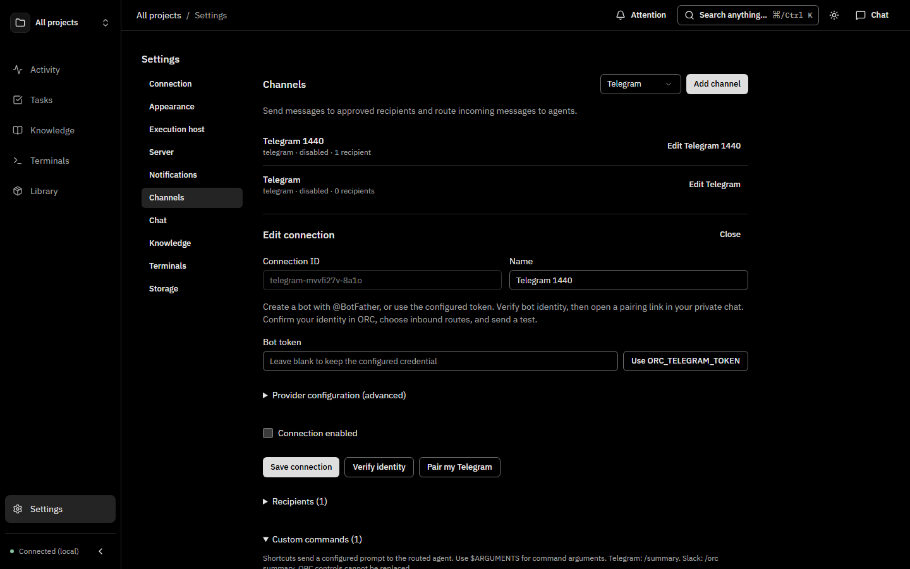

## Phone: enable two-way agent replies

After pairing a recipient, **Set up agent replies** chooses a project, default agent and optional model. Apply the setup, then save the connection. The selected project's working folder is the agent's spawn directory. Existing recipient project restrictions remain enforced.

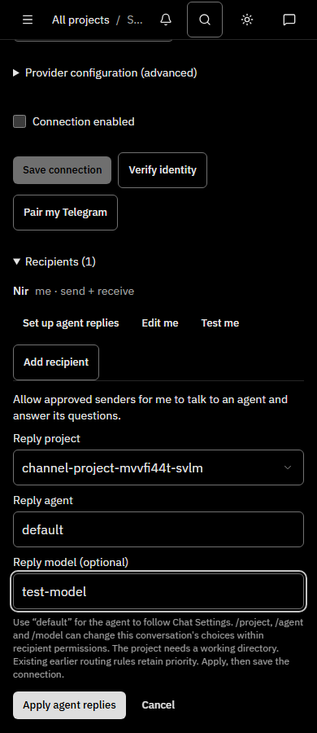

Ordered routing and custom prompt shortcuts

Rules use first-match order and support AND, OR and NOT. The simple editor and advanced JSON edit the same rule tree. Route preview does not invoke an agent.

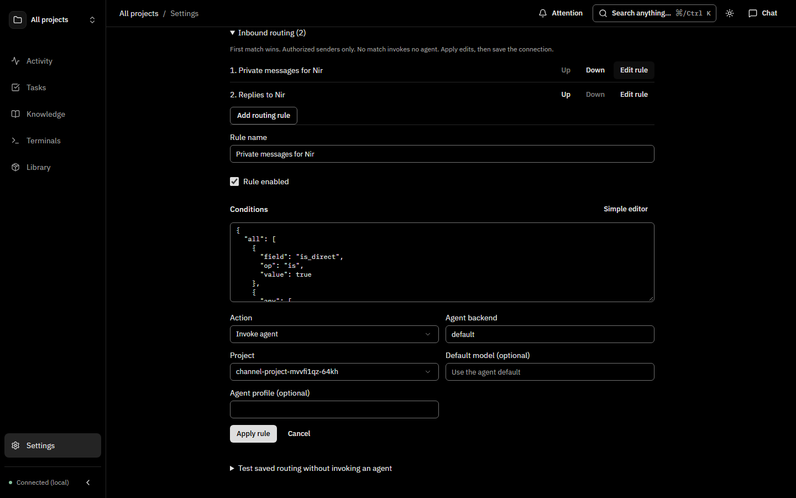

Shortcuts expand a configured prompt. `$ARGUMENTS` is literal substitution, never shell evaluation. Chat-control command names are reserved.

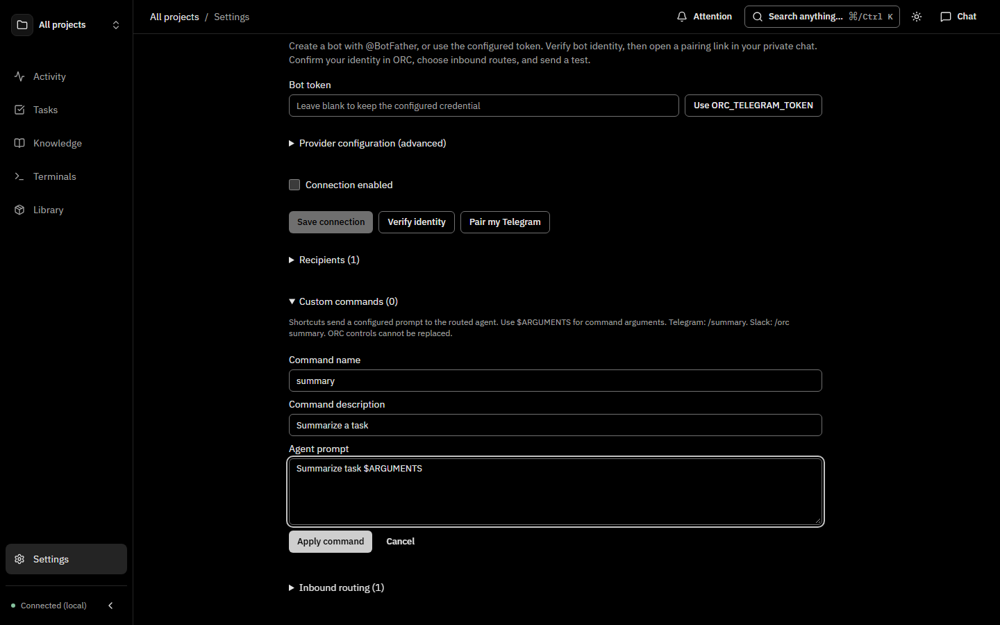

Slack onboarding

Slack has its own bot/app token fields, Socket Mode instructions and app manifest. This screenshot demonstrates the setup UI only. **Live Slack workspace delivery remains unverified by the user's explicit choice.**

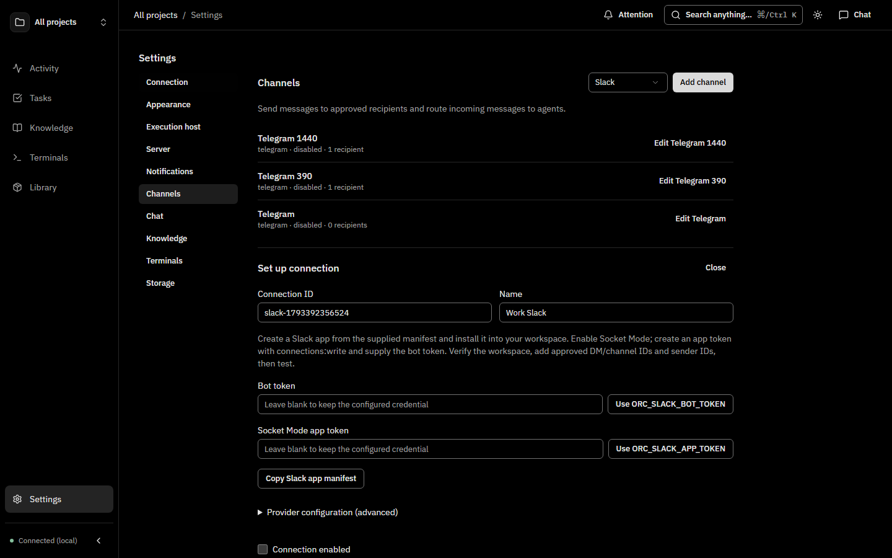

Project/job pagination and short phone keyboard fixes

Both examples select records beyond the first API page after seeding more than 100 records. Lists and pickers follow bounded API pages rather than raising a total-record cap.

| Late-page project in channel routing | Late-page job in Rules |
| --- | --- |
| 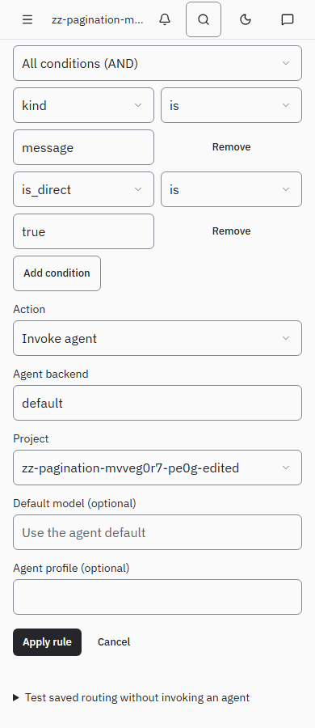 | 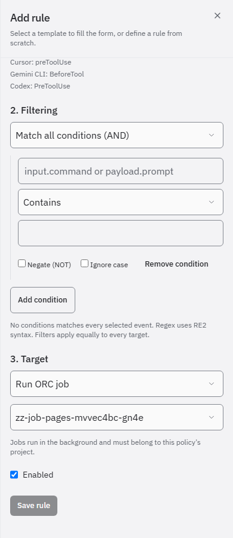 |

With only 200 pixels above a phone keyboard, a long draft and Send remain visible. The Latest control floats over the transcript; streaming activity moves into the header while retaining its accessible status announcement. The image captures the sheet itself, excluding the unused physical-screen area below the simulated keyboard boundary.

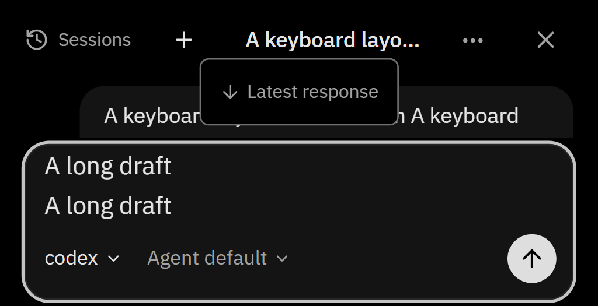

## Setup and authorization flow

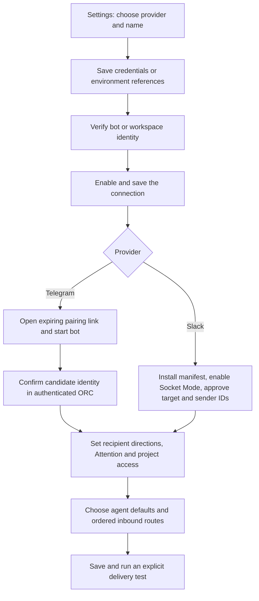

Pairing does not grant agent execution by itself. Inbound direction, approved sender IDs, project access and an enabled matching agent route must also permit it. Slack's manifest registers `/orc`; Telegram registers the small control menu and configured shortcuts.

## Channel → agent → same conversation

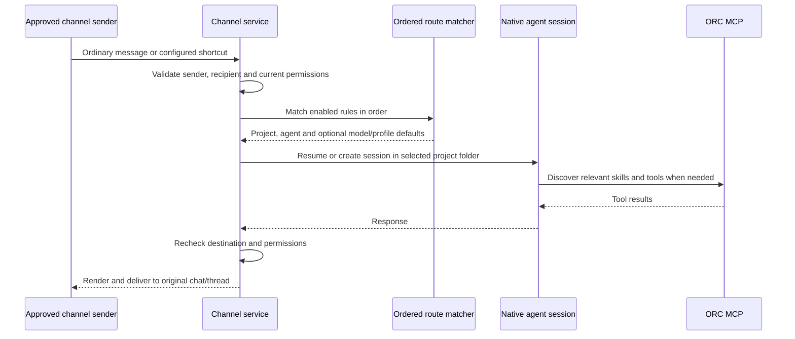

Conversations are isolated by connection, chat, thread, sender and route, with project/agent session selection preserved. `/project`, `/agent`, `/model` and `/session` manage the chat; `/stop` cancels the active turn and already queued input. Authorized unmatched messages receive setup guidance; explicit ignore rules remain silent.

## Agent/job → channel and durable human replies

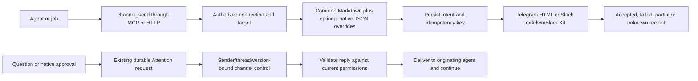

`channel_send`, `channel_message_get` and `channel_message_update` share the API service. Explicit native fields replace generated defaults; ORC retains credentials and destination. Provider acceptance is not proof that a person read a message. Ambiguous network outcomes are not blindly retried. Sensitive or oversized approvals require review in ORC.

## Evidence and limits

| Check | Result |
| --- | --- |
| Complete browser suite on the application implementation | **464 passed, 0 failed**, 2 unchanged opt-in real-agent demos skipped |
| Normal pre-commit CI | Passed: lint/format, all workspace typechecks, package tests, dependency-security regressions and web units; one unchanged platform-specific unit skip |
| All workspace production builds | Passed |
| Dependency audit | 0 vulnerabilities across 993 packages |
| More-than-100 project/job regressions | API traversal/filter/auth/bounds and desktop/phone list/picker coverage passed |
| Live Telegram | Formatted MCP send/button, commands, session continuity, project folder selection, model/session controls, native approvals and question reply/agent continuation verified |
| Live Slack | **Not verified**; automated transport/rendering/authorization/onboarding coverage passes |

The original complete browser run's five findings were corrected and the entire suite rerun successfully. The added screenshot captures are replayed by `channels.e2e.ts` and `mobile-terminal-chat.e2e.ts`; the other images come from the passing project/job pagination checks. No production installation, merge or release is part of this PR.

## Suggested review path

1. Compare the desktop overview and phone reply setup above.
2. Inspect rule order/condition editing, prompt shortcuts and Slack-specific setup.
3. Trace both message directions and the durable Attention reply flow.
4. Review permission changes, callback replay/refusal, receipt ambiguity and restart recovery in the channel/provider/runtime tests.
5. Keep live Telegram evidence distinct from fixture screenshots and Slack's automated coverage.
