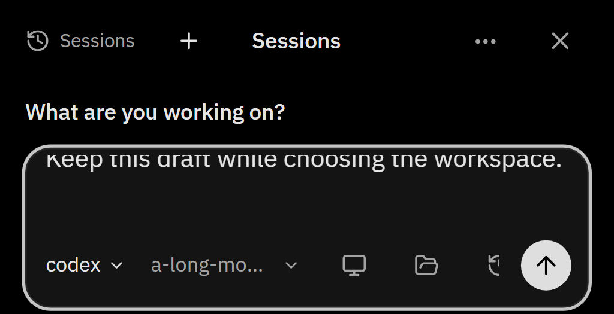
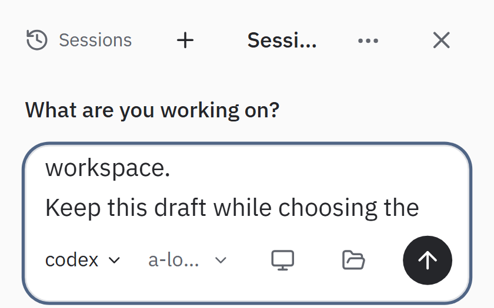
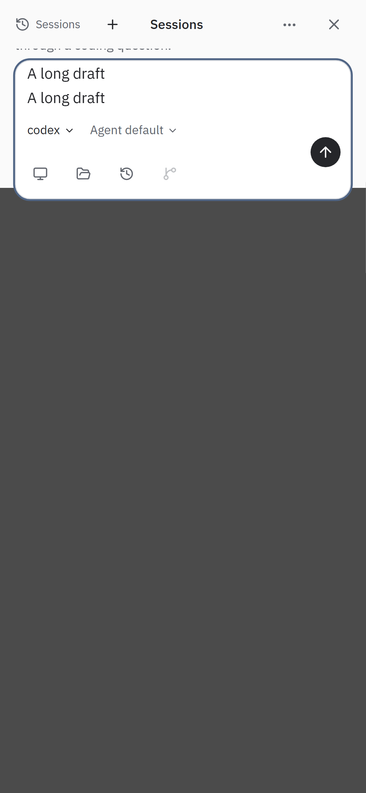
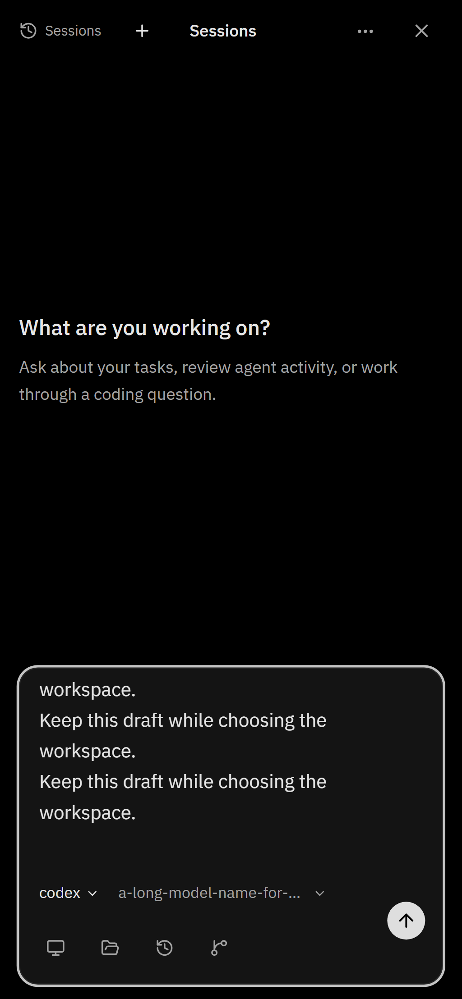
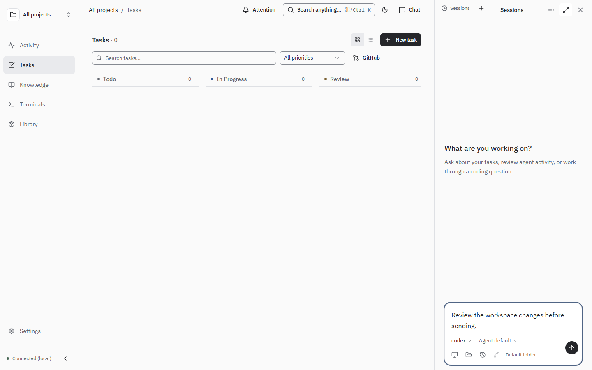

# Chat with a short software-keyboard viewport

When the software keyboard leaves 200px of vertical space, the workspace icons
previously wrapped into a second row and left only 8px for conversation content.
The compact layout keeps the agent/model selectors and Send in place while the
workspace icon strip scrolls horizontally. The agent name stays readable; long
model names truncate. All workspace actions keep 44px touch targets and remain
reachable by touch scrolling and keyboard focus. Closing the keyboard restores
the normal wrapping layout. The draft and workspace state keep the same owner.

The empty-conversation explanation is shortened to its heading in this small
viewport. Workspace progress/errors remain outside the horizontally scrolling
icon strip. No chat, API, authentication or persistence contract changes.

## Screenshots

These are real Chromium application screenshots with emulated phone input and
`visualViewport` keyboard heights. They do not claim physical Android hardware
validation. The 200px captures show the application area above the keyboard;
the keyboard itself is not drawn. Light/dark captures wait for actual theme
attributes and computed colors, and use a deliberately long model name/draft.

| 390px phone, dark, keyboard open | 320px phone, light, keyboard open |
| --- | --- |
|  |  |

Before: the reproduced failure

Keyboard closed and desktop

## Verification

- Original Android long-draft regression passes unchanged at 360/240/200px,
  including an existing conversation and preserved send/draft behavior.
- New 320/390px cases cover both themes, 240/200px keyboard heights, long model
  names, all workspace touch targets, fixed Send, native touch scroll, Tab focus,
  worktree changes and drafts surviving keyboard restore and chat hide/reopen.
- Desktop screenshot case checks both themes and the full workspace controls.
- Existing workspace and shared-folder-picker cases cover host isolation,
  cancellation, errors, delayed native results, state preservation and navigation.
- The requested local-validation prerequisite binds SDK/MCP fixtures and Vite
  dev/preview explicitly to loopback, with the rule recorded in AGENTS.md.

Browser model responses and native folder selection use their existing test
boundaries. No live model turn, native OS chooser or production rollout is claimed.
