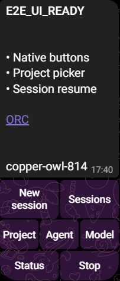
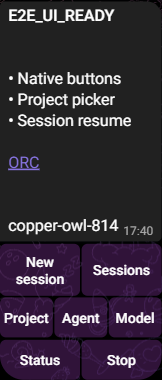

# Telegram chat controls and diagnostic retention

Telegram chat uses native inline keyboards for New session, Sessions, Project,
Agent, Model, Status and Stop. Project, agent, model and session choices are paged
in eight-item lists. `/session_new` and `/session_list` are registered commands;
argument-based commands remain compatible. Buttons use existing expiring,
single-use actions bound to connection, recipient, sender and thread.

Agent turns show a throttled updating preview with a Stop button bound to that
specific turn. Completed short replies include controls. Long replies retain all
chunks and add one final control panel. Chunks fill the provider's safe size
budget and prefer line/word boundaries. Unicode and HTML-heavy previews remain
bounded without splitting surrogate pairs. Slack keeps its existing reply format.

Owned approval/question cards also include **Stop this turn**, bound to their
active turn and sender. It remains reachable when subsequent requests push the
original preview out of view. Old or consumed controls cannot stop another turn.

## Automated acceptance

`packages/gateway/src/__tests__/channel-runtime.test.ts` exercises the actual
channel service and gateway runtime with a controlled agent and provider:

- New session and paged project selection through the native callback payloads.
- Denial for another sender, scoped conversations, project/model changes and
  native session resume.
- Durable approvals and questions, cancellation of pending and queued work,
  and rejection of a previous turn's Stop button.
- Full long-response preservation and a single final Telegram keyboard;
  unchanged Slack message rendering.
- Agent failure persists a safe generation code and session correlation; a later
  successful turn clears current error state while the failure log remains.
- Recipient changes during a turn cannot redirect its output.

`packages/channels/src/diagnostics.test.ts` starts a separate process with an
isolated home, injects transport failure/recovery, then reads the real JSON log
file. It checks deduplication, failure counts, timestamps, recovery and exclusion
of raw credentials, URLs and provider errors.

## Retained diagnostics

The existing rotating `~/.orc/logs/orc.log` receives connection and transport
failure/recovery events. Records include timestamp, provider, connection,
operation and an allowlisted safe code. Repeated identical polling failures are
counted rather than logged for every retry. Recovery retains the failure record.

Gateway failures include a session ID, operation stage, safe code and a hash of
the originating event ID. The session's `last_error` stores the safe stage/code.
Raw exception data, message bodies, tokens, URLs and sender IDs are excluded from
these added diagnostics. Existing outbound receipts retain delivery status/error
and timestamps. Logs rotate; they are bounded diagnostic history, not an audit
archive. Provider account ownership and authorization are unchanged.

## Live acceptance

On 2026-10-31, diagnostics commit `8057caf` passed normal local CI in 158 seconds:
lint, formatting, all workspace typechecks, package tests and web unit tests.
All workspace production builds passed. Twelve relevant dashboard browser E2E
cases passed in 24.1 seconds, covering Channels save/reopen, secure Attention,
model selection, project scope and session controls on desktop/phone layouts.
Existing CSS specificity/build-size warnings and platform skips remain.

Live Telegram acceptance passed on 2026-10-31 through `spec` → registered
`playwright-main` → the extension-backed, signed-in Telegram Web client. A
dedicated tab preserved another task's current browser tab. The user authorized
temporary polling transfer to the isolated source candidate, followed by lab
restoration. A bounded watchdog guarded restoration, and every transfer checked
the original configuration and encrypted credential hashes.

| Behavior | Observed result |
| --- | --- |
| Telegram command menu | Provider returned `session_new` and `session_list` alongside the main controls. |
| New session and project paging | Created a session, paged the native project picker and selected a project on its second page. |
| Agent and model | Selected the default Codex agent and GPT-6.1-Sol through native pickers. |
| Real model and follow-up | Codex returned the requested marker and recalled the earlier test phrase. |
| Session switch/resume | Created another session, selected the earlier one, and recalled its phrase with the same native session ID. |
| Approvals and questions | Approved benign metadata/question calls through Telegram; Blue completed the durable question, was acknowledged, and resumed the agent to `E2E_COLOR:Blue`. |
| Stop and queued input | Clicked **Stop this turn** on a pending approval; the session stopped and queued input produced no agent response. |
| Rich content | Bold text, bullets and an HTTPS link rendered in Telegram. |
| Long reply | A 6,389-character, 90-line reply arrived in two accepted messages and one final control panel. All 90 markers remained present; each displayed chunk matched its source after Telegram's boundary-whitespace trimming. |
| Restoration | Candidate polling disabled; lab polling enabled and ready with configuration/credential hashes unchanged. |

The initial live pass exposed two improvements included here: retain Stop on the
current request card, and replace fixed 500-character chunks (13 messages for the
first long test) with line/word-aware chunks. Targeted regressions cover both.

### Native Telegram screenshots

Actual bot reply and controls, cropped to exclude unrelated conversations:

Telegram owns the colors and native component styling. These are native bot
controls, not a Mini App. Slack has automated coverage only; no live Slack claim.
No production error was injected. The previous lab transient error's cause
remains unknown; absent logs do not establish its cause.
