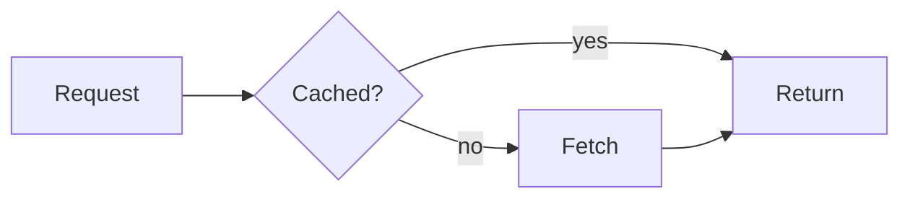

# Scratchpads

A scratchpad is a working file a human and agents keep and revisit: a plan, a design
note, a diagram, an interactive page. The human opens it at the deep link that
`pad_create` returns (`/scratchpad/<id>`, under Library) and can edit it there.
Use the KB for cited, durable knowledge; memory for short facts; tasks for tracked
work. A pad is for thinking, showing and iterating with the human.

## Collaborate through a pad

A pad is a shared surface: the human edits it in the dashboard while agents read and
write it through MCP/CLI, and every save is a new revision attributed to its author.

1. **Agent drafts, human shapes.** Draft the plan, design or diagram as a pad, send
   the link and ask for edits in place instead of a long chat reply. The human
   rewrites sections, ticks checklist items, drags diagram boxes or answers inline.
2. **Re-read before you continue.** When the human says they changed it (or before
   acting on it later), `pad_get` it and treat their edits as the decision: removed
   steps are out of scope, rewritten text is the new requirement. Say what you took
   from their change.
3. **Write back without clobbering.** Update with `if_revision`; on a conflict, re-read
   and merge. Keep the human's wording where they edited; change your own sections.
4. **Mark open questions in the pad.** Use a `## Open questions` list or `- [ ]`
   items addressed to the human; when they answer in the pad, fold the answer into
   the plan and remove the question.
5. **Hand over between agents and sessions.** Pads outlive the session. Link a
   handoff, task or session event to the pad id; the next agent finds it with
   `pad_list({session:"current"})`, `pad_list({project, q})` or the id, and continues
   from the latest revision rather than a stale local copy.
6. **Show, then decide.** For choices that are easier to see than describe (UI
   options, data shape, chart of results), make an `html` or `diagram` pad and ask
   the human to pick. For live ORC data, ask them to "Render with ORC access" after
   they have looked at the page.

Approval in a pad is the human's edit or explicit reply, not the absence of changes.
When a pad settles a durable decision, record it where it belongs (task, KB, memory)
and link back to the pad.

## Choose the kind

| Need | Kind | Content |
| --- | --- | --- |
| Plan, spec, RCA, review notes, checklist, flow/sequence diagram | `doc` | Markdown; ```` ```mermaid ```` blocks render as diagrams |
| Freeform architecture sketch, whiteboard the human will rearrange | `diagram` | `.excalidraw` JSON |
| Interactive page: chart, calculator, prototype, dashboard, board | `html` | One standalone HTML document |

Prefer `doc` with mermaid when the diagram follows from structure (flows, states,
sequences, ER). Use `diagram` when layout matters or the human will draw on it.

## Create, read, update

- MCP: `pad_create({kind, title, content?, project?, tags?})` → id, revision, link.
  Give the human the link. Pads link to the current agent session by default
  (`link_session:false` to skip); `project` is optional.
- `pad_list({project?, session:"current", kind?, q?})` finds pads; `pad_get({id})`
  returns the header then the raw file.
- `pad_update({id, content, if_revision})` replaces the whole file. Always pass the
  revision from your last `pad_get`: the human may have edited it. On a mismatch,
  re-read, merge their change and retry; never drop their edit.
- Large content: create empty, then `pad_update({id, via:"url"})` and
  `curl -T file <upload_url>`; read with `pad_get({id, via:"url"})`.
- CLI: `orc pad ls|show|new <kind> <title> -f file|pull <id> [file]|push <id> <file> -r <rev>|rm`.
  `pull` then `push -r` is the safe edit loop for a local file.
- Deleting is permanent; delete only pads you created or were told to remove.

## Plans and docs (`doc`)

Write normal Markdown: headings, task lists (`- [ ]`), tables, code. For a living
plan, keep a short "Status" section at the top and append a dated log rather than
rewriting history. Diagrams:

````markdown

````

Keep each mermaid block small and valid; one broken block shows an error in place.

## Diagrams (`diagram`)

Content is an Excalidraw file. Omit content for an empty canvas the human draws on.
A minimal file:

```json
{"type":"excalidraw","version":2,"elements":[
  {"id":"api","type":"rectangle","x":0,"y":0,"width":160,"height":60},
  {"id":"api-label","type":"text","x":20,"y":20,"text":"API","fontSize":20,
   "containerId":"api"}
],"appState":{}}
```

Give elements stable ids so later updates can change them in place. Read the current
file before editing; the human may have moved things. Image export (PNG/SVG) is a
human action in the UI.

## Interactive pages (`html`)

The page is one HTML document. Inline your CSS/JS or load libraries from a CDN with a
pinned version and `integrity` + `crossorigin` attributes.

**Without ORC access (default).** The page runs in a sandboxed frame with an opaque
origin: scripts, popups and alerts work, but it cannot read ORC's storage, use the
dashboard's credentials or navigate the dashboard. Embed the data it needs in the
page (a JSON `<script>` block or a JS constant). This is right for charts of data you
already have, prototypes and calculators.

**With ORC access.** Only the human can grant it, per view, with "Render with ORC
access". The page then runs unsandboxed and gets `window.orc.fetch(path, init)`, which
calls the ORC API as that human (`path` is relative to the API root, e.g.
`/tasks?limit=100`; it returns a fetch `Response`). Access ends when they leave or
anyone else edits the pad. Write the page so it works both ways:

```html
<script>
const live = Boolean(window.orc);
async function loadTasks() {
  if (!live) return SAMPLE_TASKS; // still useful in the sandbox
  const res = await orc.fetch("/tasks?limit=100");
  if (!res.ok) throw new Error(`ORC API ${res.status}`);
  return (await res.json()).tasks;
}
</script>
```

Show which mode the page is in and tell the human that live data needs "Render with
ORC access". Check routes and limits in the OpenAPI spec (`/openapi.json`) rather than
guessing. Writes (`POST`/`PATCH`) act as the human: make each one an explicit user
action in the page, never a side effect of loading. Never put secrets or tokens in a
pad, and never ask the human to grant access to a page they have not looked at.
